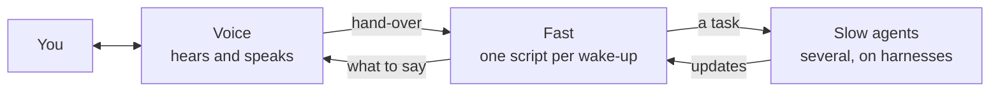

# The core

The core is what every [live session](../README.md) has and no part can
replace: three kinds of agent, the way work is given from one to another, and
the way each agent's prompt is put together. Everything else, including the
pages of your project, is a [part](../extend/README.md) added to it.

## The three agents

- **Voice is the interface.** A realtime speech model. It hears you, hands
  over everything you say, and says only the lines it is given. It knows
  nothing about the project.
- **Fast is the hub.** A quick model, `gpt-6-luna`. It is woken by what you
  say and by what the slow agents report, and answers each wake-up with one
  short script. It moves the page and gives work away. It never does the
  work, and it gives no opinion of its own.
- **Slow agents do the work.** Coding agents on your machine, Claude Code and
  Codex. They answer questions and change files, and publish updates on their
  tasks. They never talk to you directly.

To you they are one assistant. You never name a task or an agent.

## What the core owns

- **The agents themselves,** and the loop that wakes Fast.
- **[Delegation](delegation/README.md):** tasks, updates, and whether a piece
  of work goes to a new agent, the same one or a fork.
- **What was said and what was asked for.** The
  [session](../world-model/session/README.md) and the
  [work](../world-model/work/README.md) are kept in the world model the same
  way a part keeps its own, but they are the core's and cannot be turned off.
- **[The prompts](prompts/README.md):** one template for each agent, with the
  places where parts add their text.
- **[The harness](harness/README.md):** one contract for every coding agent.

Nothing in the core names a part. What an agent knows about the page or the
scratch pad, the `devpage` and `canvas` parts told it.

## Two modes

- **Realtime:** you talk. Voice is on, and what Fast and the slow agents
  write for you is written to be heard.
- **Chat:** you type or dictate. Voice is off, what you write reaches Fast as
  a message, and the answers are shown as text.

Fast, the slow agents, delegation and the world model are the same in both.
The mode changes two things only: whether Voice runs, and
[a few lines of each prompt](prompts/README.md#lines-that-depend-on-the-mode).

## The rules every agent is told

The first three are told to all three agents in the same words. The rest are
in each agent's own prompt.

- **One partner, for thinking and for doing.** Answers come first. No fluff,
  no repeating what you said, no question back when you want an opinion.
- **Thinking or doing.** When you explore ("I think", "maybe", asking for an
  opinion): talk, change nothing. When you state something as settled or name
  a specific change: do it, without asking you to confirm. In between: act
  only when it is cheap and easy to undo.
- **One assistant.** Whatever is said to you is in the first person, as the
  one who thinks, answers and does the work. Nothing names an agent, a model,
  a task by its number, a tool or a hand-over, unless you ask how the session
  itself works.
- **Length.** In realtime, what a slow agent publishes is one to four plain
  sentences, the answer or the result first. What Fast writes itself is one
  or two.
- **Questions to you.** Only when an agent cannot go on, and then exactly
  one.
- **Voice by itself says nothing.** It says only the lines it is given,
  completely and unchanged, and never talks over you.
- **A judgment is never Fast's.** A fact Fast can see, it says. What you
  should think of something goes to a slow agent.

## Topics

### The agents

- [Voice](voice/README.md) — what the voice model sends when you stop
  speaking, and how your words become messages with ids.
- [Fast](fast/README.md) — what wakes Fast, what it does with what you say
  and with what the agents report, and how it is replaced before its context
  fills.
- [Slow agents](slow-agents/README.md) — what an agent is, what it gets,
  what it publishes, and what it may change.

### What connects them

- [Delegation](delegation/README.md) — how a piece of work becomes a task,
  which agent gets it, and what comes back.
- [The prompts](prompts/README.md) — how each agent's prompt is put together
  from the core's text and what the parts declare.
- [The harness](harness/README.md) — what a coding agent must do to be used
  as a slow agent, and what an agent's session is made of.
