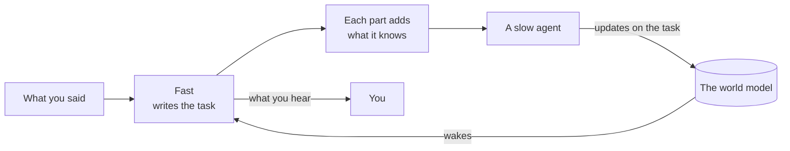
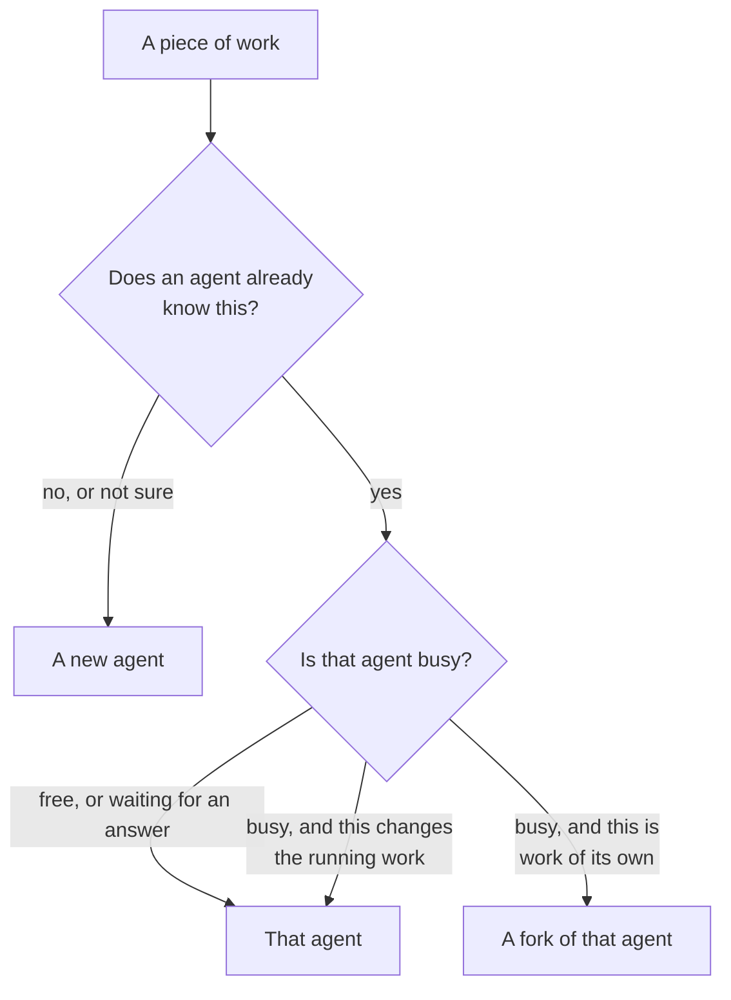

# Delegation

Delegation is how work moves in [the core](../README.md): Fast gives a piece
of work to a slow agent as a task, and the agent's updates come back through
the world model. This page says what a task is, what it carries, which agent
gets it, and what you hear of the result.



## A task

A task is one piece of work given to one agent, with its updates. Every
request for work becomes one, a follow-up too, so the side panel has one row
for each thing you asked.

Fast gives work with three calls in its script. Each makes a task.

```js
spawn(prompt)        // a new agent, which starts empty
a2.send(prompt)      // more work for agent a2
a2.fork(prompt)      // a new agent that starts with what a2 knows
```

## What a task carries

A slow agent did not hear the conversation. Its task has to be enough.

1. **What Fast wrote.** Your request and its constraints, with your words put
   in as a value (`${m41}`), and a sentence or two on what your words leave
   out: what "that" is, or what you are agreeing to.
2. **What each part adds.** At the moment the task is given, every enabled
   part may add lines. The `devpage` part adds the page you are on and the
   part you marked. The `canvas` part adds the order in which a scratch pad
   is drawn, when one is open.

So a task reaches the agent like this:

```
Task 7
The user said: "Make this seven days."
The page the user is on: /docs/waiting-list/README.md
Marked on it: "An offer stays open for three days"
```

Fast never writes the second half, and the core does not know what it is. A
part you add can [do the same](../../extend/README.md#a-world-model-part).

## Picking an agent

Fast decides, from the tasks it can see. The rule is text in
[its prompt](../prompts/README.md), not code.



- **The same agent,** for a follow-up or related work on what it just did. It
  costs nothing, but the work waits if the agent is busy.
- **A fork,** when that agent knows the area but is busy with something else.
  It costs a new conversation that starts with the other's context.
- **A new agent,** when nothing fits or Fast is not sure. It starts empty and
  reads what its task needs.

**When unsure, a new agent.** A wrong new agent costs some context. A wrong
guess at an old one costs you a confused answer.

Fast decides on four things, all read from the tasks in the world model: when
you said it (right after a task's update, it is likely a follow-up), where
you said it (the page and the marked part, against what each agent's tasks
were about), what you said, and whether the agent is busy. No agent describes
its own knowledge.

Which coding agent and model a new agent runs on is one more word in the same
`spawn`: see [Routing](../../use/routing/README.md).

## What comes back

The agent publishes updates on its task: progress, one question, finished or
failed. Each is added to the world model, and each wakes Fast. There is no
fixed rule for what you then hear; Fast decides.

- **Finished, a question, or failed:** you hear it as the agent wrote it,
  with its doubts. Fast passes it on with `say(u12)` and does not retype it.
- **Several at once:** one line for all of them.
- **Progress:** nothing.

What an update holds is on [Slow agents](../slow-agents/README.md#what-an-agent-publishes).

## A message typed to one agent

A message typed in [an agent's chat](../../inside/design/README.md#an-agents-session)
does not go through Fast: it is already addressed to one agent. It is a task
of that agent all the same, so it shows in the side panel and you get its
answer.

## How it is improved

- **Every decision is in the log:** what you said, which agents there were,
  which was picked.
- **A wrong pick becomes a case** of [the evals](../../inside/evals/README.md),
  and the prompt changes until the case passes.
