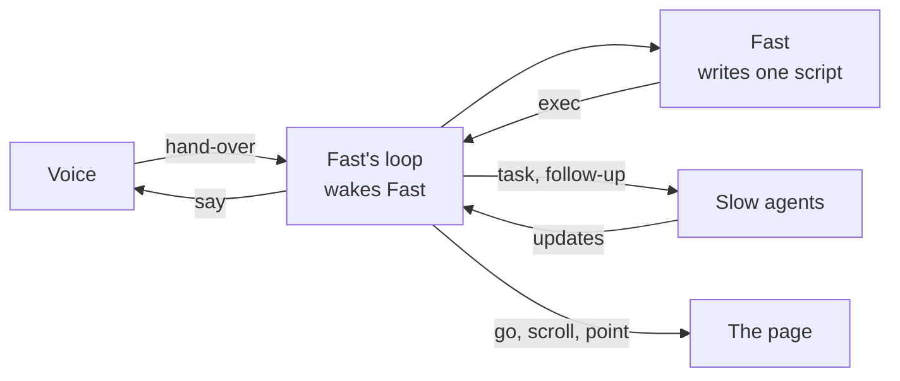
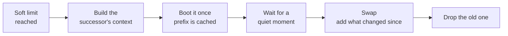

# Fast

Fast is the hub of [the core](../README.md): a quick model that is woken by
what you say and by what the slow agents report, and answers each wake-up
with one script. It does no work itself. This page says what wakes it, what
it is shown, what it does in each direction, the loop that runs it, and how
it is replaced before its context fills. The code is `live/fast.ts`.

## What wakes Fast

Fast wakes for a hand-over, or for an entry whose kind says it wakes Fast:

- **A hand-over from Voice,** or in chat mode a message you wrote. Fast gets
  the new messages, with ids. It is woken at once.
- **Updates from slow agents,** and problems: calls a script asked for that
  could not be carried out. They are collected for 400 ms, so several that
  arrive together are one wake-up. An part can also declare a kind
  that wakes Fast, including a rule that depends on the caller.

Either way it also gets what changed in the world model since its last run. Fast runs one
wake-up at a time. What arrives while it runs is delivered together in the
next one.

In realtime mode Fast runs only while the voice is on. What the agents
published while it was off, it gets when the voice starts. In chat mode it
runs for as long as the session does.

### What a wake-up shows

A wake adds the following text to Fast’s conversation, followed by any images its entries carry:

- **What woke it:** `Wake-up 14. The user just said m41.`, `New updates: u12.`,
  or `Something could not be done.`
- **The world model's new entries,** each as [its line](../../world-model/log/README.md).
- **The agents:** each with its state (busy, waiting for your answer, or
  free) and its last three tasks.
- **What each part shows.** The `devpage` part shows the page: its address,
  what is marked on it, whether the side panel is open, and its text, the
  first 14,000 characters, only when Fast has not been shown that text
  before. The `canvas` part shows the scratch pads there are. A part you add
  [shows its own](../prompts/README.md#what-is-added-later).

## From you to a slow agent

- A fact Fast can see in the world model ("where am I?", "what is running?"): Fast
  says it.
- A judgment ("what do you think of this page?", "is this right?"): an agent
  gets it. Fast gives no opinion of its own.
- Anything else, a question that needs reading or a change: Fast routes it to
  an agent and says one short line.
- A follow-up to something recent: Fast sends it to the agent that did that
  work.
- Something about the page ("open", "scroll", "show me"): Fast does it itself,
  and only when asked.
- You ask again for work that is running: Fast says it is still being done.
- Half a sentence, or thinking aloud with nothing to do: nothing.

Fast writes the request and the context the agent needs, and quotes a
message by its id (`${m41}`). What a part knows, such as the page and the
marked part, the part adds itself. Which agent gets the work is on
[Delegation](../delegation/README.md#picking-an-agent).

## From a slow agent to you

There is no fixed rule in the loop. Every update reaches Fast, and Fast
decides what you hear. An update is written to be spoken, so Fast passes it
on with `say(u12)` and does not retype it.

- **Finished, a question, or failed:** you hear it as it is, with its doubts.
- **Several at once:** one line for all of them.
- **Progress:** nothing.
- **A problem:** one line.

A part may add to these. The `canvas` part does: an update about the open
scratch pad is not read aloud ([the canvas](../../world-model/canvas/README.md#how-an-open-pad-is-used)).

This is guidance in Fast's [prompt](../prompts/README.md). The prompt is tuned, not the code.

## How Fast talks

One or two plain sentences, as "I". It never mentions agents, tasks or
models. When a script fails twice while you wait, the program says for it:
"I couldn't do that, something went wrong on my side."

## Not interrupting you

Voice is told never to talk over you: a line it is given while you speak, it
says when you stop.

## The loop

Fast needs a loop of its own. No existing agent harness wakes a model on a
voice hand-over and on task updates. It does six things:

1. Wakes Fast, on a hand-over and on updates.
2. Builds the input: the new entries since the last run, appended to Fast's
   conversation.
3. Runs `exec` in QuickJS, with [what a script can use](../../world-model/scripts/README.md#what-a-script-can-use).
4. Carries out the script's calls: to Voice, to the page, to the slow agents.
5. Logs each run: what woke it, what Fast saw, the script, what it did.
6. Swaps Fast before its context fills: see [the swap](#swapping-fast-before-its-context-fills).

When things go wrong:

- **A script that throws** is given back to Fast with its error, for one more
  try. After two, nothing is done and the log has `run_failed`.
- **A call that cannot be carried out** becomes a `problem` in the world model,
  which wakes Fast. The script's other calls are still carried out.

## Swapping Fast before its context fills

Fast must never make you wait for a compaction. Before its context fills, a
successor is built beside it and swapped in at a quiet moment.

The old Fast keeps serving until the swap. Nobody waits at any step.

### What the successor starts with

- its [prompt](../prompts/README.md), put together again, with the routing
  rules read again from their file
- a summary of the earlier conversation
- the recent messages, as they were
- the page as it is now
- the recent tasks and their agents

Older tasks and agents are forgotten. That is accepted: when Fast cannot
place what you say, it starts a new agent.

### The steps

1. **Soft limit.** After a run, Fast's context has passed the limit.
2. **Summary.** A separate model call summarizes the earlier conversation in
   at most 300 words: what you are working on, what was decided, what you like
   and dislike, what is open.
3. **Boot.** The successor's context is sent to the model once, so the
   provider caches it.
4. **Quiet moment.** No wake-up is running, nothing waits for one, and you
   have not spoken for 1.5 seconds. It is looked for again every second.
5. **Swap.** The next wake-up goes to the successor, with the entries
   since step 3, shown as already handled.
6. **Drop.** The old Fast is dropped. Idle agents that no task in the
   successor's window refers to are closed.

Step 5 is exact because the world model is [one numbered log](../../world-model/log/README.md):
"since step 3" is "after entry N".

### What can go wrong

- **No quiet moment before the hard limit.** Swap between two wake-ups
  anyway.
- **The cached prefix expired before the swap.** Boot again.
- **The summary could not be made.** Swap without it: the recent messages and
  the world model are enough to go on.

### The numbers

In `live/fast.ts`:

- the soft limit: 200,000 tokens
- the hard limit: 250,000 tokens
- recent messages kept as they were: 30
- recent tasks kept: 12, each with its newest two updates
- how long the provider keeps the cached prefix: taken as 4 minutes, not
  checked

## What Fast is made of

- **The model:** `gpt-6-luna` at reasoning effort `medium`, on the priority
  service tier, which answers in about 1.4 seconds where the default tier
  takes 2 to 2.6. The [`fast` setting](../../use/settings/README.md) names another
  model. When the API refuses the model, the session goes on with
  `gpt-6.1-sol`, and the log gets a `fast` entry of kind `model_fallback`.
- **The sandbox:** QuickJS (`quickjs-wasi`), a new one for each script,
  stopped after 300 ms. In `live/sandbox.ts`.
- **The model loop:** the program's own, in `live/fast.ts`. It keeps the
  conversation itself and calls the Responses API with one tool, `exec`, which
  the model must call, one call at a time, with nothing stored at the
  provider and a 45-second limit on a call.
