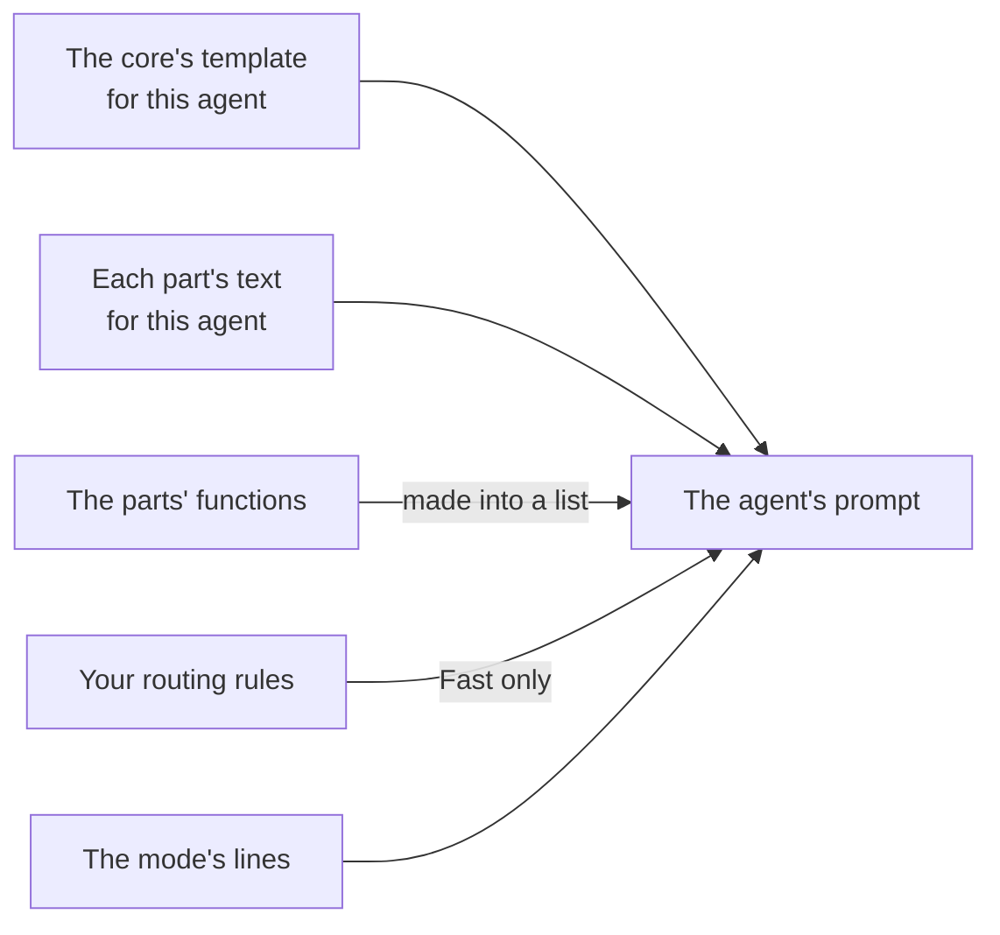

# The prompts

No agent's prompt is written whole anywhere. Each is put together when it is
needed, from a template in [the core](../README.md) and the text the enabled
parts declare. This page says what the pieces are, where each comes from, and
how to read the result.



## Three templates, three ways of writing

Each agent has one template, a Markdown file in `live/prompts/`. They share
no shape, because the three models are not prompted the same way.

- **`voice.md`** is for a realtime speech model, written on the structure
  OpenAI's [Prompting GPT-Live](https://developers.openai.com/api/docs/guides/live-prompting)
  guide gives: a role, then its backchannel, interruption and delegation
  policies. See [how Voice is prompted](../voice/README.md#how-voice-is-prompted).
- **`fast.md`** is for a quick model that answers with a script: what a
  script can call, with short examples, and how to decide.
- **`slow.md`** is for a coding agent. It is added after the coding agent's
  own instructions, so it says only what is particular to the session: how
  to report on a task, and how to write for you.

One more file, `shared.md`, holds what Voice and Fast are told first in the
same words: that you talk with one partner, who speaks as "I", and that
nothing said to you mentions how it is made. Together the two are the one
partner you talk with. The slow agents work behind it: `slow.md` has its own
start, and the rules for telling thinking from doing.

## What a part adds

A part has a text file for each agent it has something to say to, named as
the templates are: `fast.md`, `slow.md`, `voice.md`. The program does not
read what the text means. It only places it, by its headings.

- **A heading the template also has: the text is added to that section.** So
  an exception a part brings sits beside the rule it changes.
- **A heading that names a label of the template: the text is added at the
  end of that label's list.** A label is a line that is a name and a colon
  alone, as GPT-Live's `Backend tools:` in Voice's template. The `devpage`
  part adds "- The page: …" there, and the `canvas` part "- The drawing: …".
- **Any other heading: a new section,** put where the template says parts'
  sections go.

The `canvas` part's `fast.md` does both:

```md
# The canvas

Some things cannot be said well. Then you show them: the canvas is a large
sheet over the user's page that shows one scratch pad…

# What the agents report

An update about the scratch pad that is open, when it is longer than two
sentences: say in one or two sentences of your own what is on the pad now
and what the user has to decide. A pad is never read aloud.
```

The first heading is new, so Fast gets a section on the canvas. The second is
a section of the core's template, so the exception lands under the rule that
an update is passed on as it is. With the `canvas` part turned off, both are
gone, and nothing in Fast's prompt mentions a scratch pad.

## Lists are made, not written

A part's function is written once, with its name, its input and one line on
what it does. From that:

- **Fast's template gets the list of calls** its script can make.
- **A slow agent gets the function as a tool.**

Nobody keeps a second copy of the list in a prompt.

## What is added later

Two things are not in the prompt, because they change while the session
runs.

- **What Fast is shown at each wake-up.** A part may show Fast what it holds
  now: the `devpage` part shows the list of pages, the `canvas` part the
  scratch pads there are. It is read again every time Fast wakes.
- **What is added to a task.** At the moment Fast gives work to a slow agent,
  a part may add lines to it: see
  [what a task carries](../delegation/README.md#what-a-task-carries).

## Lines that depend on the mode

A template has one place for the lines that differ between the two
[modes](../README.md#two-modes).

- **Realtime:** what is written for you is written to be heard. One to four
  plain sentences, no Markdown, no paths read aloud.
- **Chat:** what is written for you is read. It may hold paths, lists and
  code, and is as long as the answer needs.

In chat mode Voice's prompt is not put together at all.

## Your routing rules

Your [`routing.md`](../../use/routing/README.md) is added to Fast's prompt as
you wrote it, with the routes your settings allow.

## When a prompt is put together

- **Voice's:** when the voice starts.
- **Fast's:** when the session starts, and again each time Fast is
  [replaced before its context fills](../fast/README.md#swapping-fast-before-its-context-fills).
  Your routing rules are read again from their file then.
- **A slow agent's:** when the agent is made.

A part enabled or changed while the session runs is in the prompts after a
restart.

## Reading a prompt

In `live/`, one command prints a prompt as an agent gets it, with a line
before each piece saying where it came from:

```sh
bun prompt.ts fast
```

```
── core: shared.md
The user is working on a project…
── core: fast.md · The script
…
── made from functions: devpage, canvas
devpage.go(address)         // opens a page from the list of pages
…
── canvas: fast.md · The canvas
Some things cannot be said well…
```

`voice` and `slow` print the other two, and `--mode chat` the chat form. When
an agent does something wrong, this is where to look first: the sentence that
caused it has one owner.

## How a prompt is changed

A prompt is tuned against [the evals](../../inside/evals/README.md), not by
reading it. Change the text in the file that owns it, run the set of that
behaviour, and keep the change when the cases pass.
