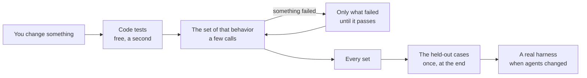

# Evals and tests

How to know the live session still does the right thing after a change.
There are three kinds of check. They cost very differently, so the cheap ones
run often and the dear ones run when they are needed.

All of them run in `live/`, with bun.

| Check | What it checks | What it costs | Run it |
|---|---|---|---|
| **Code tests** | The parts that need no model: the routing path | Nothing, under a second | `bun test routes` |
| **Evals of Fast** | That Fast decides right, with its real model | Fast's model calls, on the key in `DEVPAGE_OPENAI_API_KEY`: `--list` says how many a run makes | `bun eval.ts` |
| **A real harness** | That agents really run, fork and report on a harness | A few turns on the machine's Claude Code or Codex login | `bun smoke.ts`, `bun smoke.ts codex`, `bun smoke.ts routes` |

## The evals of Fast

A case is one moment: what Fast had been shown, what you say next, and what a
right script does there. How a case is built and judged is on
[the technical design](../agents/technical-design/README.md#the-eval-of-fast).

The evals need the key: `DEVPAGE_OPENAI_API_KEY` in the environment, or
[the two Azure variables](../README.md#on-azure). The judge is Claude, on the machine's Claude Code
login.

### The sets

Every case is in one set, by the behavior it checks. `bun eval.ts sets` lists
them with their sizes.

| Set | Cases | What it checks |
|---|---|---|
| `routing` | 6 | Which harness and model a new agent runs on |
| `sample` | 16 | Wake-ups of the sample session, as it is written |
| `follow-ups` | 7 | Which agent gets a follow-up |
| `reports` | 3 | What you hear of what the agents report |
| `answers` | 2 | What Fast answers by itself |
| `judgment` | 10 | A judgment is not Fast's to give |
| `nothing` | 1 | Words that call for nothing |
| `page` | 3 | Moving and pointing on your page |
| `work` | 2 | Work that goes to an agent |
| `red-team` | 34 | Hard moments written to break it |
| `scratch-pad` | 20 | When a scratch pad is shown, and how an open one is used |
| `held-out` | 13 | Kept apart: see below |

- **`all` is every set but `held-out`.** It is what a run without a set is:
  104 cases.
- **The held-out cases are never used to change Fast's brief.** They stay a
  fair check only while they are run rarely: to check a change at its end,
  not while working on it.
- **Every case is in one set.** The runner allows a case in two.
- **Only Fast has evals.** What a slow agent does with a task is checked by
  hand.

### What to run

| To | Run |
|---|---|
| See what a run would be, and how many calls, without running | add `--list` |
| Check one behavior you changed | `--set routing` |
| Check several | `--set routing,scratch-pad` |
| Run again only what failed last time | `--failed` |
| Run one case, or the ones with a word in their name | `--only route-by-voice` |
| Everything, every day | no option |
| The last check of a change | `--set held-out` |

- **Each case runs three times,** since the model does not answer the same
  way twice. `--runs 5` sets another number.
- **A run says first how many calls it will make,** and at the end what it
  cost. Every run is saved in `~/.devpage/live/evals/`; `--failed` reads the
  newest.
- **The options combine:** `--failed --set scratch-pad` is what failed last
  time in that set.

### The way of working

<Steps>

1. Change something: the brief, a rule, a model.
2. Run the set of that behavior, until it passes.
3. Run `--failed` after each fix, so only what was wrong runs again.
4. Run everything once.
5. Run `--set held-out` once, at the end.

</Steps>

When Fast does the wrong thing in a session, that moment becomes a case, in
the set of what went wrong.
