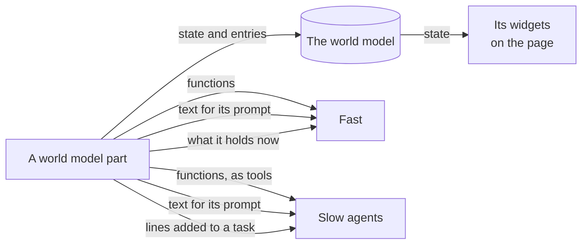

# Extend it

You extend [the live session](../README.md) by adding a world model part: one
thing the agents can see and act on. This page says what a part is, the seven
things it can declare, and the rules every part keeps. To build one, follow
[Write a part](write-a-part/README.md).



## What you can add

Anything you want the assistant to know about or do that is not a file in the
project. Some examples:

- **A list of notes** you dictate while reading, shown in the side panel and
  given to the agent that later works on that page.
- **Your issue tracker:** the open issues shown to Fast, and a function that
  files one.
- **Your running app:** which screen is open, and a function that opens
  another.

The pages of your project and the scratch pad are added in exactly this way,
as the parts [`devpage`](../world-model/devpage/README.md) and
[`canvas`](../world-model/canvas/README.md). Nothing in
[the core](../core/README.md) names them, so a part of yours can do
everything they do.

## A world model part

A part has a name and declares what it has of seven things. None is required:
a part with one function and nothing else is a part.

1. **State: how things are now.** Declared with its fields, so every read and
   write is checked. Widgets show it.
2. **Entries: what happened.** A kind of entry says its fields, the line Fast
   reads of one, and whether one wakes Fast. An entry is never changed or
   dropped.
3. **Functions: what can be done.** A function says its name, its input,
   what it runs and [who may call it](functions/README.md): Fast, slow
   agents, both, or a widget.
4. **Widgets: how it shows on the page,** each in a
   [place](../../on-the-page/widgets/places/README.md).
5. **Text for an agent's prompt.** What Voice, Fast and the slow agents are
   told about the part, written separately for each.
6. **Lines added to a task.** What a slow agent must know at the moment it is
   given work.
7. **What Fast is shown.** What the part holds now, read again each time Fast
   wakes.

Here is the whole of a small part that keeps notes:

```ts
// part.ts
export default ({ z }) => ({
  state: { notes: z.array(z.object({ text: z.string(), page: z.string() })).default([]) },
  entries: {
    noted: { fields: { text: z.string() }, line: (e) => `Noted: "${e.text}"`, wakes: false },
  },
  functions: {
    add: {
      for: "fast",
      description: "Keeps a note the user dictated.",
      input: { text: z.string(), page: z.string() },
      run: ({ text, page }, now) => {
        now.state.notes.push({ text, page });
        now.add("noted", { text });
      },
    },
  },
  widgets: { Notes: "panel" },
  addToTask: (state, task) =>
    state.notes.filter((n) => n.page === task.page).map((n) => `A note on this page: "${n.text}"`),
  showFast: (state) => ({ "The notes": state.notes.map((n) => n.text).join("\n") }),
});
```

Beside it, `fast.md` tells Fast when to keep a note, and `Notes.tsx` is the
widget. That is the part.

## The rules every part keeps

- **A function changes state and adds its entries in one step.** The two
  cannot disagree.
- **A function never speaks to you.** It adds an entry. The entry's kind says
  whether Fast wakes, and Fast decides what you hear.
- **A part's names are its own.** Its functions are called `notes.add`, its
  state is read as `notes`, and it cannot change another part's state.
- **A part runs as you.** Its code runs in the session's program with your
  account's rights, on your machine only. Enable a part as you would install
  a program.

## Topics

### Build one

- [Write a part](write-a-part/README.md) — a notes part from an empty folder
  to a working session, step by step.
- [Where a part is enabled](enabling/README.md) — for one project or for
  every project, and how a project turns one off.

### How it behaves

- [Who may call a function](functions/README.md) — a function for Fast, for
  slow agents, for both or for a widget, and what differs between them.
- [Widgets and state on the page](on-the-page/README.md) — where a part's
  widgets go, and how a widget reads and changes a part.

### Look it up

- [Part reference](part-reference/README.md) — every field of `part.ts`, the
  text files and the manifest.
