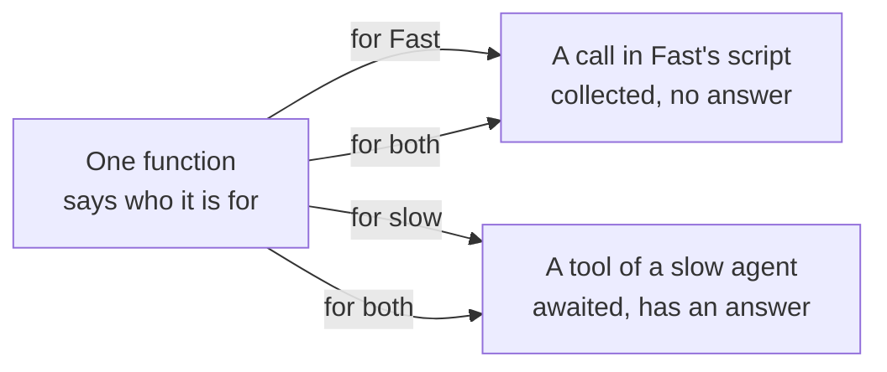

# Who may call a function

Every function of a [world model part](../README.md#a-world-model-part) is
written once and says who it is for: Fast, slow agents, both, or a widget on
the page. The program offers it to each in the right form. This page says
what each form is, and what differs for the function between them.



A function says who it is for with `for`:

```ts
functions: {
  add:    { for: "fast", … },   // notes.add(…) in Fast's script
  search: { for: "slow", … },   // the tool notes_search of every slow agent
  remove: { for: "page", … },   // world.call("notes.remove", …) from a widget
  file:   { for: "both", … },   // Fast's script and the slow agents' tool
}
```

- **For Fast: a call in its script, with no answer.** A
  [script's](../../world-model/scripts/README.md#how-a-script-runs) calls are
  collected and carried out when the script ends, so the script never sees
  what a function returned. What Fast knows is the entries it is shown: data
  meant for Fast is an entry.
- **For slow agents: a tool, with an answer.** The agent waits for it, and
  what `run` returns is the tool's result.
- **For both:** a slow agent gets the result at once. Fast gets it from the
  function's entry, one wake-up later, so the entry of a call Fast made must
  wake Fast: `wakes: (entry, caller) => caller.who === "fast"`.
- **For the page:** a widget calls it with
  [`world.call`](../on-the-page/README.md#changing-a-part). What it wrote
  comes back to every page as the part's state.

## What differs for the function

- **One `run` for every caller.** It is given its input and
  [`now`](../part-reference/README.md#now): the part's state, a way to add
  entries, and who called.
- **A function for Fast is checked inside the script.** Its input is checked
  against its schemas there, and so is its own `check` when it has one, while
  the script can still fail. A script with a call that is refused does
  nothing at all.
- **A function runs with its caller.** For Fast: the hand-over it answers and
  the messages its script used. For a slow agent: the agent and its task.
- **How a tool reaches a coding agent is not yours to write.** Each
  [harness](../../core/harness/README.md) offers the functions declared for
  slow agents. Today that is MCP; a part writes none.

## A function that starts long work

A function returns quickly. Work that outlasts it goes in `now.follow`:

```ts
run: ({ query }, now) => {
  now.add("started", { query });
  now.follow(async (publish) => {
    const found = await search(query);
    await publish((later) => later.add("found", { query, found }));
  });
}
```

The work starts after `run` is saved. Each `publish` is a step of its own,
and the caller of the function decides whether its entries wake Fast, as for
any entry.
