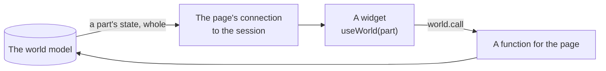

# Widgets and state on the page

How a [world model part](../README.md#a-world-model-part) shows on a page:
the part says where its widgets go, a widget reads the part's state with
one call, and changes it by calling one of the part's functions.



## Where the widgets go

- **The part says where its widgets go.** Its `part.ts` declares each widget
  with its [place](../../../on-the-page/widgets/places/README.md):
  `widgets: { Notes: "panel" }`.
- **The panel is a stack of sections.** Each widget placed in `panel` is one
  section. The agents and their tasks are
  [work's](../../world-model/work/README.md#widgets) section.
- **The session's own widgets are declared the same way,** by the core and
  by the `devpage` and `canvas` parts, not by name inside devpage.
- **Widgets only.** A part does not add pages to the project.

## Reading a part

```js
const work = useWorld("work")

// on the socket, when a part changes
{ type: "state", part: "work", state: { tasks: [...], agents: [...] } }
```

- **A widget reads a part with one call, `useWorld(part)`.** It returns that
  part's state and draws the widget again when it changes. The
  [`devpage` module](../../../on-the-page/widgets/page-module/README.md#useworld-and-world)
  exports it, because a package's widget can import only its own modules.
- **No new connection.** `useWorld` reads from the WebSocket each page already
  holds to the program. Only its `state` message changes; what was heard, an
  agent's session, page actions and the microphone's audio stay as they are.
- **The program sends one part at a time.** A page that connects gets every
  part's state. After that, a change to a part sends that part's state, whole.
  Not a diff: a widget that reads the whole part cannot be wrong after a
  missed message.
- **The session itself publishes four:**
  [`session`](../../world-model/session/README.md#state) for the voice and its problem,
  [`work`](../../world-model/work/README.md#state) for tasks and agents,
  [`devpage`](../../world-model/devpage/README.md#state) for where you are and what is marked,
  [`canvas`](../../world-model/canvas/README.md#state) for the open pad.

## Changing a part

```js
import { world } from "devpage";

world.call("notes.remove", { text: "this limit is too low" });
```

- **A widget changes a part only through a function** declared
  [for the page](../functions/README.md).
- **What the function wrote comes back as the part's state,** to every open
  page, so the widget draws from `useWorld` and keeps no copy.
- **Where no session is on, a call does nothing.**
