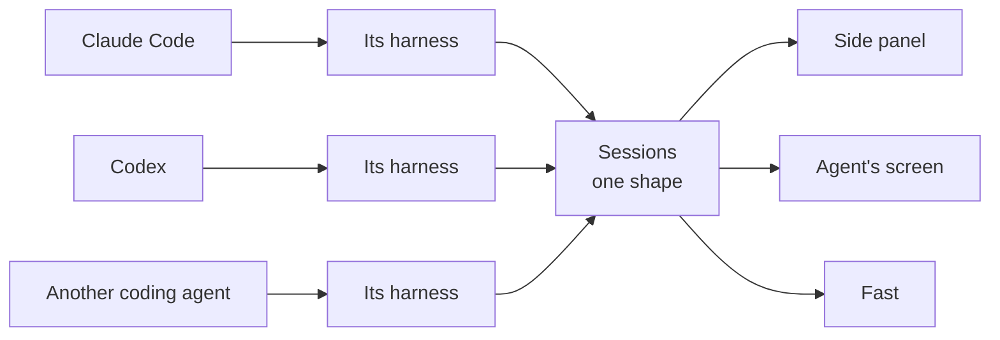
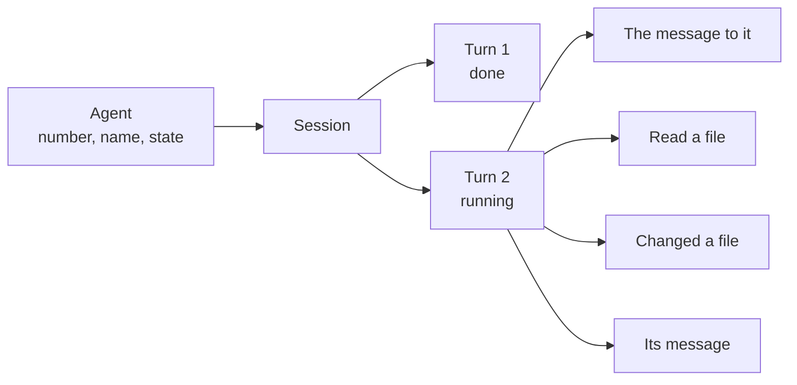

# The harness

The live session is not a coding agent. It is one interface to several of
them: Claude Code and Codex today, another tomorrow. A **harness** is a
coding agent as the session uses it, through one abstraction for both
directions: giving an agent work, and reading what happens inside it. This
page says what that abstraction is, what an agent's session is made of, the
same for every harness, and what it takes to show one on
[the agent's screen](../design/README.md#an-agents-session). It belongs to
[the agents](../agents/README.md).

The contract is `live/harness.ts`, with two implementations: Claude Code
(`live/claude.ts`) and Codex (`live/codex.ts`). Both pass the same check with
the real coding agent. A session can use both at once, each agent on its own
[route](../routing/README.md).

Each coding agent speaks its own language. Its harness turns it into one
shape. Everything after it, the side panel, the agent's screen and Fast,
knows only that shape and never asks which harness it is.

## Not tasks

This model has nothing to do with tasks. It is the coding agent's own model,
and it is here for one thing: to show what happens inside one.

- **A task is the session's.** It is a piece of work you asked for, with a
  title, a state and a report. It is on [Slow agents](../slow-agents/README.md).
- **A turn is the harness's.** One message in, and the agent works until it
  stops.
- **They are not linked.** One piece of work can take several turns: a
  follow-up, an answer to a question. The session of an agent does not know
  about tasks, and a task does not point at turns.
- **Both are about the same agent.** The side panel shows an agent's tasks.
  The agent's screen shows its session.

## The primitives

Four things, each inside the one before.

| Primitive | What it is |
|---|---|
| **Agent** | One conversation with one harness. It has a number, a name and a state. |
| **Session** | Everything that happened in an agent: its turns, in order. The coding agent keeps it, and the harness reads it. |
| **Turn** | One message to the agent, and all it did until it stopped. |
| **Item** | One thing that happened in a turn: a message, a command, a changed file. |

### A turn

- **It starts with one message** and ends when the agent stops.
- **It has a state:** running, done, failed or stopped.
- **A follow-up is another turn.** So is your answer to its question, and a
  short "yes" typed in the chat.
- **A turn that ends with a question is done.** Your answer starts the next
  turn.

### An item

An item has a kind, a state (running, done or failed), a time, and one line
of plain text that says what it is. The line is what the screen shows. The
detail behind it is the tool's input, cut short; a command's output and a
file's diff are not kept.

| Kind | In the code | What it is | Its line |
|---|---|---|---|
| **The message to it** | `user_message` | What you said or typed, as the agent got it. | The words. |
| **Its message** | `agent_message` | What the agent says to you. | The words. |
| **Note** | `note` | What the agent says to itself while it works. | The words, folded. |
| **Read** | `read` | It read a file. | Read, and the path. |
| **Change** | `change` | It made or changed a file. | Changed, and the path. |
| **Command** | `command` | It ran something in the shell. | Ran, and the command. |
| **Search** | `search` | It searched the project or the web. | Searched, and for what. |
| **Tool** | `tool` | Any other tool, one this list does not name. | The tool's name. |
| **Question** | `question` | It cannot go on without you. | The question. |
| **Subagent** | `subagent` | It gave part of the work to another agent of its own. | The work it gave. |
| **Notice** | `notice` | Something about the session, not from the agent: an error, a conversation that was lost and started again. | What happened. |

- **Eleven kinds, and the list is closed.** A coding agent has many tools.
  What does not fit one of the first ten is a Tool, with its name. The screen
  never has to learn a new kind when a coding agent adds a tool.
- **A subagent is an item that has items.** Its own work is a list of the same
  kinds, inside it. The screen shows a subagent as one line and does not open
  it.
- **The work, folded.** The one line the screen folds a turn's work to is a
  summary of its items between the message to the agent and its message.

## What a harness does

What a coding agent must do to be used: take work, and say what happens. In
the code it is smaller than this table: one operation, a turn. A turn is
started on a new agent, on one that exists, or on a copy of one, and it gives
its items as they happen. The rows are what that one operation covers.

| What | What it does | Every harness |
|---|---|---|
| **Start** | Makes an agent in the project, with the session's brief. | Yes |
| **Send** | Starts a turn with a message. | Yes |
| **Items** | Gives each item as it happens, and again when its state changes. | Yes |
| **Models** | Says which models it has, with a line on what each is for. | Yes |
| **Fork** | Starts a new agent with another one's context. | Only where it can. Claude Code and Codex: yes. |
| **History** | Gives the turns of a conversation again, from what the coding agent itself keeps. | Only where it can. Claude Code and Codex: yes. |
| **Steer** | Takes a message while a turn is running, without stopping it. | Only where it can. Claude Code and Codex: no. |

- **The tools go in with the turn.** How an agent reports back, its update, a
  comment, the log, is given to the harness as a list of tools. The harness
  hands them to its agent its own way.
- **A model goes in with the turn** too: the one of the agent's route.
- **A harness says what it can do.** Fork, history and steer are flags it
  sets. Nothing outside a harness asks for it by name.
- **When it cannot, there is a fallback.** No fork: the new agent starts empty
  and reads the project. No history: only the turn that runs can be watched.
  No steer: the message waits for the turn to end, as a follow-up does.

### Claude Code

What the Claude Agent SDK gives, and what it becomes.

| From Claude Code | Becomes |
|---|---|
| The prompt of a turn | The message to it |
| The `update` tool: progress, finished, failed | Its message |
| The `update` tool: question | Question |
| Text between its tools | Note |
| Read, fetching a web page | Read |
| Edit, Write, editing a notebook | Change |
| Bash | Command |
| Grep, Glob, web search | Search |
| The Agent tool | Subagent |
| Any other tool | Tool |
| The turn's result | The turn's state |

- **Its message is the update, not its text.** An agent's plain text is
  written for nobody, and its updates are written for you. So the chat shows
  the updates as what it says, and keeps the text as notes inside the folded
  work.
- **The message to it is the prompt.** Fast writes a prompt around what you
  said, and that prompt is what Claude Code keeps. So the chat shows the
  prompt, without the line that names the task and without the page the
  program added.
- **Nothing is kept twice.** Claude Code keeps every conversation in a file
  of its own. The harness reads it when you open an agent, and the program
  keeps no copy. Only the turn that runs is sent as it happens.
- **A fork's file starts with its parent's conversation.** The agent's own
  session begins at the first task that was given to it.
- **It runs on the machine's Claude Code login.** A conversation is picked up
  again by its id, also after a restart, and can be picked up as a fork. The
  project's own settings for Claude Code apply. The agent's tools are served
  to it from the program itself.
- **It asks nobody,** and one thing is refused: a change to a file outside the
  project's folder and the folder of scratch pads.

### Codex

- **A turn is one run of `codex exec`,** on the machine's Codex login, in a
  sandbox that may write only the project's folder and the folder of scratch
  pads. The message goes in on its standard input.
- **The agents' tools are served to it** by a small tool server on the
  loopback address, at a secret address, for the length of the turn, since
  Codex takes tools that way.
- **A conversation is picked up** with `resume`, and as a fork with `fork`.
- **History is read from the file Codex keeps** of a conversation.
- **Its items:** its message between tools is a Note, a command it ran a
  Command, a changed file a Change, a web search a Search, its plan a Tool
  ("Updated its plan"), work it gave to an agent of its own a Subagent, an
  error a Notice.

## What the screen needs

1. **The items.** The harness reads them from what the coding agent keeps of
   the conversation.
2. **Sending them to the page.** When you open an agent: its turns so far.
   Then each new item, only for the agent that is open.
3. **The agent's screen.** A second view in the side panel: turns, items, the
   folded work. The panel gets twice as wide.
4. **Typing.** A message from the chat box starts a turn on that agent. It
   does not go through Fast.

Steps 1 and 2 are the harness. Steps 3 and 4 are the screen on top of it.

## Where it is

In `live/`. A change takes effect when the session is restarted.

- **`harness.ts`** is the contract: the kinds of item, a turn and its events,
  the tools, what a harness can do. It knows no coding agent and no task.
- **`claude.ts`** is Claude Code as a harness. Everything that knows Claude
  Code is in this one file.
- **`codex.ts`** is Codex as a harness.
- **`agents.ts`** runs the agents on their harnesses, without knowing which.
  Nothing keeps a session here: it asks the harness for an agent's history,
  and passes on what happens in the turn that runs.
- **`smoke.ts`** checks a harness with the real thing, in a throwaway folder:
  the base agent, an agent forked from it for a small task, a fork of that
  agent, a follow-up, and their sessions read back. `bun smoke.ts` for Claude
  Code, `bun smoke.ts codex` for Codex.
- **To look at a session:** the program answers `/session/<agent's number>`
  with its turns and items.

## Left out on purpose

- **Going back in time:** checkpoints, and undoing a turn.
- **Approvals:** an agent here asks nobody before it uses a tool.
- **Changing harness in the middle of a conversation.**
- **Plans and to-do lists** as their own kind of item. They are a Tool.
- **Stopping a turn from the page, and steering one.**
