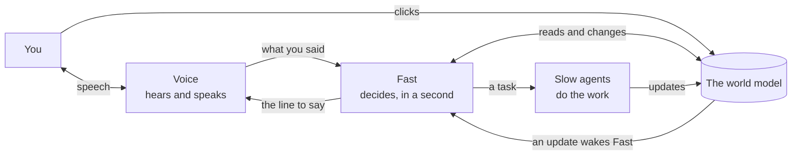

# How it works

The live session rests on five ideas. This page gives each in a few lines,
then follows one request from your words to the changed page. With these you
can reason about everything else under [the live session](../README.md).



## The five ideas

### 1. You work on the project, not on agents

You say what you want done or answered, and you point at what you mean. Which
coding agent gets it, whether it is a new one, and what it needs to be told
are decided for you. To you there is one assistant, and it never makes you
wait: you can give the next request while the first is running.

### 2. Three kinds of agent, each for one speed

- **Voice** hears you and speaks. It decides nothing.
- **Fast** answers in about a second. It decides what happens with what you
  said: it says a fact it can see, moves the page, or gives the work to a
  slow agent. It never does the work.
- **Slow agents** are coding agents, Claude Code and Codex. They read, think
  and change files, for as long as that takes.

More on [the core](../core/README.md).

### 3. They share one world model

No agent tells another what it knows. They all read and write one record:
what is true now (the page you are on, the part you marked, the tasks), and
one numbered log of what happened (what was said, what was asked for, what an
agent reported). That record is the [world model](../world-model/README.md).

### 4. Work is delegated as tasks

Fast gives a piece of work to a slow agent as a task. The agent publishes
updates on the task into the world model, and each update wakes Fast, which
decides what you hear. More on [delegation](../core/delegation/README.md).

### 5. Parts extend it

What the agents can see and do is not fixed. A **part** adds one thing to the
world model: its state, what can happen to it, what can be done with it, how
it shows on the page, and what each agent is told about it. The pages of your
project are a part, named `devpage`. The scratch pad is another, `canvas`.
[You can add your own](../extend/README.md).

## One request, from your words to the page

You are reading a page about a waiting list. You click the sentence "An offer
stays open for three days" and say "make this seven days".

1. **Your click marks the sentence.** The `devpage` part records it in the
   world model.

   

2. **Voice hands over your words.** They become a message with an id, stored
   with the page you were on and the part marked at that moment. Fast is
   woken and reads one line:

   ```
   m41  user  "Make this seven days."  page /docs/waiting-list/README.md  marked "An offer stays open for three days"
   ```

3. **Fast answers with one short script.** Your words are a variable in it,
   so Fast never retypes them.

   ```js
   spawn(`The user said: "${m41}"`);
   say("I'm changing it.");
   ```

4. **You hear "I'm changing it."** A task appears in the side panel. You can
   already say the next thing.

   

5. **A slow agent gets the task.** The `devpage` part adds what the agent
   could not know from your words:

   ```
   Task 7
   The user said: "Make this seven days."
   The page the user is on: /docs/waiting-list/README.md
   Marked on it: "An offer stays open for three days"
   ```

6. **The agent changes the file and publishes an update.** The page changes
   in front of you, and the update wakes Fast:

   ```
   u12  t7 a2  finished  "The page now says seven days."
   ```

7. **Fast passes it on:** `say(u12)`. You hear "The page now says seven
   days." Clicking the done task takes you to the changed sentence.

   

Every screen of one request is on [Design](../inside/design/README.md).

## Two modes

The same core runs in two modes.

- **Realtime:** you talk. Voice hears you and speaks, and everything written
  for you is written to be heard: short, plain, no paths or lists.
- **Chat:** you type or dictate. Voice is off. What you write reaches Fast as
  a message, exactly as a spoken one does, and the answers are shown as text,
  so they may hold paths, lists and code.

Nothing else differs: the same Fast, the same slow agents, the same world
model, the same tasks.

## What a page shows

The session puts four things on every page.

- **The orb,** in the bottom right corner. It starts and stops the session
  and shows your voice, the assistant's, and whether work is running. What
  keeps the session from starting is said beside it.
- **The tasks button,** in the navbar, with the number of running tasks. It
  opens the side panel.
- **The side panel:** the agents, each with its tasks, and above them the
  last thing heard or said. A done task leads to what it changed.
- **The canvas:** a [scratch pad](../world-model/canvas/README.md) over the
  whole page, for an idea that is easier to look at than to hear.

While the session is on, a click on a part of the page, or a selection, marks
it as what you are talking about.
