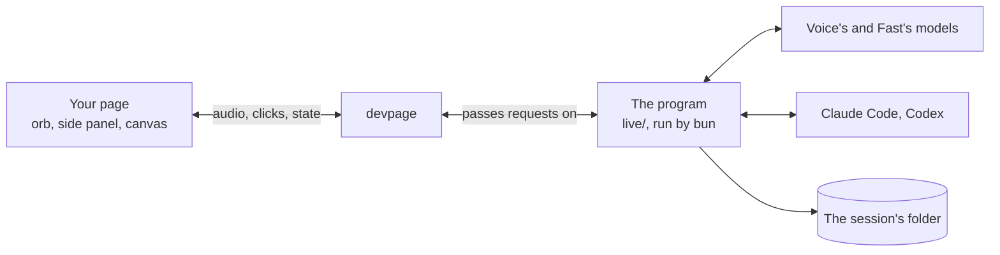

# Inside

For changing [the live session](../README.md) itself. This page says what the
session is made of as software, a program beside devpage and widgets on the
page, and how devpage installs and runs the program. The pages under it hold
the program's files, the screens, and how a change is checked.

## The program

The session itself is a TypeScript program,
[`live/`](../../../../../live/service.ts) in devpage's repository: it holds
the voice session, runs Fast and the slow agents, and keeps the world model.
devpage does not contain that logic. It carries the program's source in its
executable, and
[`devpage setup`](../../configuration-reference/README.md#devpage-setup) puts
it on the machine:

<FileTree>

- ~/.devpage/live/
  - program/ — the program, unpacked, with its packages installed
  - bun/ — the bun that runs it, at the version devpage pins, and its package cache
  - projects/ — what each project's session keeps

</FileTree>

devpage runs the program as it runs any
[extension's](../../extensions/reference/README.md#process): started by the
first page that asks, given each request and WebSocket under its address,
stopped when devpage exits. Its `run` names `bun`, and a program whose `run`
names `bun` is run with devpage's own bun once that is installed, never the
machine's.

The installed program is exactly the one the executable carries. `devpage
setup` stamps it; a devpage that finds another's stamp, after an update,
serves without the session and
[says so](../use/turn-it-on/README.md#steps).

To run a copy you are changing in place of the installed one, name its folder
with the [`program` setting](../use/settings/README.md#devpages-own-setting).

## The widgets

The orb, the tasks button, the side panel's section and the canvas are
system widgets in `core/assets/widgets/`, declared with their places
like [any part's](../extend/on-the-page/README.md). They hold no logic of the
session: they show the world model's state and send what you do.

## Topics

### How it is built

- [Technical design](technical-design/README.md) — the program's files, one
  request inside the program, a restart, where things are kept, the log and
  the cost.

### How it looks

- [Design](design/README.md) — the orb, the side panel, an agent's chat and
  the canvas, with every screen of one request.
- [Agent icons](agent-icons/README.md) — the orb that stands for one agent:
  why it looks as it does and how it is made.

### How a change is checked

- [Evals and tests](evals/README.md) — the three kinds of check, what each
  costs, and the order to run them in.
