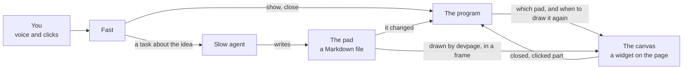

# The scratch pad

Some ideas cannot be said well by voice. Then the assistant shows you a
canvas over the screen, with the idea drawn like a page, and you develop it
together. This page says how that is built: what a pad is, how the page shows
one, and when the assistant uses it. What you see is on
[Design](../design/README.md#scratch-pads).


## The parts



Three things make it: the pad files, the canvas widget, and the canvas in
[the world](../agents/world/README.md).

## A pad is a file

- **One Markdown file per idea,** in the `pads/` folder of
  [the session's folder](../README.md#where-a-session-is-kept). Its first
  heading is the idea's title, and its file name is made from it:
  `pads/reminding-about-an-offer.md`.
- **It is not in the project.** So a pad is in no sidebar, no search, no link
  check and no commit.
- **The program answers it, and devpage draws it.** A pad's address in the
  session is `pads/<name>.md`. The program gives its Markdown at
  `pages/pads/<name>.md`, and devpage draws what an extension answers under
  [`pages/`](../../extensions/reference/README.md#pages) as a page of the
  project.
- **It can use everything a page can:** widgets, diagrams, designs, tables.
  It is drawn as a page of the project, so it has the project's widgets.
- **The assistant makes and names pads.** You never see the list. The program
  keeps which pad is shown.

## Who writes a pad

A slow agent, with the tools it already has: it writes the file as it writes
any page. The session grants access to the pads folder even when agents are
confined to the project.

- **Fast names the pad and shows it at once.** When you ask to be shown
  something, or an idea needs a picture, Fast makes a pad from the idea's
  title, opens the canvas on it and gives an agent the task with the pad's
  address. The canvas shows the title until the agent has written more.
- **Fast cannot write one itself.** It answers in a second, and a pad needs
  the project and some thought.
- **The canvas follows the file.** Every save shows, so you see the pad grow.

## Placeholders

A pad takes a while to draw, and you should never look at an empty canvas. So
the agent's first save is the title and one placeholder for each part it
plans. Then it puts the real part in the place of each, from the top.

```md
<Soon kind="picture" width="two-thirds" height="l" />
<Soon kind="list" width="third" height="l" />
```

- **A placeholder has no text.** Its shape says what is coming: `flow`,
  `cards`, `list`, `table`, `picture` or `text`.
- **The agent sets its size,** about the size of the real part, so the pad
  does not jump. `height` is `s`, `m`, `l`, `xl` or a number of pixels.
  `width` is `quarter`, `third`, `half`, `two-thirds` or `three-quarters`, and
  the ones that fit share a row.
- **What is inside follows the size:** a taller list has more lines, a wider
  flow more steps.
- **All of them breathe, and one is alive:** a light runs around it and its
  inside draws itself. It is the first placeholder from the top, the next
  part to be drawn.
- **Nothing on one can be pressed.** A click on it marks it, like any part of
  the pad.
- **The real part fades in.** When the pad is saved, the canvas fades the new
  drawing in over the old one.
- **A finished pad has none left.**
- **The agent is told twice.** The order is in its instructions, as numbered
  steps, and the program adds it again to every task that names a pad.
  Instructions alone were not enough: a pad was written in one save.

## Showing it: the canvas

A [system widget](../../on-the-page/widgets/system-widgets/README.md), `DevpageLiveCanvas`,
which devpage places beside the orb. It is mounted once and stays while you
move between pages.

- **The program says what to show.** It sends every open page the pad on the
  canvas, or none. The widget draws what it is told, so a reloaded page shows
  the canvas again.
- **Full screen.** The canvas fills the window, 6 pixels in from each side,
  and its size does not depend on the pad. A long pad scrolls inside.
- **A thin gray edge** is all that shows around it. It is a plain gray, not
  the page dimmed: the page is hidden and takes no clicks.
- **Rounded corners, no shadow.**
- **The pad stays a column in the middle.** devpage's own page width holds,
  so a wide screen gives the pad more air, not longer lines.
- **The side panel is on it, as a card.** The same component as on a page, in
  a rounded container with a border, on the right under the cross, as high as
  what is in it. On a page the panel stays flat against the right edge.
- **The cross is in the top right corner and closes it.** The widget tells
  the program, the program tells the world, and Fast knows you closed it.
- **The orb is above it,** in the canvas's bottom right corner.

## A pad in a frame

The canvas holds an `iframe` with the pad's address. devpage draws the pad
there as it draws any page, so widgets and diagrams work with no code of the
session's.

- **The same site.** The frame and the page have one origin, so the widget
  reaches into the frame: the session's code turns picking on there, hears
  what you clicked or selected, and marks a part.
- **No navbar, no sidebar.** The widget adds a stylesheet to the frame that
  hides devpage's own frame around the page: the navbar, the sidebar, the
  comments, the places.
- **No second session.** The session's code runs in the frame too, since it
  is a page of the same site. There it does nothing: no connection, no orb,
  no voice.
- **Shown when it is ready.** The frame is hidden until devpage says the page
  is drawn, so you never see the navbar flash.

What it costs:

- **It leans on devpage's insides in one place:** the names of the elements
  to hide. They are in the widget, which is devpage's own, so the two change
  together.
- **Each show loads a whole page,** which takes longer than a layer built
  into the page would.

## When a pad changes

devpage does not watch a file outside the project, and a pad is such a file.
So the program does it.

1. The program watches the folder of pads.
2. When the pad on the canvas is saved, the program waits 150 ms for the
   saving to settle and sends the open pages a new version number. A pad
   whose file is gone closes the canvas.
3. The widget loads the pad again in a second frame behind the first, and
   swaps them when it is drawn, at the same scroll. The new one fades in over
   the old in under half a second. Nothing flashes.

## What you say while it is open

- **The pad is the page.** While the canvas is open, what you say carries the
  pad's address as its page, and a part you marked on it as its marked part.
  The agent gets "this" as it does on any page.
- **Fast reads the pad.** Its text is what Fast is shown as your page, and
  `page.point`, `page.select` and `page.scroll` work on it.
- **Fast sees the canvas** in the world: which pad is shown, that it opened
  or closed it, or that you closed it. It also has the list of pads.
- **Fast's script has three calls:** `canvas.pad(title)` gives the address of
  the pad for an idea, `canvas.show(address)` opens the canvas on it,
  `canvas.close()` closes it. `page.go` closes it too: going to a page means
  showing the page.
- **Another idea, another pad.** When you move to another idea, Fast shows
  its pad and says which idea it is.
- **After you close it, it stays closed** until you ask to see something
  again.
- **A done task whose change is on a pad** opens the canvas on that pad when
  you click it.

## How an open pad is used

These are in the instructions of Fast and of the agents.

- **A pad is small.** One picture, three or four short lines, at most one
  small table, and the two or three things you have to decide. It is not a
  document: the reasons are said, or you ask for them.
- **The idea grows on the pad.** While the canvas is open, what you add,
  correct or ask about its idea goes to the agent as "bring the pad up to
  date with this". You never hear a long answer while the pad stays as it
  was.
- **"Design only" is about the project, not the pad.** It never means the pad
  is left alone.
- **You hear a sentence or two.** What is on the pad now, and what you have
  to decide. A long report is not recited: you read the pad.
- **Fast gives no opinion of its own** while the agent works your point into
  the pad.
- **While it is still being drawn, Fast says so,** and does not say it is
  opening a pad that is open.
- **It closes when the idea is done:** you agree with what is on it and ask
  for it to be built or written up.

## When to use it

Either you ask for it, or Fast sees that words will not do. So the canvas may
open by itself, and Fast says that it is showing something; never after you
closed it, until you ask.

- **You ask:** "show me", "draw it", "open the scratch pad", "let's think
  about this together".
- **Words will not do,** when you would have to hold more than about three
  things in your head, when saying it would take more than half a minute, or
  when you would want to point at one part:
  - parts and how they connect: a flow, who talks to whom;
  - options compared on several points;
  - a plan with steps;
  - exact things: names, numbers, wording;
  - an idea built over several turns.
- **Not for** a yes or no, one fact, an opinion, or how a task is going:
  those are said.
- **Not for what a page already shows:** then Fast goes to that page and
  points.

## One request

1. You say "show me how that would work".
2. Fast makes the pad's address from the idea's title, opens the canvas on
   it, gives an agent the task with that address, and says "I'm drawing it."
3. The canvas opens with the title. The agent writes the pad's file, and the
   canvas follows.
4. The agent publishes that it is finished, in one line that Fast says. It
   does not read the pad aloud.
5. You click a part and say "not this, do it the other way".
6. Fast sends that to the same agent, with the pad and the part. The agent
   changes the file, and the canvas is drawn again.
7. You press the cross, or say "close it". The page is there as you left it.

## Where it is

| Where | What |
|---|---|
| **`core/assets/widgets/DevpageLiveCanvas.tsx`** | The canvas: the full-screen frame, the gray edge, the cross, the side panel as a card, the two frames that swap, the fade between them. |
| **`core/assets/widgets/Soon.tsx`** | The placeholder: its kinds, its sizes, and which one is alive. |
| **`core/assets/widgets/live.ts`** | The canvas in the session's state, the close, picks and marks in the frame, and doing nothing when it runs inside the frame. |
| **`live/service.ts`** | The canvas in the world, sent to the pages. The watch on the folder of pads. The pad as the page you are on. A pad's Markdown, answered under `pages/`. |
| **`live/sandbox.ts`, `live/fast.ts`** | `canvas.pad`, `canvas.show`, `canvas.close`, the canvas and the pads in what Fast reads, and when to use it in Fast's brief. |
| **`live/agents.ts`** | The agents' brief: where pads are and how one is written. |
| **`live/evals/cases.ts`** | The cases on when to use the canvas. |

A pad lives as long as the session's folder: nothing cleans up old pads. A
pad is shown over the page, never beside it, and nothing moves a pad into the
project's docs.

## The evals

`live/evals/cases.ts` has twenty cases on the canvas, named `canvas-…`, the
set `scratch-pad`. They check Fast's decision, not what is on a pad.

- **It opens:** you ask for it; a flow; a comparison; a plan.
- **It stays closed:** a fact, a short question, an opinion, a change to the
  project, and something a page already shows, where you are taken to the
  page.
- **Around an open canvas:** a follow-up goes to the agent that drew the pad,
  a new idea gets a new pad, "close it" closes it, an old pad is shown again
  from the list, and a finished pad is not read aloud.
- **After you closed it,** the next thing is answered in words.
- **How an open pad is used,** five cases named `canvas-pad-…`: "design only"
  does not freeze the pad, the idea grows on the pad, a long answer is not
  recited, the canvas closes when the idea is done, and a pad still being
  drawn is said to be so.

`bun eval.ts --set scratch-pad` in `live/` runs them. See
[Evals and tests](../evals/README.md).
