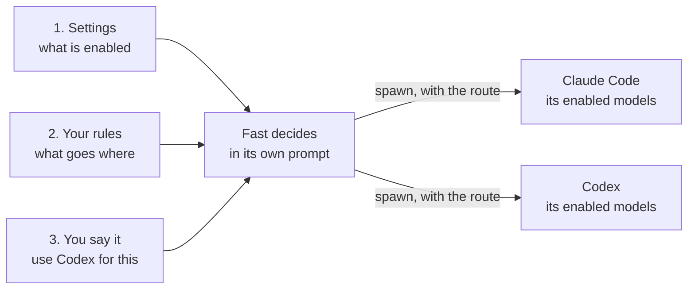

# Routing

Which harness and which model an agent runs on. Every agent is made on a
route. Three things decide it: the settings say what may be used, your rules
say what goes where, and what you say wins over the rules. How Fast then
picks an agent for a piece of work is on
[Delegation](../../core/delegation/README.md#picking-an-agent).



1. **The settings say what may be used:** which harnesses are on, and which
   models of each. In `live.harnesses` in `~/.devpage/config.yml`, or the
   project's own. Strict: nothing else can be used.
2. **Your rules say what goes where:** for this kind of work, use that route.
   In `routing.md`, in plain words. Soft: Fast reads them, and there is a
   default.
3. **What you say wins over the rules,** for that piece of work, inside the
   settings.

## A route

A route is a harness and one of its models. Its name is the two with a slash:
`codex/gpt-6.2-astra`. A harness on its own default model is named by the
harness alone: `codex`.

- **An agent is made on a route** and stays on it. A conversation of one
  harness means nothing to another.
- **A follow-up stays with its agent.** So does a fork: it is a copy of its
  parent's conversation.
- **To move work to another harness,** a new agent is made there, and the
  prompt says what it needs to know.

## 1. The settings

The `harnesses` [setting](../settings/README.md): each harness that is on,
with the models of it that may be used.

```yaml
live:
  harnesses:
    claude-code: [fable, sonnet, haiku]
    codex: [gpt-6.2-astra, gpt-6.2-sol]
```

- **For every project, or for one.** `live` in `~/.devpage/config.yml` holds
  it for every project. A project's `extensions.live.config` in its
  `devpage.yml` may hold its own `harnesses`, which replaces the other whole.
- **The first route is the default:** the first model of the first harness.
- **A harness with no list** runs on its own default model: `codex: []`.
- **No setting at all** is one route: Claude Code, on its default model.
- **The names are the harness's own.** The two harnesses are `claude-code`
  and `codex`; a model is named as its harness names it.
- **The harnesses say which models exist.** Each reports its models, with a
  line on what each is for. A model in the settings that its harness does not
  have is dropped when the session starts, and so is a harness that does not
  exist; the log says so. The default route is kept as it is, so there always
  is one.
- **Read when the session starts.** A change needs a restart.

## 2. The rules

`routing.md`: plain words, a few lines. `~/.devpage/routing.md` holds the
rules for every project; a `routing.md` at the top of a project replaces them
whole for that project. You write it and change it; you can also ask for a
change, and an agent edits the project's file.

```md
# Routing

- Thinking a design through, opinions on a text: claude-code/fable.
- Small edits, renames, quick lookups: claude-code/haiku.
- Building or changing code: codex/gpt-6.2-astra.
```

- **Fast reads it.** It is added to [Fast's prompt](../../core/prompts/README.md#your-routing-rules)
  as you wrote it, with the list of routes that are enabled and what each
  model is for.
- **Read again each time Fast's context is built,** so a change takes effect
  within the session.
- **No file, or no rule that fits:** the default route.
- **Few and coarse.** Fast is a small quick model that chooses from your
  words alone.

## 3. What you say

"Do this with Codex." "Use the strongest model for this one."

- **It wins over the rules,** for that piece of work.
- **It stays inside the settings.** When you name something that is not
  enabled, Fast says that it is not enabled and starts nothing, on no other
  route either: what happens with the work is yours to decide.

## How Fast picks

**There is no routing stage.** Routing is one more thing Fast decides, in the
same prompt and the same script as everything else it decides: which agent,
what to say, where to go. The routes and your rules are part of what Fast is
told. Nothing before Fast and nothing after it chooses a route.

Fast already writes `spawn(prompt)` to make an agent. It takes one more word,
the route:

```js
spawn(prompt, "codex/gpt-6.2-astra")
```

- **Left out: the default route.**
- **Only `spawn` takes a route.** `send` and `fork` go to the agent's own
  harness and model.
- **The program only checks and carries out.** A name that is not an enabled
  route is refused: nothing starts, Fast is told which routes there are, and
  it decides again. The program never puts another route in its place.
- **A route is written whole,** harness and model. Which model of a harness is
  Fast's to say.
- **With one route, Fast is told nothing** about routes: there is nothing to
  pick.
- **Fast never says a route's name** unless you ask which one something runs
  on.

## What is the same for every route

After an agent is made, nothing asks which harness it is on. The side panel,
the agent's chat, its updates and what you hear are the same. That is
[the harness](../../core/harness/README.md).

## Where it is

In `live/`. A change takes effect when the session is restarted.

- **`routes.ts`** reads the settings, checks them against what the harnesses
  report, finds a route by its name, reads `routing.md`, and writes what Fast
  is told.
- **`harness.ts`** takes a model for a turn, and a harness says which models
  it has. **`claude.ts`** and **`codex.ts`** do both.
- **`agents.ts`** holds every enabled harness. Each agent remembers its
  harness and its model.
- **`sandbox.ts`** and **`fast.ts`**: `spawn` takes a route, and the routes
  with your rules are added to Fast's instructions.
- **`service.ts`** puts them together and checks the route Fast names.

## How it is checked

- **With the real harnesses:** `bun smoke.ts routes` in `live/` makes one
  agent on a Claude Code route and one on a Codex route at the same time, each
  on a small model, forks the second, and checks that a model and a harness
  that do not exist are dropped and reported.
- **The routing path without any model:** `bun test routes` in `live/`. Nine
  tests, with fake harnesses that note what they are asked: no settings enable
  nothing and Fast is told nothing, the settings give the routes in order, a
  name is a route only when it is enabled and nothing is picked in its place,
  the routes and your rules are inside Fast's own instructions, a script's
  `spawn` carries its route, a new agent runs on the harness and model Fast
  named, a follow-up and a fork stay on their agent's route, a new agent starts
  empty, and a project's rules replace the ones for every project
  whole.
- **Fast picking a route from your words, with its real model:**
  `bun eval.ts --set routing` in `live/`. Six cases: a rule for a small edit,
  a rule for code, the default when no rule fits, what you name winning over a
  rule, a harness that is not enabled starting nothing, and a follow-up
  staying with its agent. See [Evals and tests](../../inside/evals/README.md).
