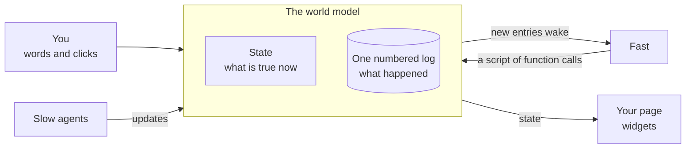

# The world model

The world model is the one record the agents of
[the live session](../README.md) share: what is true now, and everything that
happened, in order. No agent tells another what it knows; each reads the
world model and adds to it. This page says what is in it, who reads and
writes it, and where each piece is described. It is a model of the world in
the plain sense: a kept record of the project and the conversation, not a
model trained to predict.

## Two things are kept

- **State: what is true now.** The page you are on, the part you marked,
  which scratch pad is open, every task and agent. Widgets show it.
- **The log: what happened.** One numbered list of entries that is only added
  to: you said this, a task was given, an agent finished. Fast reads the new
  entries each time it wakes.

Both are changed only by **functions**. A function changes state and adds its
entries in one step, so the two never disagree.

## It is made of parts

Nothing is in the world model by itself. Every piece of state, every kind of
entry and every function belongs to a named owner.

- **The core's own:** [session](session/README.md), what was said, and
  [work](work/README.md), what was asked for. Every session has them.
- **Parts:** [devpage](devpage/README.md), the pages of your project, and
  [canvas](canvas/README.md), the scratch pad. They come with the session and
  can be turned off. A part [you add](../extend/README.md) sits beside them,
  kept and read the same way.

## Who reads and who writes

- **You** write by speaking, typing and clicking. You read it as the page's
  widgets: the side panel, the mark, the canvas.
- **Fast** reads the new entries and what each part shows it, and writes
  through [a script](scripts/README.md) of function calls.
- **Slow agents** write updates on their tasks, and can read the log. A
  function a part declares for them is one of their tools.
- **Voice** reads and writes nothing. What it hears becomes a message.

## Topics

### How it is kept and used

- [One numbered log](log/README.md) — the entries, their kinds, the line
  Fast reads of each, and what Fast holds of them.
- [Fast's scripts](scripts/README.md) — how Fast calls functions: ids as
  variables, examples, and how a script runs.
- [The store](store/README.md) — one SQLite file for a session's state and
  its full log.

### The core's own

- [Session](session/README.md) — the voice's status and what was said, and
  the functions `say` and `restart`.
- [Work](work/README.md) — tasks, updates and agents: the functions that
  give work, and the slow agents' tools.

### The parts that come with the session

- [The devpage part](devpage/README.md) — the page you are on, the part you
  marked, the list of pages and comments.
- [The canvas part](canvas/README.md) — the scratch pad: an idea drawn over
  the page, and how the assistant uses it.
