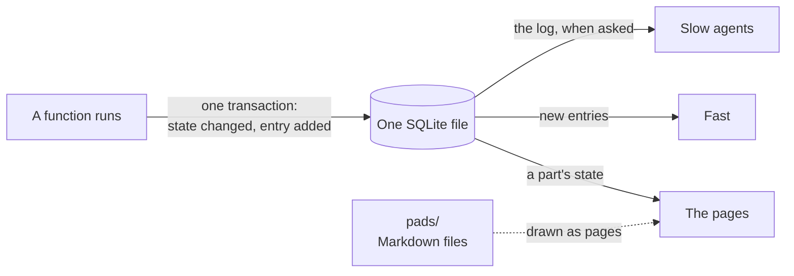

# The store

The store is where [the world model](../README.md) is kept: one SQLite file
for each project's session, in
[the session's folder](../../use/settings/README.md#where-a-session-is-kept).
It holds the state of the core and of every part, and the full log. A
function writes its state change and its entries in one transaction. This
page says what the store holds and how an older session is moved into it.

- It takes the place of `tasks.json`, `agents.json`, `world.jsonl` and the
  daily files of [the log](../../inside/technical-design/README.md#the-log).
- It keeps both the state as it is now and the full log of every event. No
  entry is dropped.
- How many tables it has is not part of the contract. The contract is one
  store and one way to write.
- [Scratch pads](../canvas/README.md) stay Markdown files: devpage
  draws them as pages and the agents edit them as files.
- A message stores the part marked when it was said. A task stores its
  hand-over and voice session. The current mark and open pad survive restart.
- Fast and the side panel read tasks and agents from
  [work](../work/README.md#state).
- [The eval of Fast](../../inside/technical-design/README.md#the-eval-of-fast) and
  [the cost](../../inside/technical-design/README.md#the-cost) read the store, where
  the live service records usage and the inputs to Fast.

## Moving a session into the store

Existing file-backed sessions import into SQLite automatically. The move runs when
the program starts and finds no completed import, including when a registry
already uses the database. It keeps every entry's number and every
id of a message, an update, a task and an agent, with each agent's
conversation in its harness. The old files are kept, renamed.

Sessions from the prototype can have two entries with the same number, one
from the session itself and one from an extension. The shared stream keeps the
session's own number used in the session log. An extension entry moved to a
new stream position carries its old number as `originalNumber`. Extension
entries keep their relative order.
