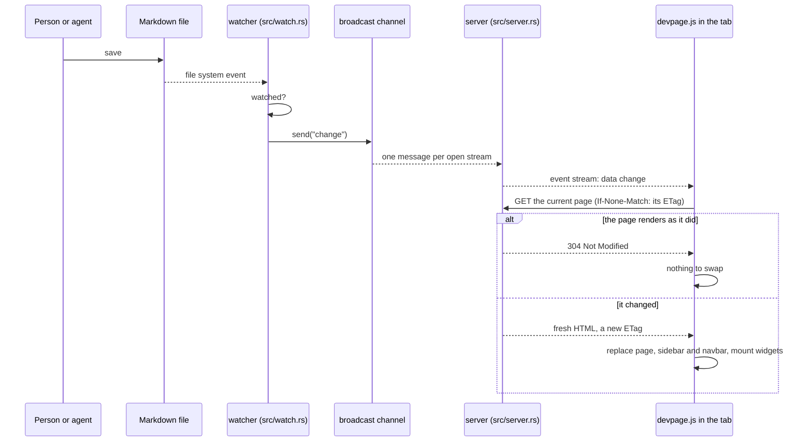
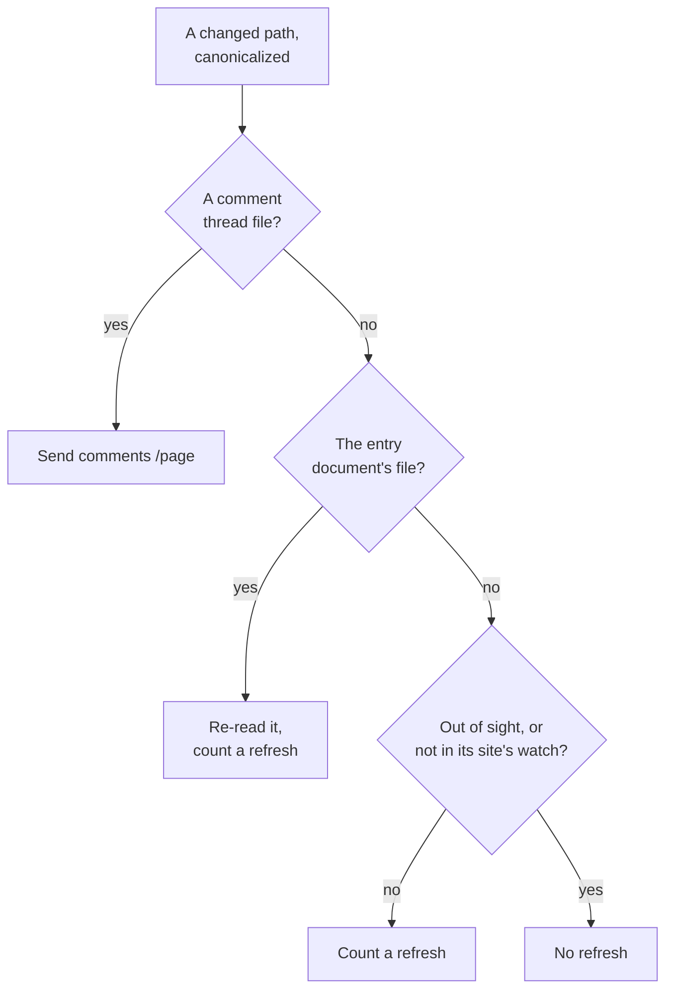

# Live updates

How a saved file reaches every open page: a file watcher over the served
folder skips what isn't watched, a broadcast channel fans each change out to one
server-sent event stream per open tab, and the page script fetches its page —
or, for a change in the comment store, the page's comments — again and swaps
it in place. It also covers why
there is one stream per tab; [the page script](../page-script/README.md) is
the browser's side. It is a
mechanism page under the [viewer](../README.md), for someone about to change
`src/watch.rs`, `src/server.rs` or `assets/devpage.js`.

## The watcher

When devpage starts, `watch::start` in `src/watch.rs` watches the whole
[served folder](../writing-a-document/README.md#the-served-folder), recursively,
with the platform's recommended `notify` watcher. It ignores accesses (a read,
not a change), and decides each changed path like this:

Before the decision, a path is canonicalized — falling back to the path as
reported, as for a deleted file — and skipped if it isn't inside the served
folder. A thread file in the comment store
(`.devpage/comments/<page>/<id>.yml`) sends `comments /<page>`; the comment
store is watched whatever a site's `watch` says, and never refreshes pages
itself; nothing else under `.devpage/` is looked at. Every other path is first
handed to the design store — see [Designs](#designs) — and to the widgets'
memory of the files they read, which forgets it so the next
[widget address](../widgets/how-widgets-run/README.md#compiling) reads it
again, and passed to the
[index](../document-index/README.md#the-index) (`Index::changed`), so a new,
edited or deleted document file or `.gitignore` is reflected at once. The
entry document's own file is re-read (`Entry::reload`) — so `/` and the
`watch` list follow the file — and refreshes whatever `watch` says.

### What is out of sight

A path doesn't refresh when the index finds it out of sight — inside a `.git`
or `.devpage` folder, or excluded by any `.gitignore` in the served folder,
nested ones included — or when the nearest site holding it has a `watch` list
that matches none of it (`refreshes` in `src/watch.rs`, then
`Document::watches`, patterns relative to that site's folder). A document file
always counts, and so does a widget or helper — a `.ts` or `.tsx` file
directly in the widgets folder of the entry document or of any indexed
document — and a path in no site with a `watch` list, whichever document
devpage was started with.

If any path counted, it sends one `change` message for the event. Nothing in
this needs a `.git` folder to exist.

A `change` message carries no file name: every open page refreshes, whichever
file changed. There is no debouncing, so one save can produce several events —
and several refreshes — depending on how the editor writes the file and how the
platform reports it. Creating a file and deleting a file both count as changes.
Document files are re-read as they change, so editing one needs no restart.
While the entry's file is invalid, the last valid version stays in use, and
`/` and the pages of a site whose file is invalid show why instead; when a
refreshed page comes back in a different frame — that problem page replaced
by the fixed site, or a document that changed kind — the page script loads it
whole rather than swapping its parts.

The watcher lives for the whole run.

## The channel and the stream

`src/main.rs` creates a `tokio::sync::broadcast` channel with room for 16
messages. A send with no open pages fails, and the watcher ignores the
failure.

`GET /__devpage/events` (`events` in `src/server.rs`) subscribes to the channel
and answers with a server-sent event stream. Every item from the subscription
becomes one event whose data is the message — `change`, or `comments` and
the page's path — including the error a subscriber
gets when it falls more than 16 messages behind, so a slow page still hears
that something changed. The stream sends a keep-alive every 15 seconds.

## Designs

A design on its canvas, or embedded in a page, is kept current by its own
gRPC-Web watch stream rather than by refetching: the watcher hands every
changed path outside `.devpage/` to the server's store of resolved designs —
whatever a site's `watch` list and `.gitignore` say, since any file may be part
of a design — and the store resolves again only the designs made from that
file and streams the nodes that changed
([Design engine](../design-engine/README.md#the-watch-stream)).

A design's file is also an ordinary watched file, so saving one refetches the
open pages like any other change — that is how a page embedding the design
gets its problems bar again. The refetch keeps the page's canvases
([The page script](../page-script/README.md#swapping-a-page-in-place)), so a
design is redrawn only by its stream, and only where its nodes changed. A site
whose `watch` list leaves out `.design` files and the images designs use still
has its canvases redrawn, but its problems bar waits for the next refetch.

## The page script

What the script in every open page does with a `change` or `comments`
message — and with links, the theme, the navbar and hidden tabs — is on
[The page script](../page-script/README.md).

## Why one stream per tab

The reason is stated in the header comment of `assets/devpage.js`: browsers
allow only six open connections per host over plain HTTP/1.1, and an open event
stream holds one of them for as long as it is open. So a tab keeps a single
stream however many pages it visits — links inside the document swap the page
in place instead of loading a new one — and a hidden tab gives its connection
back until it is shown.

## Failure modes

- **A file that isn't watched changes.** Nothing refreshes; the next request or
  link still shows the new content, since pages are read on every request.
- **devpage stops.** Open pages stop updating. The browser's `EventSource`
  reconnects on its own once devpage is back, but the page is not fetched again
  on reconnecting, so changes made in between show with the next change or
  navigation.
- **A burst of events.** Several events from one save each trigger a fetch;
  they are not coalesced. The first that finds the page changed swaps it in;
  the rest find the ETag it brought and swap nothing.
- **The watcher reports an error.** `notify` hands the callback in
  `src/watch.rs` either an event or an error, and an error is dropped
  silently (`let Ok(event) = event else { return };`) — nothing is logged and
  devpage keeps serving. A watch that has broken this way shows only as pages
  that stop refreshing while requests still work; restart devpage to start a
  new watcher. Only a watcher that can't be started at all is reported, when
  devpage starts (see the
  [configuration reference](../configuration-reference/README.md#errors)).

How comments reach a page is on [Comments](../comments/the-comment-store/README.md#the-requests).

## Topics

- [The page script](../page-script/README.md) — swapping pages in place,
  mounting widgets, the stream, links and history, the theme, the navbar and
  hidden tabs.
