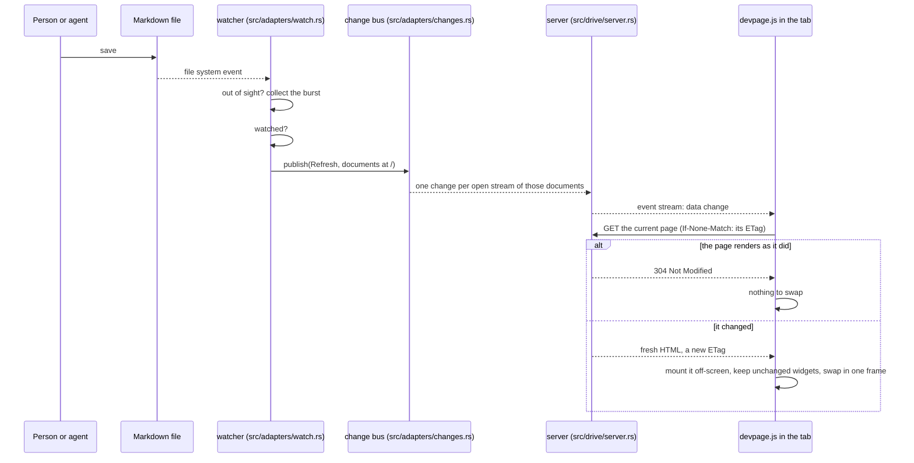
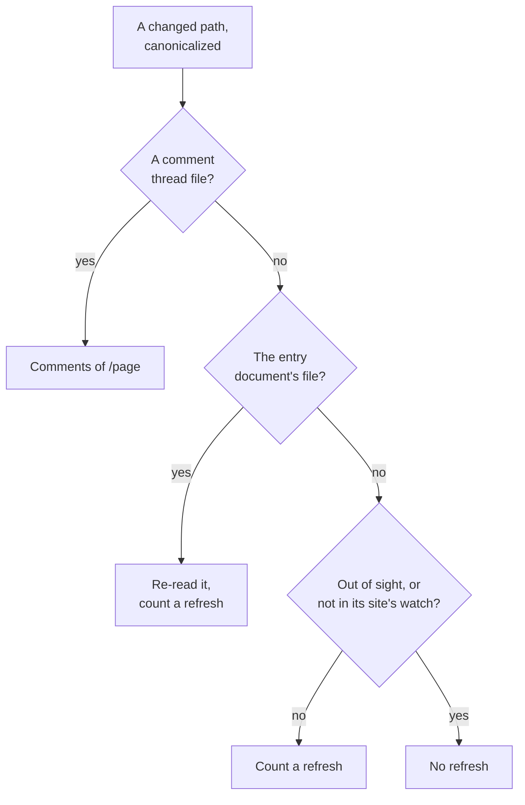

# Live updates

How a saved file reaches every open page: a file watcher over the served
folder skips what isn't watched, the change bus carries each typed change to
one server-sent event stream per open tab of the documents it concerns, and the page script fetches its page —
or, for a change in the comment store, the page's comments — again and swaps
it in place. It also covers why
there is one stream per tab; [the page script](../page-script/README.md) is
the browser's side. It is a
mechanism page under the [viewer](../README.md), for someone about to change
`src/adapters/watch.rs`, `src/adapters/changes.rs`, `src/drive/server.rs` or `core/assets/devpage.js`.

## The watcher

When devpage starts, `watch::start` in `src/adapters/watch.rs` plans the
[watch set](#the-watch-set) of the
[served folder](../writing-a-document/README.md#the-served-folder) — every
folder in sight, and nothing out of sight — and has the
[platform's watcher](#per-platform) watch it. Every event the platform
reports goes to one handler, whose work happens in two steps:

1. **Sifting, as each event arrives** (`Listeners::sift`). Accesses (a read,
   not a change) and errors are dropped, and so is every path that can't
   matter, judged from the path alone with no file system call: a path with a
   `.git` component, a path under `.devpage/` other than the comment store,
   and a path [out of sight](#what-is-out-of-sight) by a `.gitignore` — unless
   the `watch` list of the nearest site holding it names it. So a build
   rewriting `target/` costs one lookup per path in memory, and no listener
   hears of it. The `.gitignore` rules are the index's, so a changed
   `.gitignore` takes effect on the next event, without a restart. With the
   watch set, the platform reports almost nothing out of sight; sifting is
   the backstop for the rest — a folder that went out of sight before the
   next re-plan, and platforms that can't leave a subtree out.
2. **Handling, a burst at a time** (`Listeners::changed`, on a thread of its
   own). The paths that survive go to a thread that waits for one, collects
   whatever else arrives within 50 ms (`BURST`), and handles each path of the
   burst once, deciding it like this:

Before the decision, a path is canonicalized — falling back to the path as
reported, as for a deleted file — and skipped if it isn't inside the served
folder; only paths that survived sifting are. A thread file in the comment store
(`.devpage/comments/<page>/<id>.yml`) is a change to that page's comments —
unless the server wrote it: a write through the comment store announces that
page's comments as it lands, and the store remembers the bytes it wrote, so the
watcher announces a thread file only when its bytes differ from what open pages
last heard of, as after a hand edit. The comment store is watched whatever a
site's `watch` says, and never refreshes pages itself; nothing else under `.devpage/` is looked at. Every other path is first
handed to the design store — see [Designs](#designs) — and passed to the
[index](../document-index/README.md#the-index) (`Index::changed`), so a new,
edited or deleted document file or `.gitignore` is reflected at once, and its
module cache forgets the file so the next
[widget address](../widgets/how-widgets-run/README.md#compiling) reads it
again. The
entry document's own file is re-read (`Entry::reload`) — so `/` and the
`watch` list follow the file — and refreshes whatever `watch` says. Once the
burst is decided and its changes published, its paths go to the
[search index](../search/README.md#how-it-stays-current) (`Search::changed`),
which reads everything published again when one of them can change it.

### What is out of sight

A path doesn't refresh when the index finds it out of sight — inside a `.git`
or `.devpage` folder, or excluded by any `.gitignore` in the served folder,
nested ones included — or when the nearest site holding it has a `watch` list
that matches none of it (`refreshes` in `src/adapters/watch.rs`, then
`Document::watches`, patterns relative to that site's folder). A document file
always counts, and so does a widget or helper — a `.ts` or `.tsx` file
directly in the widgets folder of the entry document or of any indexed
document — and a path in no site with a `watch` list, whichever document
devpage was started with.

If any path counted, the burst is one refresh. Nothing in
this needs a `.git` folder to exist. A `.gitignore`d file a site's `watch`
names gets past sifting — so the index and the design store hear of it — but
still doesn't refresh.

A refresh carries no file name: every open page refreshes, whichever
file changed. The events of one save, or of many files saved together, that
arrive within 50 ms of the first are one burst and one refresh; a save
reported across a longer stretch can still refresh more than once. Creating a
file and deleting a file both count as changes.
Document files are re-read as they change, so editing one needs no restart.
While the entry's file is invalid, the last valid version stays in use, and
`/` and the pages of a site whose file is invalid show why instead; when a
refreshed page comes back in a different frame — that problem page replaced
by the fixed site, or a document that changed kind — the page script loads it
whole rather than swapping its parts.

The watcher lives for the whole run. Dropping it (`Watch`) stops the
platform's watcher and drops the event handler, which ends the burst thread.

### The watch set

**Nothing out of sight is watched.** Leaving a path out only after it is
reported is not enough: on macOS, fseventsd does the work of delivering
every event a watcher asks for, whatever devpage then drops. Measured on an
M-series Mac, 400k file writes under `target/` of the devpage repo cost
fseventsd 5.6 s of CPU with no devpage running, 9.6 s with one watching the
whole folder, and 42.8 s with eight — about 4.5 s more per devpage, for
events it threw away. So the watcher never asks for them.

`WatchSet::plan` (`src/adapters/watch/set.rs`) splits the served folder, by the
index's rules — [out of sight](#what-is-out-of-sight) is the same judgement
sifting makes — into:

- **deep folders** — the largest folders with nothing out of sight anywhere
  under them, watched recursively;
- **shallow folders** — folders in sight that hold something out of sight
  (the served folder itself, usually), watched for their entries and the
  files directly in them.

It walks only what is in sight: an out-of-sight folder is never read. Only
folders decide: an ignored file in a deep folder is still reported, and
sifted. Two kinds of out-of-sight folder are watched anyway, since what is
in them already gets past sifting:

- `.devpage` is shallow, and its comment store, `.devpage/comments`, is in
  sight; nothing else under `.devpage/` is watched.
- An ignored folder a site's `watch` list explicitly reaches into. Each
  pattern's literal prefix — its components before the first with a glob
  character — joined to its site's folder decides: an ignored folder is
  watched when the prefix is in it or is it, or when the prefix is an
  ignored folder holding it. So `watch: ["build/*.svg"]` keeps `docs/build/`
  and the folders under it watched, while `**/*.md` in `docs/devpage.yml`,
  whose prefix is `docs/` itself, reaches into no ignored folder: it can
  match `docs/build/out.md`, but nothing in `docs/build/` is watched, and
  nothing at all in `target/`. The prefixes are every site's — the entry's
  and every indexed site's.

**Re-planning.** After each burst, the burst thread plans the set again and
the platform applies only the difference — a folder no longer in the set
stops being watched, a new one starts — when the burst holds:

- a `.gitignore`, or a site's document file (its `watch` list), or the
  entry's file;
- a folder created in sight that the platform doesn't report on yet — on
  macOS, one in a shallow folder — or a removed one holding a watched
  folder;
- a watched folder deleted and made again, even within one burst: the
  platform judges what it reports on by the watches it holds, not by the
  last plan, and a deleted folder's watch is gone with it — so the folder
  made again counts as not reported on, is watched again, and what is
  already in it is handled as changed (`rm -rf docs/guides && git checkout
  docs/guides`). On macOS a deep folder's stream follows its path and goes
  on reporting;
- a folder created out of sight directly in a folder in sight: `cargo build`
  in a nested crate creates `crate/target/`, which makes the crate's deep
  folder shallow. This is judged from the path, as sifting is, before
  sifting drops it; the build's events until the re-plan are dropped by
  sifting.

What is already in a folder the platform didn't report on before — the
folder, the files directly in it, and for a deep folder everything under it,
sifted as events are — is then handled as changed, so what was written there
before its watch started is still heard of: a page's first comment thread is
written into a new folder of the comment store at once.

### Per platform

- **macOS** (`src/adapters/watch/macos.rs`): devpage's own watcher, not `notify`'s,
  since `notify` has one FSEvents stream for every path it watches and
  filters a non-recursive watch in its callback, after fseventsd has
  delivered the whole subtree. Each deep folder gets an FSEvents stream of
  its own, so adding or removing one restarts nothing else: file events,
  latency 50 ms (`BURST`), coalesced by fseventsd (no `NoDefer`), all on one
  dispatch queue. Each shallow folder gets a kqueue watch (`EVFILT_VNODE`)
  for its entries — added, removed, renamed, found by reading the folder
  again — and so does each file directly in it, for writes, deletes and
  renames; a symbolic link is watched itself, never what it points to. One
  thread waits on the kqueue. kqueue holds a descriptor per
  watched file and folder, so devpage raises its open-files limit to what
  the system allows (at most 10240) when it starts watching.
- **Linux** (`src/adapters/watch/inotify.rs`): `notify`'s inotify watcher,
  non-recursive on every folder in sight — the shallow folders and every
  folder of the deep ones. inotify watches a folder at a time anyway, so an
  ignored folder gets no inotify watch at all, and a folder created in sight
  is watched on the next re-plan. A folder an event says was removed or
  renamed is no longer counted watched, with every folder under it, so the
  next re-plan watches whatever has its name again.
- **Elsewhere** (`src/adapters/watch/recursive.rs`): `notify`'s recommended watcher,
  recursive on the whole served folder, as before the watch set: it reports
  everything, and sifting drops what is out of sight.

Every platform hands the same handler `notify` events, so sifting, bursts
and the listeners are the same everywhere.

## The bus and the stream

The change bus (`Changes` in `src/adapters/changes.rs`) carries typed changes: a
`Refresh`, or the `Comments` of the Markdown file at an address. Each is
published for a **scope** — the documents served under one mount prefix (`/`
for everything a local devpage serves), or every document, which is how the
external-link checker announces an answer any page may link to. `src/main.rs`
makes one bus and hands it to its producers — the watcher, the external-link
checker, and the server, whose comment writes each publish that page's
`Comments` as they land — and to its subscribers. Publishing with no one subscribed is not an
error.

The watcher decides a burst in two halves: `Listeners::forget` has every cache
forget what changed — the design store, the index with its widget modules, the
entry document — and returns the changes the burst means, publishing nothing;
`Listeners::changed` publishes them for the documents at `/`, then hands the
paths to the search index. The forgetting is the watcher's own, never traffic
on the bus.

`GET /__devpage/events` (`events` in `src/drive/server.rs`) subscribes to the
documents the server serves, at `/`, and answers with a server-sent event
stream. Every change it hears becomes one event whose data is its message —
`change`, or `comments` and the page's path. A subscriber that falls more than
64 changes behind hears a refresh, so a slow page still hears that something
changed. The stream sends a keep-alive every 15 seconds. The slide-PNG cache
subscribes the same way and forgets what it drew on any change it hears.

## Designs

A design on its canvas, or embedded in a page, is kept current by its own
gRPC-Web watch stream rather than by refetching: the watcher hands every
changed path outside `.devpage/` that survives
[sifting](#the-watcher) to the server's store of resolved designs — whatever a
site's `watch` list says, since any file may be part of a design — and the store resolves again only the designs made from that
file and streams the nodes that changed
([Design engine](../design-engine/README.md#the-watch-stream)).

A design's file is also an ordinary watched file, so saving one refetches the
open pages like any other change — that is how a page embedding the design
gets its problems bar again. The refetch keeps the page's canvases
([The page script](../page-script/README.md#swapping-a-page-in-place)), so a
design is redrawn only by its stream, and only where its nodes changed. A site
whose `watch` list leaves out `.design` files and the images designs use still
has its canvases redrawn, but its problems bar waits for the next refetch.

## The page script

What the script in every open page does with a `change` or `comments`
message — and with links, the theme, the navbar and hidden tabs — is on
[The page script](../page-script/README.md).

## Why one stream per tab

The reason is stated in the header comment of `core/assets/devpage.js`: browsers
allow only six open connections per host over plain HTTP/1.1, and an open event
stream holds one of them for as long as it is open. So a tab keeps a single
stream however many pages it visits — links inside the document swap the page
in place instead of loading a new one — and a hidden tab gives its connection
back until it is shown.

## Failure modes

- **A file that isn't watched changes.** Nothing refreshes; the next request or
  link still shows the new content, since pages are read on every request.
- **devpage stops.** Open pages stop updating. The browser's `EventSource`
  reconnects on its own once devpage is back, but the page is not fetched again
  on reconnecting, so changes made in between show with the next change or
  navigation.
- **A burst of events.** Events within 50 ms of the first are handled
  together, each path once, with at most one `change`; events spread over a
  longer stretch make one burst, and at most one `change`, every 50 ms. Each
  `change` makes an open page fetch itself — or, while it is loading, load
  once more after that; one that finds the page's ETag unchanged swaps
  nothing.
- **The watcher reports an error.** The platform's watcher hands the
  handler in `src/adapters/watch.rs` either an event or an error, and an error is dropped
  silently by `Listeners::sift` — nothing is logged and
  devpage keeps serving. A watch that has broken this way shows only as pages
  that stop refreshing while requests still work; restart devpage to start a
  new watcher. Only a watcher that can't be started at all is reported, when
  devpage starts (see the
  [configuration reference](../configuration-reference/README.md#errors)).

How comments reach a page is on [Comments](../comments/the-comment-store/README.md#the-requests).

## Topics

- [The page script](../page-script/README.md) — swapping pages in place,
  mounting widgets, the stream, links and history, the theme, the navbar and
  hidden tabs.
