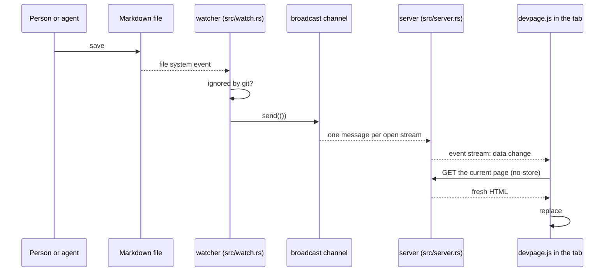

# Live updates

How a saved file reaches every open page: a file watcher over the repository
skips what git ignores, a broadcast channel fans each change out to one
server-sent event stream per open tab, and the page script fetches its page —
or, for a change in the comment store, the page's comments — again and swaps
it in place. It also covers why
the script keeps one stream per tab and closes it in hidden tabs. It is a
mechanism page under the [viewer](../README.md), for someone about to change
`src/watch.rs`, `src/server.rs` or `assets/devpage.js`.

## The watcher

When devpage starts it watches the whole
[repository](../writing-a-document/README.md#the-repository), recursively,
with the platform's recommended `notify` watcher. For each file system event it:

1. ignores the event if it is an access (a read, not a change);
2. makes each path relative to the repository, and drops paths inside `.git/`
   and paths git ignores — read from the repository's `.gitignore` files — so
   build output and dependencies never refresh a page;
3. for a path in the comment store (`.devpage/comments/`), sends a `comments`
   message naming the page the thread is about;
4. for any other path, updates the index of document files if the path is a
   YAML file, and sends a `change` message.

A `change` message carries no file name: every open page refreshes, whichever
file changed. There is no debouncing, so one save can produce several events —
and several refreshes — depending on how the editor writes the file and how the
platform reports it. Creating a file and deleting a file both count as changes.
Document files are re-read as they change, so editing one needs no restart.

The watcher lives for the whole run.

## The channel and the stream

`src/main.rs` creates a `tokio::sync::broadcast` channel with room for 16
messages. A send with no open pages fails, and the watcher ignores the
failure.

`GET /__devpage/events` (`events` in `src/server.rs`) subscribes to the channel
and answers with a server-sent event stream. Every item from the subscription
becomes one event whose data is the message — `change`, or `comments` and
the page's path — including the error a subscriber
gets when it falls more than 16 messages behind, so a slow page still hears
that something changed. The stream sends a keep-alive every 15 seconds.

## The page script

`assets/devpage.js` runs on every page. It does three things.

**Swapping a page in place.** `load(url)` fetches the URL with
`cache: "no-store"`. If the response isn't OK or isn't HTML it returns `false`;
otherwise it parses the HTML, replaces the children of `#page` and `#nav` with
the fresh ones, sets the document title and draws the new content's Mermaid
diagrams. The rest of the page — the scripts, the event stream, the scroll
position — stays as it was.

**The live-update stream.** `connect()` opens an `EventSource` on
`/__devpage/events`. Each `change` message calls `load(location.href)`, so the
page the tab shows is fetched again and swapped in; a `comments` message for a
file the tab shows fetches that file's threads again. A tab holds at most one stream.

**Links and history.** One click listener on the document handles every
link, in the text and in
[clickable diagrams](../diagrams-and-themes/README.md#clickable-diagrams), where
pele turns a Mermaid `click … href` line into an SVG `<a href>` inside the
node. The listener reads the link's `href` *attribute* and resolves it against
the page's address: an SVG link's `href` property is an object, not a URL
string, so the attribute is the one form both kinds of link share. A click is
handled in place when it is a plain left click — no Cmd, Ctrl or Shift, not
already handled — on a link to the same origin whose path ends in `.md`:

- a link to the page already shown only updates the `#fragment` — this is how
  a bare `#heading` link scrolls on the same page;
- otherwise the target is loaded with `load`, pushed onto the history with
  `history.pushState`, and the view scrolls to the fragment, or to the top;
- if `load` fails (an error status or a non-HTML response) the browser
  navigates to the link normally.

Back and forward (`popstate`) load the address they land on the same way.
Every other link — other sites, non-Markdown files, the document title's link to
`/` — is left to the browser and loads a whole new page.

**Hidden tabs.** When a tab is hidden it closes its stream; when it is shown
again it reopens the stream and loads its page once, to catch up on changes
made while it was hidden. A page being unloaded (`pagehide`) closes its stream
too. A tab opened in the background doesn't connect until it is shown.

## Why one stream per tab

The reason is stated in the header comment of `assets/devpage.js`: browsers
allow only six open connections per host over plain HTTP/1.1, and an open event
stream holds one of them for as long as it is open. So a tab keeps a single
stream however many pages it visits — links inside the document swap the page
in place instead of loading a new one — and a hidden tab gives its connection
back until it is shown.

## Failure modes

- **A file git ignores changes.** Nothing refreshes; the next request or
  link still shows the new content, since pages are read on every request.
- **devpage stops.** Open pages stop updating. The browser's `EventSource`
  reconnects on its own once devpage is back, but the page is not fetched again
  on reconnecting, so changes made in between show with the next change or
  navigation.
- **A burst of events.** Several events from one save each trigger a fetch;
  they are not coalesced.
- **The watcher reports an error.** `notify` hands the callback in
  `src/watch.rs` either an event or an error, and an error is dropped
  silently (`let Ok(event) = event else { return };`) — nothing is logged and
  devpage keeps serving. A watch that has broken this way shows only as pages
  that stop refreshing while requests still work; restart devpage to start a
  new watcher. Only a watcher that can't be started at all is reported, when
  devpage starts (see the
  [configuration reference](../configuration-reference/README.md#errors)).

How comments reach a page is on [Comments](../comments/README.md#under-the-hood).
