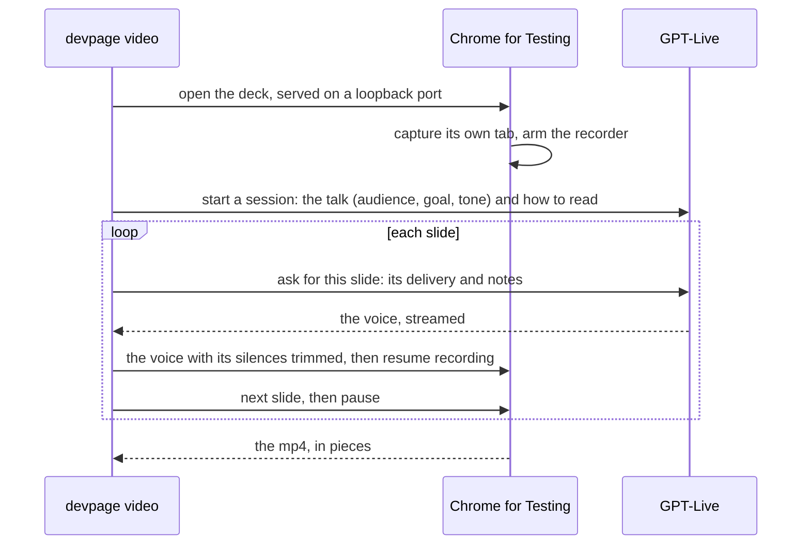

# How a video is recorded

How `devpage video` turns a deck into an mp4: how each slide is shown and
captured while the narrator speaks, how silence is cut, and the Chrome it
drives. It is a mechanism page under [Making a video](../README.md), for
someone about to change how a deck is recorded.

## How it is recorded

The page records itself. devpage serves the deck on a loopback port, as
[`devpage pdf`](../../pdf/how-a-pdf-is-printed/README.md#the-chrome-it-drives) does, opens it in its
own Chrome, and evaluates its recorder (`assets/video.js`) into the page: the
page captures its own tab at 1920 × 1080, plays the voice through one
continuous audio player, and records both into one `MediaRecorder`. Once
capture starts, Chrome adds a "sharing this tab" bar that shrinks the page, so
devpage grows the window back until the page measures 1920 × 1080 three times
in a row. Chrome's encoder sometimes fails to start, so the recorder is started,
checked and paused before any narration — up to five times — and the run stops
if it never comes up.

For each slide devpage asks GPT-Live for its notes, waits until the voice has
started and 2 seconds of it are buffered — the recorder is paused while it
waits, so the wait never shows — then resumes the recorder and plays it. The
voice streams in continuously, silence included, and there is no
end-of-speech event: a slide is done after 1.5 seconds without speech. Then
devpage presses → while still recording, waits the slide's lead, and only then
pauses, so the recording resumes on the new slide.

Those two waits — the voice buffered before a slide plays, and the quiet that
ends it — are the recording's **pacing**, a value the recorder is given
(`Pacing` in `src/drive/video.rs`). `devpage video` always records with the
default, 2 seconds and 1.5 seconds, which suits GPT-Live over a network; the
quiet must outlast any pause inside a slide's speech. The Chrome tests record
a stand-in voice from the same machine with a short pacing instead.

### Silence

The narrator pauses between sentences and waits between slides. What reaches
the video has **no silence longer than 1 second** (`MAX_SILENCE_SECONDS`):

- Inside a slide, a pause up to a second is kept as it is; a longer one is cut
  to a second.
- At a slide change the gap is split: the old slide keeps 0.6 seconds of it,
  and the new slide shows for 0.4 seconds (`SLIDE_LEAD_SECONDS`) before its
  voice starts. Silence before the next slide's voice is dropped.
- Every cut fades out and back in over 5 ms, so it can't click.

Speech is a 10 ms window whose loudest sample is over 500 (of 32768). These
are fixed; there is nothing to configure.

## The Chrome it drives

`devpage video` drives **Chrome for Testing**, not the chrome-headless-shell
everything else uses: the shell can't capture a tab. It is pinned to the
shell's version ([The Chrome it drives](../../pdf/how-a-pdf-is-printed/README.md#the-chrome-it-drives)
in Printing to PDF). devpage downloads it the
first time a video is made — about 370 MB once unpacked, into
`~/Library/Caches/devpage/chrome-for-testing` on macOS,
`%LOCALAPPDATA%\devpage\chrome-for-testing` on Windows,
`~/.cache/devpage/chrome-for-testing` elsewhere, beside the shell — and uses
that copy from then on, in headless mode — the **recording profile**, beside
the shot profile `devpage pdf` and a slide's PNG use. Each run starts its own Chrome, with
its own temporary profile folder and a debugging port Chrome picks, and kills it when
the run ends, however it ends — done, failed, Ctrl-C, `SIGTERM` or `SIGHUP`.
