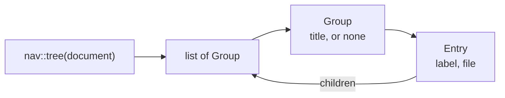
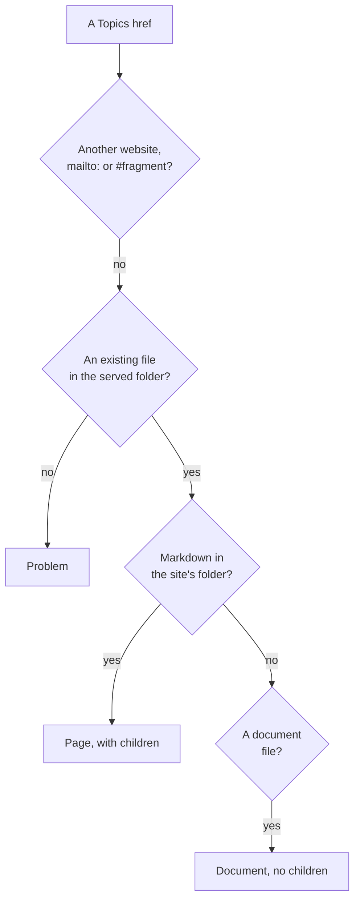

# Navigation tree

How `core/src/nav.rs` reads the sidebar tree out of the pages' `## Topics`
sections — finding the section, taking each item's first link, resolving it to
a file, grouping by `###` headings and placing each page once — and how
`core/src/render/sidebar.rs` turns the tree into the sidebar's HTML — collapsed, the
current page highlighted and its branch open — which the `DevpageSidebar`
widget takes over in the browser. It is a mechanism page under the
[viewer](../README.md), for someone about to change those files; how to use Topics is in
[Organizing navigation](../organizing-navigation/README.md).

## The data



- A **`Topic`** is one link found in a Topics section, before resolving: its
  group (the `###` heading above it, if any), its label and its `href`.
- An **`Entry`** is a resolved page in the tree: its label, its canonical file
  path and its own children.
- A **`Group`** is a run of entries under one `###` heading; `title` is `None`
  for entries listed before any group heading.

`nav::tree` returns the root page's children as groups; the root page itself is
not an entry — the sidebar's document-title link stands for it.

## Reading a Topics section

`nav::topics(source)` parses the page with comrak (default options) and walks
the **top-level** blocks of the document in order:

- A heading of level 1 or 2 ends any Topics section and resets the group; it
  starts one when it is level 2 and its text, trimmed, is exactly `Topics`.
- Inside Topics, a level-3 heading sets the current group to its trimmed
  text. Deeper headings are ignored.
- Inside Topics, each top-level list contributes its items in order. For each
  item, the **first link** found anywhere inside it — including in a nested
  list — gives the label (the link's text, with inline code included) and the
  `href`. Items without a link are skipped.

Lists that aren't top-level blocks — inside a block quote, say — are not read.
A page may have more than one `## Topics` heading; each is read.

## Resolving a link

`nav::resolve` turns an `href` into a `Target`:



Any other outcome is `None`. In detail:

1. An `href` with a scheme (another website, `mailto:`) or with no path
   (`#fragment`) is **`None`** — not an entry. What an `href` names is read
   the one way every link in devpage is: `html::Link::classify` in
   `core/src/html.rs`.
2. Otherwise any `#fragment` is cut off, the rest is joined to the **listing
   page's folder** and canonicalized. If that fails, or the file is outside
   the served folder or not a regular file, it is a **`Problem`**: `Topics
   entry <href> — no such file`.
3. A Markdown file inside the site's folder is a **`Page`**: an entry with its
   own children. A Markdown file outside the site's folder is a **`Problem`**:
   `Topics entry <href> — outside the site's folder`.
4. A document file (`document::kind_of`) is a **`Document`**: an entry that
   opens that document, with no children.
5. Anything else is `None`.

`None` and `Problem` targets are left out of the tree. A problem is reported
by [link checking](../checking-links/README.md): a missing file as the broken
link it is, a page outside the site's folder as the Topics problem above. The
`href` is used as written, without percent-decoding.

## Building the tree and stopping cycles

A page listed in several Topics sections is in the tree once, at its
**position**: its shallowest listing, and of those the first in reading
order. `homes` finds every page's position first, level by level
from the root page (breadth first, in list order), remembering for each file
the page listing it and the listing's index; the root page is its own
position, so a listing of it is never one.

Then `tree` calls `children` on the root. `children` reads the page from disk
(an unreadable page has no children), and for each resolved topic:

- skips the topic unless this listing is the file's position; a page entry
  gets its children built recursively, a document entry never has children;
- appends the entry to the last group if that group has the same title, or
  starts a new group.

So a link back up to an ancestor — or to the root — is left out, and the
walk ends. The tests `builds_the_tree_and_stops_at_cycles` and
`a_page_listed_twice_is_in_the_tree_only_at_its_shallowest_listing` cover this.

Grouping compares with the *last* group only, so the same `###` title appearing
twice, with another group between, gives two separate groups.

The tree is rebuilt for every page request, reading every page it reaches; no
result is kept between requests.

## Rendering the sidebar

The sidebar is the `DevpageSidebar` widget, devpage's own
([Widgets](../widgets/system-widgets/README.md#devpagesidebar)). The server
renders its first paint and the browser keeps it: `render::sidebar` writes the
markup the widget renders, and the tree beside it as JSON, so React takes the
sidebar over without changing a node.

**The markup.** Under the title link comes the
[search box](../search/README.md#the-search-box) — `render::SEARCH_BOX`, a
`<div class="search">` holding the empty field and the `/` that focuses it —
then the tree. `render::tree` renders the groups as nested `<ul>` lists:

- a group with a title becomes `<li class="group"><span>title</span></li>`
  before its entries;
- an entry with no children becomes `<li><a href="/path">label</a></li>`;
- an entry with children is a **branch**: `<li class="branch">`, carrying its
  address as `data-href`, holds a row — its link and a chevron button
  (`aria-expanded`, labelled with the entry's label) — then its children's
  list; the branch is `open` or not, and a closed branch's list is hidden;
- labels and group titles are HTML-escaped, and no text sits between the
  elements, since React renders none.

For a root page listing *Getting started* and, under a *Guide* group, a page
with children of its own, the sidebar on *Getting started* reads:

```html
<nav id="devpage-nav" data-sidebar="/docs/README.md">
  <a class="document-title" href="/docs/README.md">Docs</a>
  <div class="search"><input type="search" placeholder="Search" …><kbd>/</kbd></div>
  <ul>
    <li><a href="/docs/getting-started.md" class="current">Getting started</a></li>
    <li class="group"><span>Guide</span></li>
    <li class="branch" data-href="/docs/guide/README.md">
      <div class="entry"><a href="/docs/guide/README.md">Guide</a><button type="button" class="chevron" aria-expanded="false" aria-label="Guide"></button></div>
      <ul>
        <li><a href="/docs/guide/writing.md">Writing</a></li>
      </ul>
    </li>
  </ul>
</nav>
```

(laid out here for reading; the page carries it on one line). The `href` is
the file's address: `/` plus its path in the served folder; `data-sidebar` is
the document's own — its root page's. **Current-page highlighting** compares
an entry's address with the requested page's own path built the same way:
the page's entry gets `class="current"`. The document-title link above the tree (class `document-title`)
gets `current` when the page is the root page.

**Collapsed, the current branch open.** A branch is open when the page shown
is that entry or anywhere under it (`leads_to`), so the branch down to the
page is open, the page's own children included, and every other branch is
closed. Each page is in the tree once, so a branch's address names one
branch.

**The tree as JSON.** After the `</nav>`,
`<script type="application/json" id="devpage-sidebar">` holds what the widget
renders: the document's address, its document file's address
(`document_path`, which [search results](../search/README.md#the-endpoint) name
it by), the page shown, the title link (its label,
address and logo) when the sidebar has one, and the groups — each entry its
label, address and children. `<` is written `\u003c`, so no label can end the
script.

**What the reader opened.** The widget remembers which branches the reader
opened, per document, in `localStorage` under `devpage-sidebar:` and the
document's address. A small script after the JSON opens those branches before
the page paints — exactly as the widget's first render will — so a reload
shows them from the first frame, and React still takes over the same DOM.
Without storage, nothing is remembered and the sidebar works the same.

**Across page swaps.** The page script mounts the widget on the sidebar once
and keeps it: each page swapped in — a link, back and forward, a
[live update](../live-updates/README.md) — hands it that page's tree and
address in the swap's commit, so the highlight moves and the new page's branch
opens in the same frame as the content, while every branch the reader opened
stays open ([The page script](../page-script/README.md#the-sidebar)). An edit
to a Topics list reaches the open sidebar the same way.
