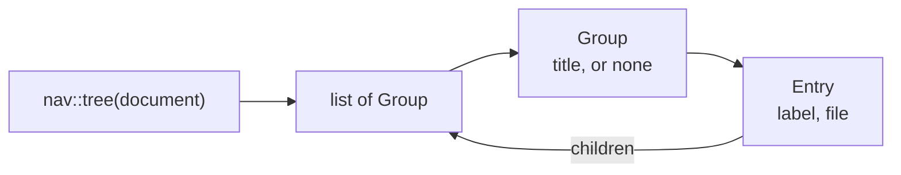

# Navigation tree

How `src/nav.rs` reads the sidebar tree out of the pages' `## Topics`
sections — finding the section, taking each item's first link, resolving it to
a file, grouping by `###` headings and stopping at pages already seen — and how
`src/render.rs` turns the tree into the sidebar's HTML with the current page
highlighted. It is a mechanism page under the [viewer](../README.md), for
someone about to change either file; how to use Topics is in
[Organizing navigation](../organizing-navigation/README.md).

## The data

- A **`Topic`** is one link found in a Topics section, before resolving: its
  group (the `###` heading above it, if any), its label and its `href`.
- An **`Entry`** is a resolved page in the tree: its label, its canonical file
  path and its own children.
- A **`Group`** is a run of entries under one `###` heading; `title` is `None`
  for entries listed before any group heading.

`nav::tree` returns the root page's children as groups; the root page itself is
not an entry — the sidebar's document-title link stands for it.

## Reading a Topics section

`nav::topics(source)` parses the page with comrak (default options) and walks
the **top-level** blocks of the document in order:

- A heading of level 1 or 2 ends any Topics section and resets the group; it
  starts one when it is level 2 and its text, trimmed, is exactly `Topics`.
- Inside Topics, a level-3 heading sets the current group to its trimmed
  text. Deeper headings are ignored.
- Inside Topics, each top-level list contributes its items in order. For each
  item, the **first link** found anywhere inside it — including in a nested
  list — gives the label (the link's text, with inline code included) and the
  `href`. Items without a link are skipped.

Lists that aren't top-level blocks — inside a block quote, say — are not read.
A page may have more than one `## Topics` heading; each is read.

## Resolving a link

`nav::resolve` turns an `href` into a `Target`:

1. An `href` containing `:` (another website, `mailto:`) or starting with `#`
   is **`None`** — not an entry.
2. Otherwise any `#fragment` is cut off, the rest is joined to the **listing
   page's folder** and canonicalized. If that fails, or the file is outside
   the served folder or not a regular file, it is a **`Problem`**: `Topics
   entry <href> — no such file`.
3. A Markdown file inside the site's folder is a **`Page`**: an entry with its
   own children. A Markdown file outside the site's folder is a **`Problem`**:
   `Topics entry <href> — outside the site's folder`.
4. A document file (`document::kind_of`) is a **`Document`**: an entry that
   opens that document, with no children.
5. Anything else is `None`.

`None` and `Problem` targets are left out of the tree. A problem is reported
by [link checking](../checking-links/README.md): a missing file as the broken
link it is, a page outside the site's folder as the Topics problem above. The
`href` is used as written, without percent-decoding.

## Building the tree and stopping cycles

`tree` starts with a set `seen` holding the root page, then calls `children`
on the root. `children` reads the page from disk (an unreadable page has no
children), and for each resolved topic:

- for a page, inserts the file into `seen`; if it was **not** there before,
  the entry's children are built recursively, otherwise the entry gets none;
  a document entry never has children;
- appends the entry to the last group if that group has the same title, or
  starts a new group.

`seen` is shared by the whole walk, which is depth-first in list order. So a
page appears wherever it is listed, but only its first appearance in that order
is expanded, and a link back up to an ancestor — or to the root — ends there.
This is the case the test `builds_the_tree_and_stops_at_cycles` covers.

Grouping compares with the *last* group only, so the same `###` title appearing
twice, with another group between, gives two separate groups.

The tree is rebuilt for every page request, reading every page it reaches; no
result is kept between requests.

## Rendering the sidebar

`render::navigation` renders the groups as nested `<ul>` lists:

- a group with a title becomes `<li class="group">title</li>`
  before its entries;
- each entry becomes `<li><a href="/path">label</a>`, followed by its
  children's list, if any;
- labels and group titles are HTML-escaped.

The `href` is the file's address: `/` plus its path in the served folder.
**Current-page highlighting** compares that with the requested page's own path
built the same way: every matching entry gets `class="current"` — more than one
when a page is listed twice. The document-title link above the tree (class
`document-title`) gets `current` when the page is the root page.

The sidebar is part of every page's HTML, inside `<nav id="devpage-nav">`, so a
[live update](../live-updates/README.md) or an in-place link swaps it together
with the content.
