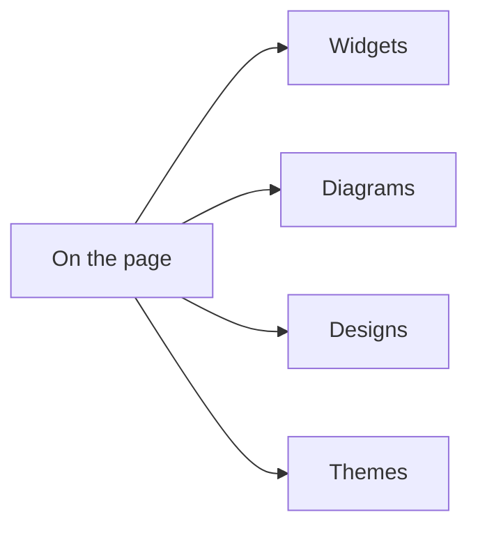

# On the page

What a page holds beyond Markdown and how it looks: React components used as
tags, Mermaid diagrams, UI designs drawn from code, and the light and dark
themes that color all of it. It is a part of the [viewer](../README.md);
Markdown itself is on [Markdown that works](../write/writing-a-
document/markdown-that-works/README.md).

## Topics

- [Widgets](widgets/README.md) — React components as tags in Markdown: using
  them, the system widgets, and writing a project's own.
- [Diagrams](diagrams/README.md) — Mermaid diagrams: writing them, making their
  nodes links, checking them, what errors look like, and how the server draws
  them.
- [Designs](designs/README.md) — writing a design as code, props and instances,
  prototypes, embedding one in a page, and its PNG.
- [Themes](themes/README.md) — the light and dark tokens that color the page,
  its code and its diagrams, the theme switch, and per-page CSS.
