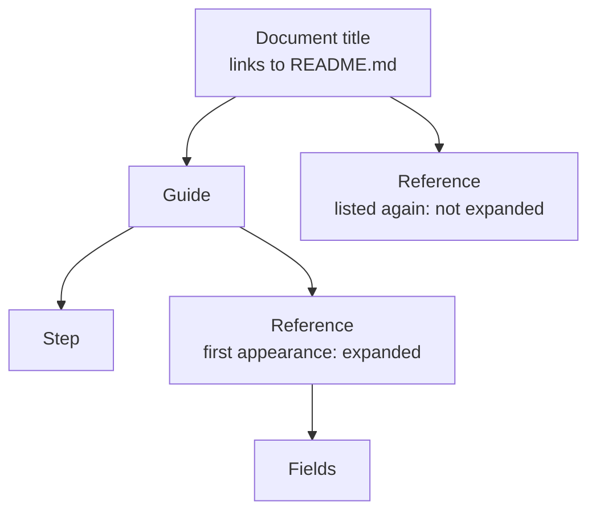

# Organizing navigation

How a document's sidebar is built from the `## Topics` sections of its pages —
children, groups, order, labels, repeated pages and pages left out — and how to
use that to give a document a reading order that goes from its landing page down to
reference. It is a task article under the [viewer](../README.md); the
[navigation tree](../navigation-tree/README.md) mechanism explains the
implementation.

## A Topics section

A page lists its children in a section headed exactly `## Topics`, normally at
its end:

```markdown
## Topics

### The system

- [Viewer](boxes/viewer/README.md) — serves a document.
- [Engineering](boxes/engineering/README.md) — how changes reach main.
```

The rules:

- **Children.** Each top-level list item's **first link** — searched through
  the whole item, nested lists included — is a child. Nested list items never
  become entries of their own. The rest of the item — usually a one-line
  abstract — is for the reader of the page and does not appear in the sidebar.
  An item with no link anywhere inside it is skipped.
- **Labels.** The sidebar labels a child with that link's text, not with the
  target page's heading.
- **Groups.** A `###` heading inside Topics starts a group; the sidebar shows
  its text as a small heading above the group's children. Links listed before
  any `###` heading are ungrouped.
- **Order.** Children appear in the order of the list. That order is the
  reading order.
- **End of the section.** Topics ends at the next `#` or `##` heading.
- **What counts.** Only links to Markdown files that exist inside the document
  count. Links to other sites, links that are only a `#fragment`, links to
  non-Markdown files and links to missing files are left out of the sidebar
  without an error.

Links anywhere else in a page — paragraphs, other sections, a "where next"
list — never change the sidebar. Use them freely to link across the tree.

## How the tree grows

The sidebar starts with the document title, which links to the root page. Under it
come the root page's Topics children; under each child, that page's own Topics
children, and so on down.

- **A page listed twice** appears in both places, but only its first
  appearance — reading the tree top to bottom, children before siblings — shows
  its own children. A link back up the tree, such as a child listing its
  parent, therefore can't loop.
- **A page that no Topics section lists** is still served when something links
  to it, but has no place in the sidebar.
- **The sidebar highlights** every entry for the page being shown — more than
  one when the page is listed twice — or the document title, on the root page.

For example, take three pages whose Topics sections list:

```text
README.md          → Guide (guide.md), Reference (reference.md)
guide.md           → Step (step.md), Reference (reference.md)
reference.md       → Fields (fields.md)
```

The tree is read depth first, in list order, so *Reference* is first met
under *Guide* — that appearance shows its children — and the root's own
listing of it, met later, is a leaf:



Both *Reference* entries link to the same page, and both are highlighted
while it is shown.

Because the tree is read from the files on every request, editing a Topics
list changes the sidebar of every open page as soon as the file is saved.

## Structuring a document's reading order

The Topics lists are the document's table of contents, so lay them out the way a
reader learns. This repository's documentation skill
(`.claude/skills/documentation/SKILL.md`) describes five layers, each answering
a different question:

| Layer | Question it answers | What it holds |
| --- | --- | --- |
| **1. Landing** | What is this, and where do I go? | A subject's README: what it is in a few paragraphs, one picture of its parts, Topics grouped by what the reader wants. |
| **2. Essentials** | How should I think about it? | One or two articles teaching the mental model with one example walked end to end. |
| **3. Concepts and tasks** | How do I work with it? | Articles around what a reader wants to understand or do, linking down into mechanisms. |
| **4. Mechanisms** | How does this part work inside, and why? | One page per mechanism: design, reasons, failure modes. |
| **5. Reference** | What exactly is the contract? | Schemas, APIs, configuration — complete and exact. |

In practice:

- Give each subject a landing page whose Topics groups its children under
  `###` headings by layer or by reader goal — for example `### Essentials`,
  `### Concepts and tasks`, `### Mechanisms`, `### Reference` — in reading
  order.
- Start every page with `# Title` and one abstract paragraph, and follow each
  Topics link with a one-line abstract, so a list of links reads as a summary.
- Link both ways: a page links up to its parent in its text, and down to the
  next useful detail in its Topics or its prose.
- When a page belongs in two places — an essentials article shared by the
  whole document, say — list it in both. It is expanded only where it first
  appears, so put its own children under the place a reader meets it first, or
  give it none.

The [viewer](../README.md) is laid out this way: its Topics run from
[Getting started](../../../getting-started.md) down to the
[configuration reference](../configuration-reference/README.md).
