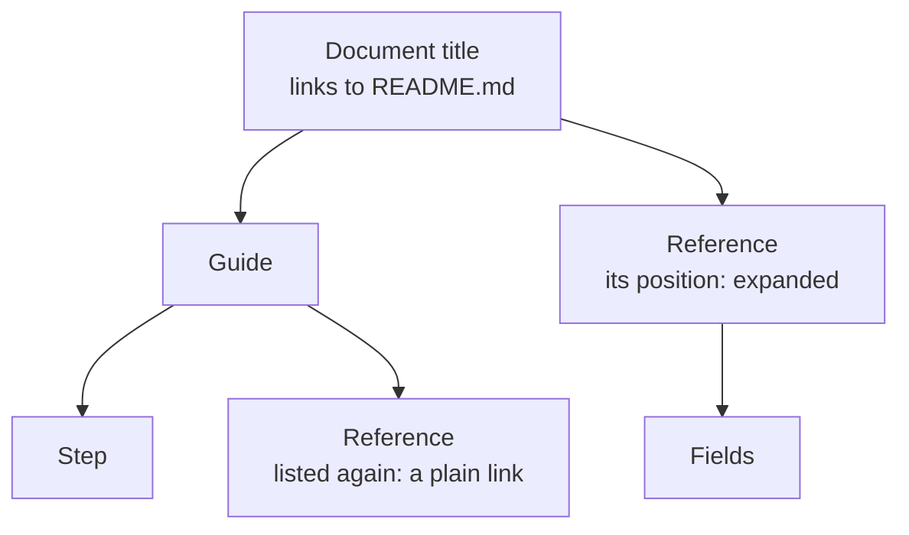

# Organizing navigation

How a site's sidebar is built from the `## Topics` sections of its pages —
children, groups, order, labels, repeated pages and pages left out — and how to
use that to give a site a reading order that goes from its landing page down to
reference. It is a task article under the [viewer](../README.md); the
[navigation tree](../navigation-tree/README.md) mechanism explains the
implementation.

## A Topics section

A page lists its children in a section headed exactly `## Topics`, normally at
its end:

```markdown
## Topics

### The system

- [Viewer](boxes/viewer/README.md) — serves a document.
- [Engineering](boxes/engineering/README.md) — how changes reach main.
```

The rules:

- **Children.** Each top-level list item's **first link** — searched through
  the whole item, nested lists included — is a child. Nested list items never
  become entries of their own. The rest of the item — usually a one-line
  abstract — is for the reader of the page and does not appear in the sidebar.
  An item with no link anywhere inside it is skipped.
- **Labels.** The sidebar labels a child with that link's text, not with the
  target page's heading.
- **Groups.** A `###` heading inside Topics starts a group; the sidebar shows
  its text as a small heading above the group's children. Links listed before
  any `###` heading are ungrouped.
- **Order.** Children appear in the order of the list. That order is the
  reading order.
- **End of the section.** Topics ends at the next `#` or `##` heading.
- **What counts.** A link to a Markdown file in the site's folder, or below it,
  is a child. A link to a document file — a doc, a deck, another site — is an
  entry that opens that document, with no children under it. Links to other
  websites, links that are only a `#fragment` and links to other files are not
  entries. A link to a missing file, or to a Markdown file outside the site's
  folder, is left out of the sidebar and reported as a
  [problem](../checking-links/README.md).

Links anywhere else in a page — paragraphs, other sections, a "where next"
list — never change the sidebar. Use them freely to link across the tree.

## How the tree grows

The sidebar starts with the site's title, which links to the root page, and a
[search box](../search/README.md#the-search-box) that finds any section of any
document as you type — `/` or ⌘K focuses it. Under them come the root page's
Topics children; under each child, that page's own Topics
children, and so on down.

- **A page listed twice** appears in both places, but has one position: its
  listing nearest the top of the tree, and of those the first. Only there does
  it show its own children, get highlighted, and open its branch; anywhere
  else it is a plain link. A link back up the tree, such as a child listing
  its parent, therefore can't loop.
- **A page that no Topics section lists** is still served when something links
  to it, but has no place in the sidebar.
- **The sidebar highlights** the page being shown at its position, or the
  document title, on the root page.

## Opening and closing

The sidebar starts collapsed: the top level of the tree shows, and the branch
down to the page shown is open — every entry above it, and the page's own
children. Every entry with children has a chevron beside it that opens or
closes it; its link still opens the page.

- **What you open is remembered** for that document, in the browser: a branch
  you opened is open again when you come back, from the first frame — even
  after a reload. Closing it forgets it. A browser that keeps nothing still
  opens and closes branches; it only forgets them.
- **Moving to another page** keeps the sidebar as it is — what is open, where
  it is scrolled — and only moves the highlight, opening the new page's branch.
- **Group headings** stay where they are in the tree, open or closed.

For example, take three pages whose Topics sections list:

```text
README.md          → Guide (guide.md), Reference (reference.md)
guide.md           → Step (step.md), Reference (reference.md)
reference.md       → Fields (fields.md)
```

*Reference* is listed by the root page and by *Guide*. The root's listing is
nearer the top, so it is the position — it shows the children — and the
listing under *Guide* is a plain link:



Both *Reference* entries link to the same page; while it is shown, only the
one at its position is highlighted, and *Guide* stays closed.

Because the tree is read from the files on every request, editing a Topics
list changes the sidebar of every open page as soon as the file is saved,
leaving open what was open.

## The navbar

A site can have a bar across the top, beside its sidebar or instead of it. Its
title sits on the left — after its logo, when the document file names one with
`logo` — and opens the root page; the `navbar` field of the document file lists
what sits on the right, in order:

```yaml
kind: site
title: devpage
root: README.md
navbar:
  Docs (book-open): README.md
  Getting started (rocket): getting-started.md
  Examples (layout-grid):
    Site — these docs (book-open): README.md
    Doc — feature catalog (file-text): features/devpage.yml
    Slides — the devpage talk (presentation): talks/devpage/devpage.yml
    Design — the checkout prototype (frame): designs/checkout/checkout.design
  (github): https://github.com/andrei512/devpage
```

- **`Label: target`** is a link. The target is a page, a document file — a doc,
  a deck, another site — a design, or an address on the web; paths are relative to the
  document file.
- **`Label:` with a nested map** is a dropdown of the links under it, one level
  deep.
- **`(icon)`** after a label adds that [Lucide](https://lucide.dev/icons/)
  icon, by name — `book-open`, `rocket`, `layout-grid`. Lucide carries no brand
  marks, so `github` is GitHub's own mark, added by devpage. On its own,
  `(github)` is a link shown as its icon only, with the target's site name as
  its tooltip ([the vendored icons](../vendored-icons/README.md)).
- The link to the page you are on, or to the section holding it, is
  highlighted: of the navbar's links, the one nearest the page in the sidebar
  tree, so a page under *Guide* lights *Guide*, and any other lights the link to
  the root page. A dropdown holding the link is highlighted too. On a narrow
  screen the links fold into a menu button.
- A dropdown opens on a click, or with ↓ from the keyboard, and closes on
  Escape, a click elsewhere, or a followed link. Links to pages of the site load
  in place, like links in the text.

A link to a missing page, an unknown icon name or a `logo` that names no file
is a [problem](../checking-links/README.md), like any broken link — reported once
for the document file, and `devpage check` follows the navbar's links like any
others. The navbar's title replaces the sidebar's: with a navbar, the sidebar
starts straight at the tree.

**The logo.** `logo: logo.svg` in the document file — an image relative to it,
usually a square SVG — shows at 22px before the title, in the navbar or, with
no navbar, at the head of the sidebar, and is the browser tab's icon on every
page of the site. A doc and a deck take a `logo` too: before a doc's title in
its outline, and as the tab's icon of both.

**Sidebar, navbar or both.** The sidebar shows unless the site sets
`sidebar: false`; the navbar shows when `navbar` is set. A site with neither
is just its pages, linked by their text.

## Structuring a site's reading order

The Topics lists are the site's table of contents, so lay them out the way a
reader learns. This repository's documentation skill
(`.claude/skills/documentation/SKILL.md`) describes five layers, each answering
a different question:

| Layer | Question it answers | What it holds |
| --- | --- | --- |
| **1. Landing** | What is this, and where do I go? | A subject's README: what it is in a few paragraphs, one picture of its parts, Topics grouped by what the reader wants. |
| **2. Essentials** | How should I think about it? | One or two articles teaching the mental model with one example walked end to end. |
| **3. Concepts and tasks** | How do I work with it? | Articles around what a reader wants to understand or do, linking down into mechanisms. |
| **4. Mechanisms** | How does this part work inside, and why? | One page per mechanism: design, reasons, failure modes. |
| **5. Reference** | What exactly is the contract? | Schemas, APIs, configuration — complete and exact. |

In practice:

- Give each subject a landing page whose Topics groups its children under
  `###` headings by layer or by reader goal — for example `### Essentials`,
  `### Concepts and tasks`, `### Mechanisms`, `### Reference` — in reading
  order.
- Start every page with `# Title` and one abstract paragraph, and follow each
  Topics link with a one-line abstract, so a list of links reads as a summary.
- Link both ways: a page links up to its parent in its text, and down to the
  next useful detail in its Topics or its prose.
- When a page belongs in two places — an essentials article shared by the
  whole document, say — list it in both. It is expanded only where it first
  appears, so put its own children under the place a reader meets it first, or
  give it none.

The [viewer](../README.md) is laid out this way: its Topics run from
[Getting started](../../../getting-started.md) down to the
[configuration reference](../configuration-reference/README.md).
