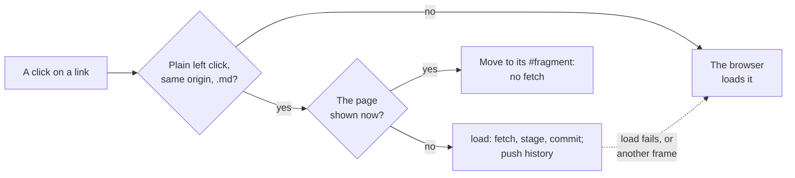

# The page script

What `assets/devpage.js` does in every open page: swapping a page in place,
mounting widgets, keeping a site's sidebar mounted, listening to the live-update stream, following links without
reloading, keeping the theme, driving the navbar, and letting hidden tabs go
quiet. It is a mechanism page under [Live updates](../live-updates/README.md),
for someone about to change the script.

## Swapping a page in place

Every swap — a live update, a tab shown again, a link, back and forward —
takes one path, `load(url, how)`: **fetch, stage, commit**.

**Fetch.** `load` fetches the URL with
`cache: "no-cache"`: the browser asks the server with the ETag it has, and a
page that hasn't changed comes back from the cache after a `304`
([Caching](../serving-pages/README.md#caching)). If the response isn't OK or
isn't HTML it returns `false`. If it is the page shown, at the same address
with the same ETag, nothing has changed: `load` returns without swapping or
mounting anything, and the page's DOM is untouched. The script knows the ETag
of the page it was loaded with by asking the browser's cache for it
(`cache: "only-if-cached"`) — never the server — and of every page it swaps in
from that page's response. Otherwise it parses the HTML and compares its
frame — the classes the server put on its `<body>`, less `show-comments`,
which the script itself adds while the comments are shown, and the devpage
build in its `data-build` — with the open page's. A different frame, as when
a document changed kind or devpage was redeployed with a new page script, is
loaded whole.

**Stage.** The same frame is swapped in. The script first copies into its
head the fresh page's preload links it lacks (`adoptPreloads`), so the modules
the fresh page needs download together before mounting asks for them, and
takes the fresh page's `window.devpageWidgets`, so widgets edited since are
fetched at their new addresses — those the content names, and those they
render by name, transitively, whose addresses moved while the widget naming
them kept its own (`loadWidget`). It puts the fresh content of `#devpage-page`
into a hidden copy of it in the same document — absolutely placed,
`visibility: hidden`, as wide as the page, so a widget that measures itself
gets real sizes — shows the slide the address names in it, and mounts the
widgets there, its Mermaid diagrams included. The page shown stays as it was
the whole time.

**Keep what hasn't changed** (`keepUnchanged`). Before mounting, each
outermost widget in the fresh content is matched against those mounted in the
page by its key: its placeholder's HTML as the server sent it, and the
address of every widget it can render — those it names, nested ones included,
and those they render by name. A widget's address changes exactly when its
compiled module would, so an equal key mounts the same thing: the old,
still-mounted element is kept in its place, with its state, and only the
others mount afresh. An edited widget has a new address, so it mounts afresh
even where its placeholder's HTML is the same. Each
[embedded design](../designs/README.md#viewing-a-design) outside a widget
whose canvas is still in the fresh page is kept too, with its drawing, so the
page's one watch stream stays open while the set of designs it shows is the
same. A design embedded inside a widget goes with the widget: kept with it, or
made again when React mounts the widget afresh, in which case the new canvas
takes over what the old one showed — the design it had navigated to and its
way back — and is drawn again from the stream
([Design engine](../design-engine/README.md#in-the-browser)).

**Commit**, in one task, so no frame shows a page half built: the kept
elements take their places, the fresh content replaces the children of
`#devpage-page`, the mounted [sidebar](#the-sidebar) is given the fresh
page's tree and address, the fresh children replace those of `#devpage-navbar`
— so the navbar's highlight follows the page — and of a doc's outline, a link's
address is pushed onto the history, the title is set, the slide is shown,
broken links are marked, and the scroll is put where it belongs: kept for a
live update, the reader's for back and forward, and the `#fragment` or the
top for a link. Then every React root no longer in the page is unmounted —
its effects and timers stop — the design script starts the designs the page
newly embeds and stops those gone, closing their streams, and the comments are
fetched again. The scripts and the event stream stay as they were.

**One at a time.** Each load has a generation and an `AbortController`: a
newer load makes an older one stale — its fetch is aborted, or its staged
content dropped and unmounted. Live updates that arrive while a load is in
flight don't start their own: they make one more load of the page shown after
it, however many arrive.

## Mounting widgets

On load and in every page staged, each Mermaid fence becomes
a `Diagram` placeholder, and every widget placeholder in the content is
mounted with React — the widgets it names loaded first
([Widgets](../widgets/how-widgets-run/README.md)). Each root is remembered by
the element it renders into, and each outermost one by its key, so a later
swap can keep it or unmount it. Once every widget has
mounted, the script draws the designs the content embeds — those inside
widgets exist only now — and the page marks itself ready. React and the
widgets' modules are imported together, not React first; on a page as served
they are already on their way, named by its head
([the load set](../rendering-a-page/README.md#the-load-set)). The design
script, `assets/design.js`, is loaded the first time a
page has a design, and from then on starts every canvas not yet drawn and
stops those gone.

## The sidebar

A site's sidebar is the `DevpageSidebar` widget
([Navigation tree](../navigation-tree/README.md#rendering-the-sidebar)). On
load, `mountSidebar` imports React and the widget — both named by the page's
head — and **hydrates** `#devpage-nav` with it (`hydrateRoot`), from the tree
the server put beside it as JSON (`#devpage-sidebar`). The server's markup is
what the widget renders, so React adopts the existing nodes and changes none:
nothing on screen moves when it takes over. The page marks itself ready once
the sidebar and the content's widgets have mounted.

The sidebar is mounted once and never unmounted while the tab shows the site.
A swap waits for it to have mounted, so it never replaces nodes React is
taking over; then, in the commit, it hands the widget the fresh page's tree
and address inside `flushSync`, so React renders it in that same task: the
highlight moves, and the new page's branch opens, in the frame that shows the
new content, never one before or after. Everything else the widget holds —
the branches open, the sidebar's scroll — stays. If the widget couldn't load,
the sidebar stays as the server drew it, and each swap replaces its children
as it does the navbar's.

## The live-update stream

`connect()` opens an `EventSource` on
`/__devpage/events`. Each `change` message loads the page the tab shows again
and swaps it in — unless it renders as it did, which a change to another page
usually leaves it — or, while a load is in flight, asks for one more after it;
a `comments` message for a file the tab shows fetches its threads again. A
tab holds at most one stream.

## Links and history

One click listener on the document handles every
link, in the text and in
[clickable diagrams](../diagrams/README.md#clickable-diagrams), where
pele turns a Mermaid `click … href` line into an SVG `<a href>` inside the
node. The listener reads the link's `href` *attribute* and resolves it against
the page's address: an SVG link's `href` property is an object, not a URL
string, so the attribute is the one form both kinds of link share. A click is
handled in place when it is a plain left click — no Cmd, Ctrl or Shift, not
already handled — on a link to the same origin whose path ends in `.md`:

- a link to the page already shown — the same path and query — only updates
  the `#fragment`, and fetches nothing — this is how a bare `#heading` link
  or a doc's outline scrolls on the same page; a link to the `#fragment`
  already shown scrolls to it again, since setting it would not;
- otherwise the target is loaded with `load`, which pushes it onto the
  history with `history.pushState` as it commits, and scrolls to the
  fragment, or to the top;
- if `load` fails (an error status or a non-HTML response) the browser
  navigates to the link normally.

The script keeps the scroll itself (`history.scrollRestoration = "manual"`):
before a link moves the reader on, and when the page is unloaded, it saves
`scrollY` in the current history entry's state. Back and forward
(`popstate`) to another path load it the same way and restore the scroll
saved in the entry; to the path shown, as when a deck's slide changes — a
slide's number is the `#fragment` — they only show the slide and restore the
scroll, with no fetch. A reload comes back to the scroll it left.
Every other link — other sites, non-Markdown files such as a doc's or deck's
document file — is left to the browser and loads a whole new page. A site's
title links to its root page, a Markdown file, so it swaps in place too.

## The theme

It keeps the theme the page's head chose current: a click on
the theme selector switches `data-theme` on `<html>` to the other theme, labels
the button with the next switch, and stores the theme in `localStorage`; until
the reader has switched, the page follows the system setting as it changes. A
blocked `localStorage` leaves the switch working for that page.

## The navbar

A click on a dropdown's button opens it; ↓ opens it and
focuses its first link, ↑ and ↓ move between links, and Escape, a click
elsewhere or a followed link closes it. On a narrow screen the menu button
shows and hides the links.

## Hidden tabs

When a tab is hidden it closes its stream; when it is shown
again it reopens the stream and loads its page once, as a live update does, to
catch up on changes made while it was hidden. A page being unloaded (`pagehide`) closes its stream
too. A tab opened in the background doesn't connect until it is shown.
