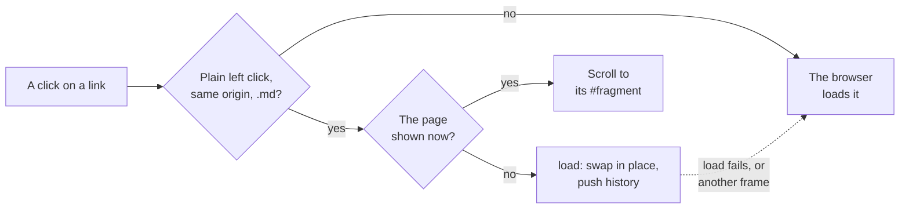

# The page script

What `assets/devpage.js` does in every open page: swapping a page in place,
mounting widgets, listening to the live-update stream, following links without
reloading, keeping the theme, driving the navbar, and letting hidden tabs go
quiet. It is a mechanism page under [Live updates](../live-updates/README.md),
for someone about to change the script.

## Swapping a page in place

`load(url)` fetches the URL with
`cache: "no-store"`. If the response isn't OK or isn't HTML it returns `false`;
otherwise it parses the HTML, replaces the children of `#devpage-page`, `#devpage-nav` and
`#devpage-navbar` with the fresh ones — so the navbar's highlight follows the page — sets the document title, takes the fresh page's
`window.devpageWidgets` — so widgets edited since are fetched at their new
versions — and mounts the new content's widgets, its Mermaid diagrams included.
The rest of the page — the scripts, the event stream, the scroll position —
stays as it was. A fresh page in a different frame (its `<body>` class differs,
as when a document changed kind) is loaded whole instead.

## Mounting widgets

On load and after every swap, each Mermaid fence becomes
a `Diagram` placeholder, and every widget placeholder in the content is
mounted with React — the widgets it names loaded first
([Widgets](../widgets/how-widgets-run/README.md)). The page marks itself ready
once every widget has mounted.

## The live-update stream

`connect()` opens an `EventSource` on
`/__devpage/events`. Each `change` message calls `load(location.href)`, so the
page the tab shows is fetched again and swapped in; a `comments` message for a
file the tab shows fetches that file's threads again. A tab holds at most one stream.

## Links and history

One click listener on the document handles every
link, in the text and in
[clickable diagrams](../diagrams/README.md#clickable-diagrams), where
pele turns a Mermaid `click … href` line into an SVG `<a href>` inside the
node. The listener reads the link's `href` *attribute* and resolves it against
the page's address: an SVG link's `href` property is an object, not a URL
string, so the attribute is the one form both kinds of link share. A click is
handled in place when it is a plain left click — no Cmd, Ctrl or Shift, not
already handled — on a link to the same origin whose path ends in `.md`:

- a link to the page already shown only updates the `#fragment` — this is how
  a bare `#heading` link scrolls on the same page;
- otherwise the target is loaded with `load`, pushed onto the history with
  `history.pushState`, and the view scrolls to the fragment, or to the top;
- if `load` fails (an error status or a non-HTML response) the browser
  navigates to the link normally.

Back and forward (`popstate`) load the address they land on the same way.
Every other link — other sites, non-Markdown files such as a doc's or deck's
document file — is left to the browser and loads a whole new page. A site's
title links to its root page, a Markdown file, so it swaps in place too.

## The theme

It keeps the theme the page's head chose current: a click on
the theme selector switches `data-theme` on `<html>` to the other theme, labels
the button with the next switch, and stores the theme in `localStorage`; until
the reader has switched, the page follows the system setting as it changes. A
blocked `localStorage` leaves the switch working for that page.

## The navbar

A click on a dropdown's button opens it; ↓ opens it and
focuses its first link, ↑ and ↓ move between links, and Escape, a click
elsewhere or a followed link closes it. On a narrow screen the menu button
shows and hides the links.

## Hidden tabs

When a tab is hidden it closes its stream; when it is shown
again it reopens the stream and loads its page once, to catch up on changes
made while it was hidden. A page being unloaded (`pagehide`) closes its stream
too. A tab opened in the background doesn't connect until it is shown.
