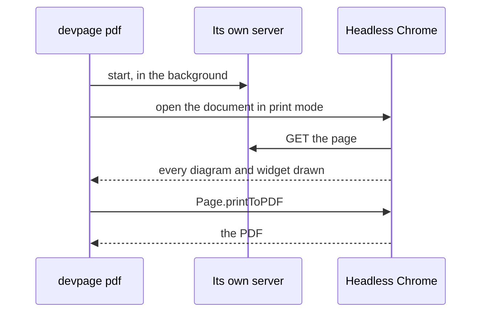

# Printing to PDF

How a doc or a deck becomes a PDF that looks exactly like the page in the
browser: the `devpage pdf` command, the Chrome it drives, and what print mode
leaves out. It is a task and mechanism article under the [viewer](../README.md).

## `devpage pdf`

<Terminal>

```
$ devpage pdf design/sync
Sync design.pdf
$ devpage pdf talks/launch -o launch.pdf
launch.pdf
```

</Terminal>

The first prints the doc in `design/sync/devpage.yml`, the second a deck to a
chosen file; `devpage pdf design.md` prints one Markdown file as a doc.

It takes the same argument as `devpage` and writes `<title>.pdf` in the current
folder unless `-o` names the file; characters a file name can't hold — `/`,
`:`, `?` and the like — become `-`. It prints the file's name when it is done. It prints a **doc** — on A4 or Letter, with
its header and footer ([Writing a doc](../writing-a-doc/README.md#on-paper)) —
or a **deck**, one slide per 16:9 page
([Making slides](../making-slides/README.md#on-paper)). A site is many pages,
not one, and `devpage pdf` refuses it; print one of its pages from the browser
instead.

The browser's own print — <Keys>⌘ P</Keys>, *Save as PDF* — produces the same pages from an
open doc or deck, since both print the same print-mode page. `devpage pdf` adds
the doc's header and footer and needs no clicking, which is what a script or an
agent wants.

## The Chrome it drives



devpage does not render PDF itself. It starts its own server in the
background, which logs nothing, opens the document in print mode in a headless Chrome, waits until
every diagram is drawn, and has Chrome print it — the same `Page.printToPDF`
call Playwright makes, spoken directly over the DevTools protocol by the
`chromiumoxide` crate, with no Node and no extra process.

Each run gives Chrome a profile folder of its own in the system's temporary
folder, so several prints can run at once, and deletes it when the run ends.

It uses the Chrome or Chromium installed on the machine. When it finds none, it
downloads a Chromium once, into devpage's cache folder, says so, and uses that
from then on.

## Why the PDF matches the screen

Print mode is the same page; it only leaves things out, and sets the page size
([A PDF is the page the browser shows](../constraints/a-pdf-is-the-page.md)):

| Kept on paper | Left out |
| --- | --- |
| the Markdown, the stylesheet | live updates |
| highlighted code | comments |
| diagrams and widgets (their first render) | navigation and the deck's controls |
| the doc's header and footer | soft shadows (PDF viewers draw them as grey boxes) |

A deck's slides are laid out at a fixed 1920 × 1080 and only scaled to the
window, so the printed page is the slide as it shows.
