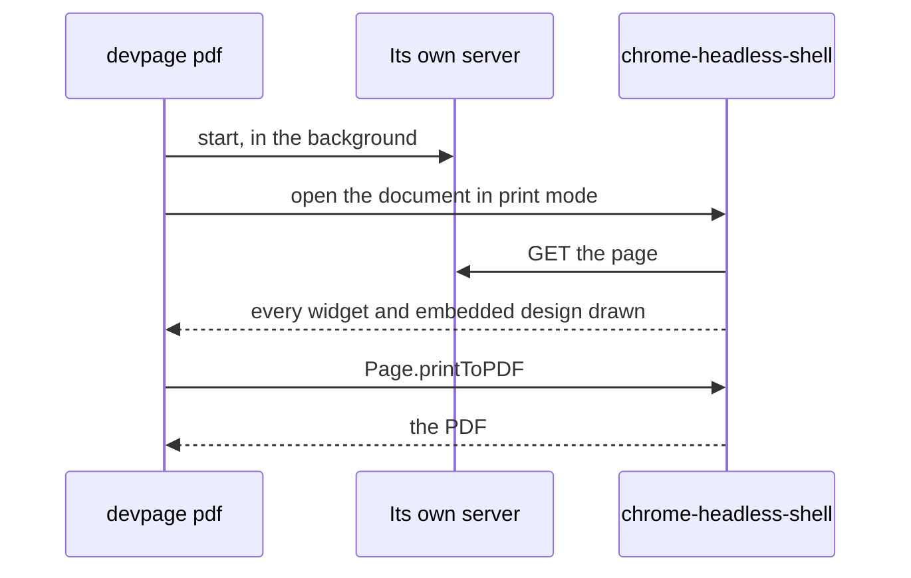

# Printing to PDF

How a doc or a deck becomes a PDF that looks exactly like the page in the
browser: the `devpage pdf` command, the Chrome it drives, and what print mode
leaves out. It is a task and mechanism article under the [viewer](../README.md).

## `devpage pdf`

<Terminal>

```
$ devpage pdf design/sync
Sync design.pdf
$ devpage pdf talks/launch -o launch.pdf
launch.pdf
```

</Terminal>

The first prints the doc in `design/sync/devpage.yml`, the second a deck to a
chosen file; `devpage pdf design.md` prints one Markdown file as a doc.

It takes the same argument as `devpage` and writes `<title>.pdf` in the current
folder unless `-o` names the file; characters a file name can't hold — `/`,
`:`, `?` and the like — become `-`. It prints the file's name when it is done. It prints a **doc** — on A4 or Letter, with
its header and footer ([Writing a doc](../writing-a-doc/README.md#on-paper)) —
or a **deck**, one slide per 16:9 page
([Making slides](../making-slides/README.md#on-paper)). A site is many pages,
not one, and `devpage pdf` refuses it; print one of its pages from the browser
instead. It refuses a design too; a page that embeds the design prints it, and
its [PNG](../designs/README.md#looking-at-a-design-as-a-png) is its picture.

The browser's own print — <Keys>⌘ P</Keys>, *Save as PDF* — produces the same pages from an
open doc or deck, since both print the same print-mode page. `devpage pdf` adds
the doc's header and footer and needs no clicking, which is what a script or an
agent wants.

## The Chrome it drives



devpage does not render PDF itself. It starts its own server in the
background, which logs nothing, opens the document in print mode in a headless Chrome — laid out
as paper from the start, with the print media type, so every slide of a deck
is shown and a design embedded on any of them is fitted where it will print —
waits until
every widget has mounted and every embedded design is painted (diagrams come
drawn in the page's HTML) — a design with
problems and nothing valid to draw counts as soon as its problems show, so it
doesn't hold the PDF up; `devpage check` is what reports it. It waits for at
most 20 seconds, after which it logs what the page still waited for and
prints whatever the page shows — and has Chrome print it — the same `Page.printToPDF`
call Playwright makes, spoken directly over the DevTools protocol by the
`chromiumoxide` crate, with no Node and no extra process.

Every request the page makes carries `X-Devpage-Shot: 1`, so a slide's PNG
it shows is never drawn by another Chrome inside the print — see
[A slide as an image](../making-slides/README.md#a-slide-as-an-image).

Each run starts its own Chrome in the **shot profile** — the one a
[slide's PNG](../making-slides/README.md#a-slide-as-an-image) is drawn in, with
the shell's GPU on — with a profile folder of its own in the system's
temporary folder, so several prints can run at once, and deletes it when the
run ends. The PDF comes back from Chrome as bytes; nothing is written but the
output file.

The Chrome is always **chrome-headless-shell**, never a Chrome installed on
the machine, and always one version, pinned in devpage — 156.0.8078.47,
`CHROME_VERSION` in `src/adapters/chrome.rs`. devpage downloads it the first time it
needs one — into `~/Library/Caches/devpage/chrome-headless-shell` on macOS,
`%LOCALAPPDATA%\devpage\chrome-headless-shell` on Windows,
`~/.cache/devpage/chrome-headless-shell` elsewhere, in a folder named for the
platform and version, such as `mac_arm-156.0.8078.47` — and uses that copy
from then on. Because the version is pinned, finding the copy makes no
network call; only a missing copy is downloaded, as that version's zip from
`https://storage.googleapis.com/chrome-for-testing-public/<version>/<platform>/`.
There are builds for macOS (Apple silicon and Intel), Linux on x86-64 and
Windows; on any other platform, such as Linux on Arm, `devpage pdf` stops
with `chrome-headless-shell <version> has no build for <os> on <arch>`.
It is a bare program with no app bundle, so nothing devpage launches
appears in the macOS Dock, and every machine prints with the same browser.
A [slide's PNG](../making-slides/README.md#a-slide-as-an-image) and the
Chrome tests drive the same copy. Only [`devpage video`](../making-a-video/README.md#the-chrome-it-drives)
drives another, Chrome for Testing, because the shell can't capture a tab.

## Why the PDF matches the screen

Print mode is the same page; it only leaves things out, and sets the page size
([A PDF is the page the browser shows](../constraints/a-pdf-is-the-page.md)):

| Kept on paper | Left out |
| --- | --- |
| the Markdown, the stylesheet | live updates |
| highlighted code | comments |
| diagrams, and widgets (their first render) | navigation and the deck's controls |
| the doc's header and footer | soft shadows (PDF viewers draw them as grey boxes) |

A deck's slides are laid out at a fixed 1920 × 1080 and only scaled to the
window, so the printed page is the slide as it shows.
