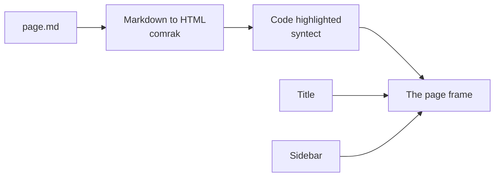

# Rendering a page

How a Markdown file becomes the HTML page a reader sees: comrak turns it into
HTML with highlighted code, the title and sidebar are worked out, and the
pieces go into the page frame. It is a mechanism page under the
[viewer](../README.md), beside [Serving pages](../serving-pages/README.md),
for someone about to change `src/render.rs` or `src/highlight.rs`.



A file ending in `.md` is read as text and passed to `render::page`, which
does the four steps below.

## Markdown to HTML

`render::markdown` runs comrak with these options
(`options()` in `src/render.rs`):

| Option | Effect |
| --- | --- |
| `extension.table` | GFM tables |
| `extension.strikethrough` | `~~text~~` |
| `extension.autolink` | bare URLs become links |
| `extension.tasklist` | `- [ ]` / `- [x]` items |
| `extension.footnotes` | `[^1]` footnotes |
| `extension.header_id_prefix = ""` | every heading gets an id from its text, with no prefix |
| `render.unsafe` | raw HTML passes through |
| `render.github_pre_lang` | a fence's language is passed as a `lang` attribute — which the highlighter below then drops for every block except `mermaid` |

Last, every Markdown table is wrapped in `<div class="table-scroll">`, so a
table wider than the page scrolls inside its own box instead of widening
the page.

An image of a `.design` file — ``, or a raw
`` however its attributes are quoted, spaced or
capitalised — becomes the design's embed (`embed_designs`): a
`<canvas class="design">` keeping the link in `src` and the image's text as
its label, which the page script has the
[design engine](../design-engine/README.md#in-the-browser) draw. Any other
image is left as it is.

## Highlighted code

`render::markdown` also plugs in a code-fence highlighter,
`highlight::Highlighter` in `src/highlight.rs`, through comrak's `Plugins`
(`SyntaxHighlighterAdapter`). For each fenced block it:

- takes the first word of the info string as the language and looks it up
  with syntect's `find_syntax_by_token` (name or file extension) in
  `two_face::syntax::extra_newlines()` — the syntax set `bat` ships, loaded
  once on first use through a `LazyLock`;
- if found, and the language isn't `mermaid`, emits syntect's class-based
  HTML (`ClassStyle::SpacedPrefixed { prefix: "hl-" }`): nested spans such
  as `<span class="hl-keyword hl-operator hl-arithmetic hl-rust">`, colored by the
  `--syntax-*` tokens in `assets/style.css` (see
  [Themes](../themes/README.md#the-tokens));
- otherwise — no language, an unknown one, `mermaid`, or a highlighting
  error partway through — writes the code HTML-escaped and unhighlighted;
- writes a bare `<pre>` and `<code>` with no language attributes, except
  `<pre lang="mermaid">` for Mermaid blocks, which is how the page script
  finds the diagrams to draw.

## The title and the sidebar

**Title.** `render::title` takes the first line starting with `# `, or the
file name without its extension.

**Sidebar.** The [navigation tree](../navigation-tree/README.md) is built
from the root page and rendered to nested lists, with the current page
marked.

## The page frame

The pieces go into one HTML page. A site's page, with a navbar and a sidebar,
has this shape:

```html
<html data-theme="light">
  <head>  <!-- icon, theme script, stylesheet, devpage.js, import map, load set -->
  <body class="site with-navbar" data-build="…">
    <header id="devpage-navbar">  <!-- logo, title, links, switches -->
    <nav id="devpage-nav">        <!-- the sidebar tree -->
    <main id="devpage-page">
      <article>                   <!-- the rendered Markdown -->
```

In detail:

- `<title>` is `<page title> · <document title>`;
- first in `<head>`, the document's logo as `<link rel="icon">` when it has
  one, then a small script that sets `data-theme` on `<html>` — the
  reader's stored choice, or the system's — before anything paints
  ([choosing a theme](../themes/README.md#choosing-a-theme));
- `<body>`'s class names the frame: `site`, plus `with-navbar` and
  `no-sidebar` as the document file says; its `data-build` is devpage's
  build id, so the page script loads a page from a new build whole
  ([The page script](../page-script/README.md#swapping-a-page-in-place));
- `<header id="devpage-navbar">`, when the site has a navbar: its logo and
  title, its links and dropdowns with their icons drawn as inline SVG, then
  the comment-mode switch (unless comments are off) and the theme selector ([the navbar](../organizing-navigation/README.md#the-navbar));
- `<nav id="devpage-nav">`, unless `sidebar: false`, holds the tree — after a link
  to the site's root page with its logo and title when there is no navbar
  to hold it;
- with no navbar, the comment-mode switch (unless comments are off) and the
  theme selector (unless `theme-selector: false`) in
  `<div id="devpage-corner">`, top right;
- `<main id="devpage-page"><article>` holds the rendered Markdown;
- in `<head>`, the stylesheet and the page script, `devpage.js` — `defer`, so
  it is fetched with everything else the head names and runs once the page is
  parsed, and `fetchpriority="high"`, so the modules don't queue ahead of
  it — from their
  [content addresses](../serving-pages/README.md#built-in-assets) under
  `/__devpage/`; with comments off `devpage.js` carries `data-no-comments`,
  and the script shows no threads and offers no comment
  ([Turning comments off](../comments/README.md#turning-comments-off));
- then an import map naming React (`react`, `react/jsx-runtime`,
  `react-dom/client` → React's content address,
  `/__devpage/react.<hash>.js`) and pele (`pele` → `/__devpage/pele.<hash>.js`),
  `window.devpageWidgets`, the document's widgets with the address of each
  ([Widgets](../widgets/how-widgets-run/README.md)), and the page's
  [load set](#the-load-set).

### The load set

Everything the page will load from devpage beyond its stylesheet and page
script is named in its head, so the browser asks for all of it as soon as it
reads the head — one round trip after the HTML, not one per import a script
finds. `Widgets::head` in `src/widgets.rs` works it out from the rendered
content:

- each widget the content names (`data-widget`), and `Diagram` when it has a
  `<pre lang="mermaid">`;
- the widgets each of those renders by name — its compiled module's
  `__devpageUses` — and theirs, in turn;
- every helper a project widget's relative imports reach;
- React, when there is any widget; pele, with a `Diagram`;
- the design script and the engine's bindings (`design.js`,
  `design-engine.js`), when the content embeds a design.

Each is a `<link rel="modulepreload">` at exactly the address its import asks
for — both come from `address` in `src/addresses.rs` — so nothing is
downloaded twice. The engine's wasm, which is fetched rather than imported, is
a `<link rel="preload" as="fetch" crossorigin fetchpriority="low">`. A page
with none of these — plain Markdown — preloads nothing and never loads React
or pele.

Every id the frame uses starts with `devpage-` — `devpage-page`,
`devpage-nav`, `devpage-navbar`, `devpage-corner`, `devpage-comments` and
`devpage-comments-toggle` — and a heading whose text would give it one of
them gets `-heading` added to its id. So a page can have a heading called
*Comments*, *Page* or *Navigation* and it stays an ordinary heading, never
styled or replaced as part of the frame.

`devpage-navbar`, `devpage-nav` and `devpage-page` are what
[live updates](../live-updates/README.md) replace in place. A doc's and a
deck's frames carry the same head — the logo's icon link and the theme script —
and the theme corner. Titles and sidebar labels are HTML-escaped; the page body
is not, since raw HTML is allowed.

Beyond the index, nothing is cached between requests: each page request
re-reads the page, its site's document file and, to build the sidebar, every
page the tree reaches. The browser keeps the page, but asks again each time:
it is served `no-cache` with an ETag, the hash of its HTML, and answered
`304` when it hasn't changed ([Caching](../serving-pages/README.md#caching)).
