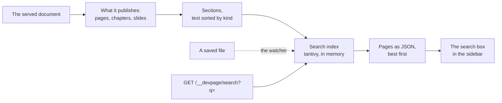

# Search

How the viewer finds text: `core/src/search/` keeps a full-text index of the
sections of everything the served document publishes in memory, ranks a
query's matches with BM25, groups them by page and answers
`GET /__devpage/search?q=…` with them as JSON, which the search box at the
top of a site's sidebar shows as the reader types. It is a mechanism page
under the [viewer](../README.md), for someone about to change what is
searched, how it ranks, what the endpoint answers or how the search box
behaves.



## What is searched

What the served document — the one devpage was started with — publishes,
and nothing else: fixtures, plans and orphaned files are still served, but
never searched. Starting from its document file:

- a **site** publishes every page its nav reaches — its root page, every page
  in its [navigation tree](../navigation-tree/README.md), and every Markdown
  file in its folder its [navbar](../organizing-navigation/README.md#the-navbar)
  links to — and every document either of them links to, in turn;
- a **doc** publishes its chapters, and a **deck** its slides.

Only what is [in sight](../live-updates/README.md#what-is-out-of-sight) is
searched, and a document file that can't be loaded publishes nothing until it
is fixed. A design has no text to search.

**One file, one address.** A file that is both a site's page and a doc's
chapter or a deck's slide is searched once, as the chapter or slide — at the
address of the document that owns it.

**Front matter** decides for one page: `search: false` leaves out a page that
is reached, `search: true` puts in one that isn't — as a page of its nearest
site, or on its own when no site holds it
([front matter](../configuration-reference/README.md#front-matter)).

Each page searched is one of three kinds, at its own address:

| Kind | What it is | Its address | A section's address |
| --- | --- | --- | --- |
| `page` | a site's page, split at its headings | the page: `/docs/guide.md` | with the heading's id: `/docs/guide.md#the-sidebar` |
| `chapter` | a doc's chapter, split at its headings | the doc's document file, with the chapter's name when there is more than one: `/plan/plan.yml#how` | with the id the doc page gives the heading: `/plan/plan.yml#how--context` |
| `slide` | a deck's slide, whole, as one section | the deck with the slide's number: `/talk/talk.yml#2` | the same |

## What is indexed

A page is read as its page shows it: its content rendered — the content
phase of [rendering a page](../rendering-a-page/README.md), the tags of
its document's [widgets](../widgets/README.md) expanded — with the widgets
of the document that shows it: its site, its doc or deck, or, in no site,
the page alone. So a heading inside a widget, `<Steps>` around `## Install`,
is a section, and a heading inside a tag that is no widget is not: the page
shows only the tag's error in its place.

A **section** is the text from one heading to the next, of any level; the
text before a page's first heading is one too, when there is any. A heading's
id is the one the rendered page gives it — comrak's, with `-heading` added
when it would be one of the [frame's ids](../rendering-a-page/README.md) — so
a section's address lands on its heading, and is an id
[`devpage check`](../checking-links/README.md) lets a link land on. A slide's section is all of its
text, headed by the slide's title: its first `# ` heading, else its first
`title="…"` — a `<Slide>`'s or a `<Hero>`'s — else `Slide <n>`.

A section's text is sorted by kind, each kind a field of its own:

| Field | What it holds | Tokenized | Weight |
| --- | --- | --- | --- |
| `title` | the page's title: its first `# ` heading, or its file name | `en_stem` | ×4, by how rare the word is among pages' titles |
| `heading` | the section's heading; empty before the first | `en_stem` | ×2 |
| `prose` | paragraphs, lists and tables; a Mermaid diagram's labels, never its source; an HTML block's text and its tags' text attributes, never its markup; inline code | `en_stem` | ×1 |
| `code` | fenced and inline code | `code` | ×0.5 |
| `notes` | a slide's `<Notes>` | `en_stem` | ×0.5 |
| `meta` | the front matter's `description` and `keywords` | `en_stem` | ×3, by how rare the word is among pages' |
| `title_exact`, `heading_exact` | the title and the heading whole, as one term — stemmed, and as typed — without stopwords | `raw` | for whole-title matches |

Blocks are joined with spaces, so no two run together. Inline HTML is left
out, and so is a `<Notes>` block on any page — a deck adds its slides' notes
itself. Of a diagram, only what its nodes, edges and messages say is text: no
ids, arrows, styles or `click` lines. Of an HTML block, what is between its
tags and its attributes' quoted values are, except those that aren't text
(`href`, `src`, `class`, `id`, `style`, `icon`, `logo`, `kind`, `delivery` and
the like) and addresses; `{…}` expressions never are. A widget's content is
the page's own Markdown, read like the rest of it; of its tag, its string
props are text, by the same rule — `title="Heads up"` is, `icon="rocket"` and
`values={["rocket"]}` are not. An unknown tag's error is no text.

`en_stem` is tantivy's default tokenizer, lowercased, with English stemming.
`title`, `heading` and `prose` each also have an unstemmed twin
(`title_words`, `heading_words`, `prose_words`, tantivy's `default`), which
only near and prefix matches look in. The `code` tokenizer keeps each
identifier whole, lowercased, and adds its parts, split at `_`, `::` and a
change to upper case: `Search::changed` is `search::changed`, `search` and
`changed`; `tweakScore` is `tweakscore`, `tweak` and `score`. Nothing in code
is stemmed.

Each section also stores its **path** — the page's title and the headings
above it, down to its own — and three numbers tantivy keeps as fast fields:
its heading's **depth** (0 before the first heading), its **order** on the
page, and the page's **place in the nav**, counted from the top in reading
order: the root, the tree's pages as listed, the navbar's, each document's
chapters or slides where it is reached.
The index keeps its sections sorted in that reading order — by the page's
place in the nav, then the section's order on it — however they came to be
indexed, so sections that score alike always rank as they read.

Beside the sections, one **page record** per page holds what a page result
shows: its title, address, kind, trail, document and **lede** — its first
paragraph. The **trail** is the labels from the top of a site's navigation
tree down to the page, the page's own label last — empty for the root page
and for a page the tree doesn't list; a page is in the tree once, so it has
one trail. In a doc of more than one chapter it is the chapter's title; a
deck's slides have none.

## The query

A query is split into words as the index splits text, after picking out:

- `"quoted words"` — a phrase: its words must match in a row;
- `-word` — a word no section found may hold, in any field;
- a **code identifier** — a word with `_`, `::` or a lower-case letter
  followed by an upper-case one — which also matches the `code` field whole.

Every word must match the section, in any field, but **stopwords** — `the`,
`a`, `of`, `how` and the like — which only add to its score; a query of
stopwords only needs them. A word matches:

- **exactly**, once stemmed — or, in `code`, as typed;
- **near it**, only when the index holds the word nowhere and it has four
  letters or more: one edit away in an unstemmed field, two from eight
  letters, a swap of neighbouring letters counting as one (tantivy's
  `FuzzyTermQuery`) — a constant score, half the field's weight;
- for the **last word** only, unless a space follows it, as the start of a
  word in an unstemmed field, so results come while it is typed — the same
  constant score.

When no section holds every word, any word will do, and a section scores times
the square of the share of the words it holds.

## Ranking

Text match first; structure only breaks near-ties:

- **A word scores in its best field** — a dis-max across the fields, plus a
  tenth of what it scores in the others — so one word doesn't score three
  times over. A word in a page's title or front matter is on every section of
  the page, so it scores by how rare it is among pages (BM25's idf over page
  records), not by BM25 over sections.
- **Words in a row** add: in a heading ×2, in prose ×1.5 (tantivy's
  `PhraseQuery`), and half that within three words of each other.
- **A code identifier** found whole adds 3.
- **The query as a whole heading** adds 3, **as a whole title** 8, and **as
  the start of a heading**, its last word being typed, 1.5 — the best of
  them, once.
- Then **structure**: a section's score is multiplied by
  `1 + 0.06/depth + 0.04/(1 + order) + 0.04/(1 + nav/8)` — a little for a
  shallower heading, a place earlier on the page, a page earlier in the nav.

The best 200 sections are **grouped by page**; a page scores as its best
section. At most 10 pages answer, each with at most 3 sections, best first,
and a count of the rest.

**Title intent.** When the query is a page's title — the same words but
stopwords, once stemmed, the last perhaps still being typed — that page is a
**title match**: it comes before every page that isn't, a whole title before
one being typed, then in the nav's order. So `design` opens the Designs page,
ahead of the feature catalog's Designs chapter, which the nav reaches later.

An empty query, or one with no words, finds nothing.

How well this finds what a reader means is measured, not guessed:
`tests/search_quality.rs` runs a set of queries over a frozen copy of these
docs and holds the ranking to a floor
([the search's quality](../../engineering/tests/README.md#the-searchs-quality)).

## How it stays current

The search index sits beside the served folder's
[document index](../document-index/README.md#the-index), and reads it:
`devpage` builds it at start (`Search::build`, given the folder and the entry
document's file), after the document files are found, and the
[watcher](../live-updates/README.md#the-watcher)'s listeners
(`core/src/watch/`) hand it each burst's paths
after the folder has heard of them and after the open pages have been told —
so indexing never holds up a refresh (`Search::changed`). `devpage check`,
`pdf` and `video` build none. In server mode a version never changes, so its
index is built on its first search, committed once and kept with no writer;
the most recently searched versions' indexes are kept, up to 256 MB
([what a version holds in memory](../server/storage/README.md#what-a-version-holds-in-memory)).

Any Markdown file can change what is published — a page's Topics add or drop
pages — as can a document file, a `.gitignore` or a folder; a widget can
change which of a page's tags are widgets. So a burst holding a Markdown or
YAML file, a widget's `.tsx`, a `.gitignore`, a folder or a path that is gone
is indexed; a burst of anything else leaves it alone.

**What is published is kept between bursts.** With every page published,
the index keeps the documents loaded finding them, and each Markdown file's
**footprint**: what of it decides what is published, as far as it does where
it is — its Topics, when a site's nav reads them; its title, when it is the
trail of one of a doc's several chapters; and, for a page the walk reaches
nowhere, its front matter's `search`, and out of every site the title its
own document takes. Everything else in a file is its content, which only its
page shows. A burst finds what is published again, whole, only when it can
change it — a folder, a path gone, a `.gitignore`, a YAML file, a Markdown
file new to it or whose footprint differs. Any other burst — a page's text
saved, a widget's `.tsx` — leaves what is published as it was, and costs only
its own pages: no document is loaded, no page's Topics read, and a saved file
is read for its footprint only when it has one (a site's page no nav reads,
or a slide, has none).

When what is published is found again, it is compared with what the index
holds, page by page. Only what differs is indexed again, in one commit:

- a page no longer published leaves;
- a page newly published comes in;
- a page whose kind, trail, document, address, place in the nav, or the
  document that shows it or that document's widgets folder changed, or whose
  file — or that widgets folder — is one of the burst's paths, inside one of
  its folders or holding one of them, is read again.

When it is not, only the pages whose file or widgets folder the burst
reaches, as above, are read again. Every other page stays as it was indexed,
unread. So a new rule in a `.gitignore` takes its folder's pages out at once,
a page dropped from every Topics section leaves, a deleted chapter takes its
doc out until it is back, and a saved page is read again alone — unless it
moved in the nav, as every page after a page added above it does.

**It answers as one built fresh.** After each commit the index is merged into
one segment without the sections it replaced: until then they would still
count in how many sections hold a word — in its score, and in whether the
index holds it at all, which decides a near match. BM25 measures a field's
length over the sections the index holds, summed from their lengths as the
index keeps them, which a merge keeps too; and the sections stay in reading
order. So a page saved ranks exactly as it would after a restart.

**Each document is loaded once a pass.** Finding what is published, and
reading the pages that differ, load each document file once, however many
of its pages they meet — a site of a hundred pages is loaded once, not a
hundred times — and read a document's widgets once, only when a page it
shows is read again: a saved page reads only its own document's.

In a release build, on devpage's own docs (106 pages), a page's text saved
takes about 15 ms, and a page's Topics saved about 22 ms, of which about 8 ms
is finding what is published again; on a generated site of 5,051 pages,
about 19 ms and about 200 ms. Most of what a page's text saved still costs
is the merge into one segment, which grows with the site: about 10 ms of the
15, and 15 of the 19.

## The endpoint

`GET /__devpage/search?q=<query>` (`search` in `src/drive/http.rs`) answers
`200` with the pages found, whether comments are on or off; a missing or
blank `q` answers none:

```json
{
  "pages": [
    {
      "title": "Retries",
      "url": "/b.md",
      "trail": ["Retries"],
      "document": { "title": "T", "path": "/devpage.yml" },
      "kind": "page",
      "title_match": false,
      "lede": "The client retries every write & read from its outbox.",
      "sections": [
        {
          "heading": "The outbox",
          "path": ["Retries", "The outbox"],
          "url": "/b.md#the-outbox",
          "snippet": "The client retries every write &amp; read from its <mark>outbox</mark>.",
          "words": ["outbox"]
        }
      ],
      "more": 0
    }
  ]
}
```

A page's `url` is where it opens: its top. `kind` is `page`, `chapter` or
`slide`; `title_match` says the query is its title; `lede` is its first
paragraph; `more` counts its sections found beyond those shown.

The **snippet** is HTML, cut from the section's prose only: the run of 24
words holding the most different query words, then the most matches — the
first of equals — widened to the sentences it starts and ends in, escaped,
each matched word in `<mark>`. Sentences longer than 40 words together are cut
at words instead, with `…` where the text goes on. A section matched only by
its heading, title or code shows its first sentence, nothing marked.

**`words`** are the words that matched in the section's heading, prose and
code, as the text spells them — `Designs`, `design` — each once, in the order
they first appear, for the page to find and mark. Stopwords and excluded
words are never among them.

`http::App::printing`, which `devpage pdf` and `video` serve through, has no
search index, and finds nothing.

The index is written by one thread with a 15 MB memory arena, the least
tantivy allows; it is most of what search adds to devpage's memory.

## The search box

A site's sidebar ([`DevpageSidebar`](../widgets/system-widgets/README.md#devpagesidebar))
opens with a search box, between the site's title and the tree; a site with
`sidebar: false` has none, nor does a doc or a deck. The server draws it with
the sidebar (`page`'s `SEARCH_BOX`), empty, so React takes it over without a
change ([Rendering the sidebar](../navigation-tree/README.md#rendering-the-sidebar)).

**As the reader types**, the box asks the endpoint for the text typed, once
typing pauses for 60 ms. While it holds text, the results take the tree's
place: the results last answered stay until the next answer replaces them, so
the tree never flashes back between keystrokes. An answer to anything but the
latest request — an earlier text, or text since cleared — is dropped, and the
request it was is aborted, so a slow earlier answer never replaces a later
one. An answer of no pages says so.

**Grouped by page**, in the endpoint's order, each page is a group of rows:

| Row | Shows | Opens |
| --- | --- | --- |
| the page's | where it is — its document's title when that isn't this sidebar's, then its trail without its own label — and its title; its lede too when it was found by its title (`title_match`) | the page, at its top |
| a section's, under it | its heading — the page's title for the text before the first heading — and its snippet, the matched words marked | the page, at the section's first matched word ([Landing on the match](#landing-on-the-match)) |
| *N more in this page*, last, when the page has `more` | | the page, at its top |

A page's sections and its more row stand indented under its row, on a rule, as
the tree's children do. A label that would say again what the row says — a
document's title over a page of the same title — is left out.

**The keys:**

| Key | Where | What it does |
| --- | --- | --- |
| `/` | anywhere but a text field | focuses the box, its text selected |
| ⌘K / Ctrl+K | anywhere | the same |
| ↓ ↑ | in the box | moves the selected row through every row, round from the last to the first; the mouse moving over a row selects it too |
| Enter | in the box | opens the selected row; pressed before the text typed has its results, opens the first selected once they come |
| Escape | in the box | clears the box and brings the tree back; in an empty box, leaves it |
| Escape | anywhere | takes the [found words' marks](#landing-on-the-match) out |

The row selected first is the best page's own when it was found by its title,
otherwise that page's best section.

**The clear button.** While the box holds text, a ⓧ button at its right end
clears it and brings the tree back, as Escape does, leaving the focus in the
box. An empty box shows the `/` hint there instead, so the server's markup —
always empty — needs no button.

**Opening a row** is following its link, so a page of a site loads in place
through the [page swap](../page-script/README.md#links-and-history), while
another site's page, a doc's chapter or a deck's slide loads its document
whole. The sidebar stays mounted across the swap, so the box keeps its text
and its results, and the reader can move to the next row and open it in turn.

## Landing on the match

A row's link carries the words it matched — a section's `words`, as they
appear in its text; none for a page's row or a more row — in `data-found`,
and the [page script](../page-script/README.md#links-and-history) does the
rest once the page is in place (`land` in `core/assets/devpage.js`):

- It marks every whole-word occurrence of those words, in any case, in the
  section the link's `#fragment` names — from that heading to the next heading
  of any level, the heading itself left out; a deck's slide whole; a chapter's
  text before its first heading when the `#fragment` names the chapter — each
  in `<mark class="devpage-found">`. Marking never enters code (`pre`,
  `code`), diagrams and designs (`svg`, `canvas`), or a widget's own DOM
  (`[data-widget]`), which React owns.
- It scrolls the first mark to the middle of the window — on a deck, the
  slide shows as its `#fragment` says. When nothing is marked the page stays
  where the link put it: the heading, or the top.
- A page's row and a more row open the page at its top, with nothing marked —
  the page shown included, which is scrolled to its top and given the address
  without a `#fragment`.

The marks stay until Escape, pressed anywhere, or the next navigation: a link
followed, or back and forward to another address. Taking them out joins each
word back into the text around it, so the page's text is as it was. A result
loaded whole lands the same way once the new page is ready: the link hands its
address and words over in the tab's session storage (`devpage-found`), which
the new page reads once and clears; blocked storage opens it unmarked.
