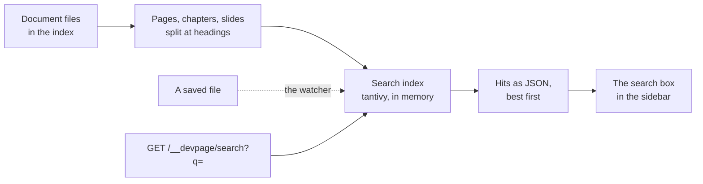

# Search

How the viewer finds text: `src/search.rs` keeps a full-text index of every
in-sight document's sections in memory, ranks a query's matches with BM25 and
answers `GET /__devpage/search?q=…` with them as JSON, which the search box
at the top of a site's sidebar shows as the reader types. It is a mechanism
page under the [viewer](../README.md), for someone about to change what is
indexed, how it ranks, what the endpoint answers or how the search box
behaves.



## What is indexed

Every document file the [index](../document-index/README.md#the-index) holds
— so nothing [out of sight](../live-updates/README.md#what-is-out-of-sight)
and nothing outside the served folder — read as its kind:

| Kind | What becomes entries | Address of an entry |
| --- | --- | --- |
| site | every in-sight Markdown file in its folder whose nearest site it is — a page of the site, whether its Topics list it or not — split at its headings | the page, with the heading's id: `/docs/guide.md#the-sidebar` |
| doc | each in-sight chapter, split at its headings | the doc's document file, with the id the doc page gives the heading: `/plan/plan.yml#how--context`, the chapter's name first when there is more than one chapter |
| slides | each in-sight slide whole, as one entry: its text and every `<Notes>` in it | the deck with the slide's number: `/talk/talk.yml#2` |

A design has no text to index, and a document file that can't be loaded has no
entries until it is fixed.

A **section** is the text from one heading to the next, of any level; the
text before a page's first heading is one too, when there is any. A heading's
id is the one the rendered page gives it — comrak's, with `-heading` added
when it would be one of the [frame's ids](../rendering-a-page/README.md) — so
an entry's address lands on its heading. A section's text is its words as the
reader sees them: inline HTML is left out, an HTML block's tags are, and a
`<Notes>` block is, on any page — a deck adds its slides' notes itself.

Each entry has these fields:

| Field | Ranked | Stored |
| --- | --- | --- |
| `title` — the file's title: its first `# ` heading, or its name | yes, ×3 | yes |
| `heading` — the section's heading; empty before the first | yes, ×2 | yes |
| `body` — the section's text | yes, ×1 | yes, for the snippet |
| `url` — the address above | | yes |
| `document_title`, `document_path` — the document's title and its document file's address | | yes |
| `trail` — the page's place in its document's nav | | yes |

The **trail** is the labels from the top of a site's [navigation tree](../navigation-tree/README.md)
down to the page, the page's own label last — empty for the root page and for
a page the tree doesn't list; a page listed twice has the trail to its position. In a
doc of more than one chapter it is the chapter's title; a deck's slides have
none.

The ranked fields are tokenized as tantivy's `en_stem`: its default tokenizer,
lowercased, with English stemming. Each also has an unstemmed twin
(`title_words`, `heading_words`, `body_words`, tantivy's `default`, not
stored), which only the word being typed is matched against.

## Ranking

A query is split into words as the index splits text. Every word must match
the entry, in any of the three ranked fields, in one of these ways:

- **exactly**, once stemmed — scored by BM25 and the field's boost;
- **near it**, when the word as typed has four letters or more: one edit away
  once stemmed, two from eight letters, a swap of neighbouring letters counting
  as one (tantivy's `FuzzyTermQuery`) — a constant score, half the field's boost;
- for the **last word** only, as the start of a word in the unstemmed twin, so
  results come while it is typed — the same constant score.

The best 50 entries come back, best first. An empty query, or one with no
words, finds nothing.

## How it stays current

The search index is part of the [index](../document-index/README.md#the-index):
`devpage` builds it at start (`Index::with_search`), after the document
files are found, and the [watcher](../live-updates/README.md#the-watcher)
hands it each burst's paths after the index has heard of them and after the
open pages have been told — so indexing never holds up a refresh
(`Search::changed`). `devpage check`, `pdf` and `video` build none.

What each document's entries were read from is kept: its chapters or slides,
or for a site its folder. A changed path reaches a document when it is the
document file, one of its chapters or slides, or a Markdown file in a site's
folder; a `.gitignore`, a folder, or a path that is gone reaches every
document under that folder, and every site whose folder holds it or is held by
it. Each document reached is read again whole: its entries are deleted, and —
if it is still an in-sight document file — added again, in one commit per
burst. So a new rule in a `.gitignore` takes its folder's pages out at once,
and a deleted chapter takes its doc out until it is back.

## The endpoint

`GET /__devpage/search?q=<query>` (`search` in `src/server.rs`) answers
`200` with the hits, whether comments are on or off; a missing or blank `q`
answers no hits:

```json
{
  "hits": [
    {
      "title": "Retries",
      "heading": "The outbox",
      "url": "/b.md#the-outbox",
      "snippet": "The client retries every write &amp; read from its <mark>outbox</mark>.",
      "document": { "title": "T", "path": "/devpage.yml" },
      "trail": ["Retries"]
    }
  ]
}
```

The **snippet** is HTML: at most 24 words of the section's text — the run with
the most matched words, the first of equals — escaped, each matched word in
`<mark>`, with `…` where it cuts the text. A word matched in the heading or
title alone gives a snippet with nothing marked.

`server::printing`, which `devpage pdf` and `video` serve through, has no
search index, and finds nothing.

The index is written by one thread with a 15 MB memory arena, the least
tantivy allows; it is most of what search adds to devpage's memory.

## The search box

A site's sidebar ([`DevpageSidebar`](../widgets/system-widgets/README.md#devpagesidebar))
opens with a search box, between the site's title and the tree; a site with
`sidebar: false` has none, nor does a doc or a deck. The server draws it with
the sidebar (`render::SEARCH_BOX`), empty, so React takes it over without a
change ([Rendering the sidebar](../navigation-tree/README.md#rendering-the-sidebar)).

**As the reader types**, the box asks the endpoint for the text typed, once
typing pauses for 60 ms. While it holds text, the hits take the tree's place:
the hits last answered stay until the next answer replaces them, so the tree
never flashes back between keystrokes. An answer to anything but the latest
request — an earlier text, or text since cleared — is dropped, and the request
it was is aborted, so a slow earlier answer never replaces a later one. An
answer of no hits says so.

**Grouped by document.** Hits are grouped by their document, under its title,
each group in the endpoint's order; the groups follow their best hit, except
that the document shown — the sidebar's own, matched by its document file's
address (`document_path`) — comes first. Each hit shows its place in the nav
(its trail, or its page's title when it has none), its heading — the page's
title for the text before the first heading — and its snippet, the matched
words marked.

**The keys:**

| Key | Where | What it does |
| --- | --- | --- |
| `/` | anywhere but a text field | focuses the box, its text selected |
| ⌘K / Ctrl+K | anywhere | the same |
| ↓ ↑ | in the box | moves the selected hit, round from the last to the first; the mouse moving over a hit selects it too |
| Enter | in the box | opens the selected hit — the first, unless moved; pressed before the text typed has its hits, opens the first once they come |
| Escape | in the box | clears the box and brings the tree back; in an empty box, leaves it |

**Opening a hit** is following its link, so a page of a site loads in place
through the [page swap](../page-script/README.md#links-and-history) and lands
on the heading — scrolled to again if it is the page and heading shown — while
a doc's chapter or a deck's slide loads its document whole. The sidebar stays
mounted across the swap, so the box keeps its text and its hits, and the
reader can move to the next hit and open it in turn.
