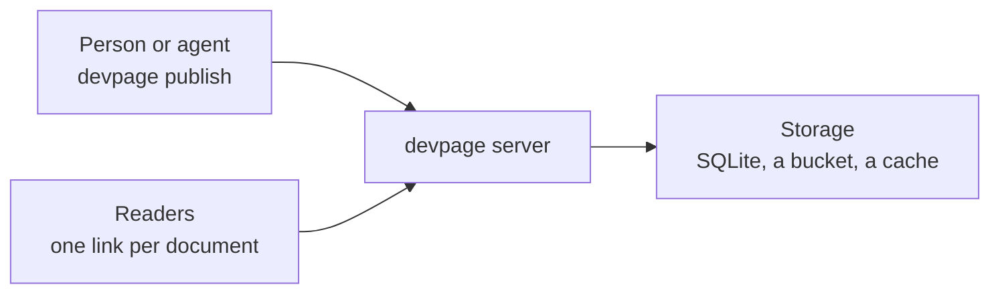

# Server mode

Server mode is devpage as a place to publish documents. `devpage server` runs
in a container; anyone — a person or an agent — publishes a document to it
with one command and gets a link back. The link always shows the latest
version, readers comment on it, and every earlier version stays readable. It is
a part of the [viewer](../README.md).

It is one of two ways to deploy devpage. **Bundled** puts one repository's
documents in an image, for a team to read
([Deploying devpage](../deploying/README.md)). **Server mode** hosts
documents that have no repository to live in — a design doc, a deck, a design —
each published on its own.

<Cards>

- (lightbulb) [How server mode works](how-server-mode-works/README.md) — Documents, versions and contexts, and one document's life end to end.
- (cloud-upload) [Publishing a document](publishing/README.md) — Connect, publish, update, delete.
- (book-open) [Reading a published document](reading-a-published-document/README.md) — The link, old versions, comments and downloads.
- (server) [Running a server](running-a-server/README.md) — The image, the environment and your proxy.

</Cards>

## Topics

### Essentials

- [How server mode works](how-server-mode-works/README.md) — the mental model:
  a document, its versions, a context, and one document followed from first
  publish to its second version.

### Concepts and tasks

- [Publishing a document](publishing/README.md) — connecting the CLI to a
  server, publishing and updating, what a publish contains, deleting.
- [Reading a published document](reading-a-published-document/README.md) —
  the latest version, older ones, comments across versions, and PDF or PNG
  downloads.
- [Running a server](running-a-server/README.md) — the example image, its
  environment, Kubernetes, and putting your own proxy in front.

### Mechanisms

- [Storage](storage/README.md) — the store in SQLite and how Litestream keeps
  it, version zips in the bucket, and the bounded cache on the PVC.
- [Measuring a server](measuring-a-server/README.md) — the envelope one server
  holds and its targets, the metrics it reports on its own port, and the
  benchmark that checks both.

### Reference

- [Server reference](reference/README.md) — every CLI command, API request and
  environment variable.

### Constraints

- [A version never changes](constraints/a-version-never-changes.md) — a
  published version's files are kept byte for byte, and its link shows the
  same thing forever.
- [The PVC is only a cache](constraints/the-pvc-is-only-a-cache.md) — nothing
  on it is the only copy, so losing it loses at most a second of the store.
- [One replica](constraints/one-replica.md) — server mode runs as one process;
  nothing coordinates two.
- [One server holds the envelope](constraints/one-server-holds-the-envelope.md)
  — on 2 CPUs and 4 GB, 10,000 documents and thousands of readers at their
  targets; the benchmark says whether it does.
- [Metrics name no document](constraints/metrics-name-no-document.md) — every
  label comes from a closed set, and metrics are served only on their own port.
