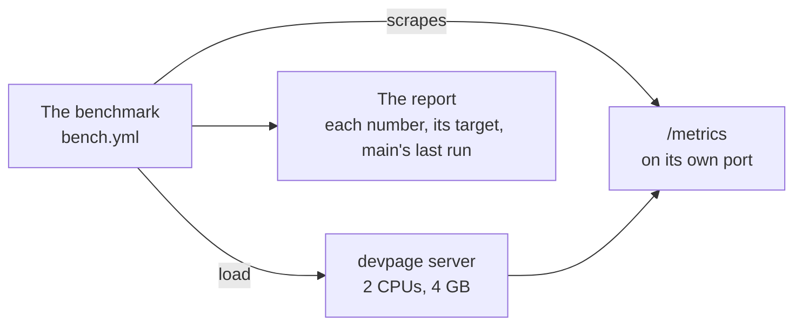

# Measuring a server

How much one devpage server holds, and how to tell which part of it gives out
first: the **envelope** a server is built to hold, the **metrics** it reports
about its own work, and the **benchmark** that loads it to the envelope and
past it. It is a concept article under [Server mode](../README.md), for an
operator sizing a server and for anyone about to make one faster — a change
made for speed starts from a number here, not from a guess.

## The envelope

[One replica](../constraints/one-replica.md) fixes the scale: one process,
read by thousands at most and written far less. The envelope is that sentence
in numbers, and one server holds it
([one server holds the envelope](../constraints/one-server-holds-the-envelope.md)):

| | |
| --- | --- |
| The pod | 2 CPUs and 4 GB — the requests and limits `deploy/server/kubernetes.yaml` sets |
| Documents | 10,000, holding 50,000 versions, every one of them read now and then |
| Pages open at once | 2,000, each listening for its document's next version |
| Page views | 50 a second sustained; 500 a second in a burst, as when a link is posted |
| Writes | a publish a second, and a comment a second, at peak |

And what holding it means:

| Request | Target |
| --- | --- |
| A page view, a version in the cache or not | p99 under 100 ms |
| A publish | p99 under 2 s |
| A comment | p99 under 200 ms |
| A publish to a document 500 pages have open | every one of them shows the new version within 1 s of the publish answering |
| Any request | under 0.1% errors |
| The whole run | memory under the pod's limit, threads not growing with the versions read |

## Metrics

The server reports its own work in the Prometheus text format at `/metrics`,
on a port of its own — `DEVPAGE_METRICS_PORT`, `9030` by default — so the
public Service and the proxy never route to it and a forgotten proxy rule
can't publish it. It holds counts and timings, never content, and no label
names a document or a version
([metrics name no document](../constraints/metrics-name-no-document.md)).

**Time per stage**, as histograms — each stage a request can spend its time in:

| Stage | Where |
| --- | --- |
| `store` | waiting for the store's lock, and the query |
| `fetch` | a version's zip from the bucket, on a cache miss |
| `unpack` | the zip into the cache |
| `router` | a version's router made: its document loaded, its index built |
| `check` | the page's problems: its links, and the pages they reach |
| `nav` | the site's navigation, around the page |
| `render` | the page's Markdown to HTML, in its frame |
| `publish-check` | a publish checked before it is accepted |
| `upload` | a publish's zip into the bucket |
| `download` | a version's PDF or PNG drawn, on its first request |

Stages nest, as the work does: `nav` runs inside `render`, and `check`
renders the page and every page a `#heading` link reaches, so most Markdown
rendering is timed under `check`. `render` is timed where every kind of page
is rendered, so a doc's chapter is counted as a site's page is.

**Requests** by route and status, with their time. **Totals**: versions held
in memory and their routers, threads, open live pages, the cache's bytes,
hits, misses and evictions, resident memory.

| Series | Labels |
| --- | --- |
| `devpage_stage_seconds` (histogram) | `stage` |
| `devpage_request_seconds` (histogram) | `route`, `status` |
| `devpage_versions_in_memory`, `devpage_routers`, `devpage_threads`, `devpage_open_pages`, `devpage_cache_bytes`, `devpage_resident_bytes` | — |
| `devpage_cache_hits_total`, `devpage_cache_misses_total`, `devpage_cache_evictions_total` | — |

The stages inside the core — `check`, `nav`, `render` — are `tracing` spans,
which cost nothing with no listener; server mode listens and turns each span
into its histogram, and times the rest where it does them. A local `devpage`
has no metrics port.

## The benchmark

A GitHub Action, `.github/workflows/bench.yml`, run by hand. It brings up the
[example stack](../running-a-server/README.md#trying-it-locally) — the image
built from the checkout, held to the pod's 2 CPUs and 4 GB, with the S3 and
Azure emulators — generates the envelope's documents from a seed, publishes
them through the API, and runs each scenario against the server, scraping
`/metrics` after each. What it runs, and how, is on
[the server's benchmark](../../../engineering/tests/README.md#the-servers-benchmark).

## The report

Each run writes its report on the run's summary page: every scenario's
numbers beside their targets, which stage took the time, and how each moved
since the last run from `main`. The numbers behind it are the run's artifact,
which the next run downloads to compare against. A number counts as moved
only outside the runners' noise, and a target as missed only by a clear
margin. Past the envelope, the report gives each scenario's **knee** — the
rate at which its p99 crosses the target — which is the headroom left.

A server in production reports the same metrics, so an operator watching them
sees which target is getting close before readers do.
