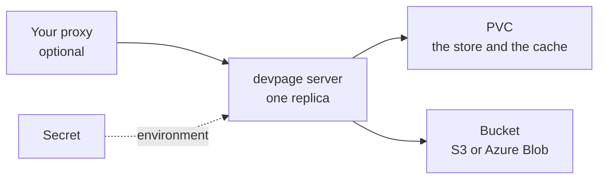

# Running a server

How to deploy `devpage server`: what it needs, the example image to copy, its
environment, and the proxy you may put in front. It is a task article under
[Server mode](../README.md); every variable is in the
[reference](../reference/README.md#environment).

## What it needs



- **One replica**, always — a StatefulSet of one on Kubernetes
  ([one replica](../constraints/one-replica.md)).
- **A PVC.** It holds the store and the cache, and losing it loses at most the
  store's last second ([the PVC is only a cache](../constraints/the-pvc-is-only-a-cache.md)).
- **A bucket** — S3 or Azure Blob — where everything durable ends up.

## The image

`deploy/server/` holds an example to copy and change: a `Dockerfile`, the
`litestream.yml` it uses, `devpage-server.sh`, which starts devpage under
Litestream, and a `compose.yaml` that tries it locally against both kinds of
bucket.

```dockerfile
FROM rust:1.98.1-slim-bookworm AS release
ARG DEVPAGE_VERSION
RUN cargo install devpage --version "$DEVPAGE_VERSION" --locked

FROM litestream/litestream:0.5.2 AS litestream

FROM debian:bookworm-slim
# ca-certificates, and the libraries chrome-headless-shell needs for PDF downloads
RUN apt-get update && apt-get install -y --no-install-recommends ca-certificates libnss3 …
COPY --from=release /usr/local/cargo/bin/devpage /usr/local/bin/devpage
COPY --from=litestream /usr/local/bin/litestream /usr/local/bin/litestream
COPY litestream.yml /etc/litestream.yml
COPY devpage-server.sh /usr/local/bin/devpage-server
ENV DEVPAGE_HOST=0.0.0.0 DEVPAGE_DATA_DIR=/data
VOLUME /data
EXPOSE 3030
CMD ["devpage-server"]
```

(The file itself also has a stage that builds devpage from a checkout of this
repository, to try a change before it is released.)

`devpage-server` points Litestream at the `store/` folder of
`DEVPAGE_BUCKET_URL` — the same bucket, the same credentials — restores the
store from there when the volume is empty, then runs `devpage server` and
keeps the store replicated ([how](../storage/README.md#the-store)).

- **Build it** with `docker build deploy/server --build-arg DEVPAGE_VERSION=<version>`,
  naming a release of devpage that has `devpage server`.
- **PDF downloads** need chrome-headless-shell, which devpage fetches when the
  image is built. It has builds for x86-64 Linux only: an arm64 image serves
  everything but PDFs.

### Trying it locally

`deploy/server/compose.yaml` runs two servers from this checkout, one per kind
of bucket, each emulated — S3 by [RustFS](https://github.com/rustfs/rustfs),
Azure Blob by [Azurite](https://github.com/Azure/Azurite) — each with its own
volume:

<Terminal>

```text
$ docker compose -f deploy/server/compose.yaml up --build --wait
$ devpage context add local http://localhost:3031
$ devpage context use local
$ devpage publish docs
```

</Terminal>

`localhost:3031` keeps its documents in RustFS and `localhost:3032` in
Azurite. The same file is what
[the PVC is only a cache](../constraints/the-pvc-is-only-a-cache.md) is
checked against: `cargo test --test deploy_restore -- --ignored` publishes and
comments on each server, deletes its volume, starts it on an empty one, and
finds every document, version and comment.

## Configuration

The command is the mode; everything else is a `DEVPAGE_*` variable. Secrets —
the bucket's keys when there is no workload identity — reach the environment
from the platform's secret store, never from the image. The ones a server
must have, and the cache's limit:

```sh
DEVPAGE_BUCKET_URL=s3://docs-bucket/devpage   # or az://container/devpage
DEVPAGE_DATA_DIR=/data                         # the PVC's mount
DEVPAGE_CACHE_MAX_BYTES=8GB                    # optional: 80% of the PVC by default
```

devpage checks the environment before it listens: a variable that is missing,
malformed or meant for bundled mode stops it with the variable's name, never
its value.

## Your proxy

devpage checks no one ([devpage authenticates no one](../../constraints/devpage-authenticates-no-one.md)):
whoever reaches it can read, publish, comment and delete. To decide who may do
what, put your own proxy in front and keep devpage's port inside the cluster.
Reads are `GET`, writes are `POST` and `DELETE` under `/api/`, so a proxy can
let everyone read and only some write.

Set `DEVPAGE_USER_HEADER` to the header your proxy names the user in, and every
publish and comment carries that author; without it, they are `anonymous`.
