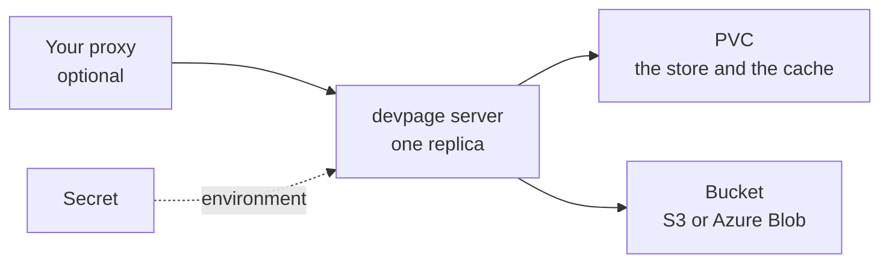

# Running a server

How to deploy `devpage server`: what it needs, the example image to copy, its
environment, and the proxy you may put in front. It is a task article under
[Server mode](../README.md); every variable is in the
[reference](../reference/README.md#environment).

## What it needs



- **One replica**, always — a StatefulSet of one on Kubernetes
  ([one replica](../constraints/one-replica.md)).
- **A PVC.** It holds the store and the cache, and losing it loses at most the
  store's last second ([the PVC is only a cache](../constraints/the-pvc-is-only-a-cache.md)).
- **A bucket** — S3 or Azure Blob — where everything durable ends up.

## The image

`deploy/server/` holds an example to copy and change: a `Dockerfile`, the
`litestream.yml` it uses, and a `compose.yaml` that tries it locally against
MinIO.

```dockerfile
FROM rust:1.89-slim-bookworm AS build
RUN cargo install devpage --version <version> --locked

FROM litestream/litestream:<version> AS litestream

FROM debian:bookworm-slim
COPY --from=build /usr/local/cargo/bin/devpage /usr/local/bin/devpage
COPY --from=litestream /usr/local/bin/litestream /usr/local/bin/litestream
COPY litestream.yml /etc/litestream.yml
# chrome-headless-shell, for PDF and PNG downloads
ENV DEVPAGE_HOST=0.0.0.0
EXPOSE 3030
CMD ["litestream", "replicate", "-exec", "devpage server"]
```

Litestream restores the store from the bucket when the PVC is empty, then runs
`devpage server` and keeps the store replicated
([how](../storage/README.md#the-store)).

## Configuration

The command is the mode; everything else is a `DEVPAGE_*` variable. Secrets —
the bucket's keys when there is no workload identity — reach the environment
from the platform's secret store, never from the image. The ones a server
must have, and the cache's limit:

```sh
DEVPAGE_BUCKET_URL=s3://docs-bucket/devpage   # or az://container/devpage
DEVPAGE_DATA_DIR=/data                         # the PVC's mount
DEVPAGE_CACHE_MAX_BYTES=8GB                    # optional: 80% of the PVC by default
```

devpage checks the environment before it listens: a variable that is missing,
malformed or meant for bundled mode stops it with the variable's name, never
its value.

## Your proxy

devpage checks no one ([devpage authenticates no one](../../constraints/devpage-authenticates-no-one.md)):
whoever reaches it can read, publish, comment and delete. To decide who may do
what, put your own proxy in front and keep devpage's port inside the cluster.
Reads are `GET`, writes are `POST` and `DELETE` under `/api/`, so a proxy can
let everyone read and only some write.

Set `DEVPAGE_USER_HEADER` to the header your proxy names the user in, and every
publish and comment carries that author; without it, they are `anonymous`.
