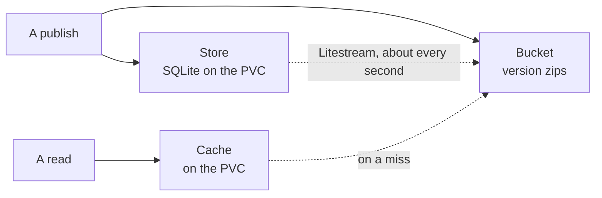

# Storage

How server mode keeps its data: the store in SQLite and how Litestream backs
it up, each version's zip in the bucket, and the bounded cache on the PVC that
makes reading fast. It is the mechanism page of [Server mode](../README.md),
for someone about to change it.

| What | Where | Lost with the PVC? |
| --- | --- | --- |
| Version zips | the bucket | no |
| The store | SQLite on the PVC, replicated to the bucket | at most its last second |
| Unpacked versions, compiled widgets, downloads | the cache | rebuilt on demand |

## The bucket

S3 or Azure Blob, named by one URL — `s3://bucket/prefix` or
`az://container/prefix`. Each version is the zip as uploaded, at
`documents/<id>/versions/<n>.zip`, written before the publish answers
([the PVC is only a cache](../constraints/the-pvc-is-only-a-cache.md)) and
never written again ([a version never changes](../constraints/a-version-never-changes.md)).
The store's replica sits beside them under `store/`.

## The store

One SQLite file, `$DEVPAGE_DATA_DIR/store.db`, with four tables:

| Table | One row per |
| --- | --- |
| `documents` | document: id, kind, title, latest version, created |
| `versions` | publish: document, number, author, published, size, sha-256 of the zip |
| `threads` | comment thread: document, page, anchor, the version it started on, detached |
| `messages` | message in a thread: author, at, text |

**Litestream backs it up, not devpage.** It streams SQLite's write-ahead log
to the bucket about once a second and takes periodic snapshots; on start it
restores the file from the bucket when the PVC is empty. It is the standard
open-source tool for one SQLite on one node beside an object store, so devpage
has no backup code. One process writes the store
([one replica](../constraints/one-replica.md)), which is what SQLite and
Litestream both assume.

## The cache

Everything else on the PVC is a copy: versions unpacked from their zips,
compiled widgets, rendered downloads. It is bounded and evicts what was used
least recently.

- **`DEVPAGE_CACHE_MAX_BYTES` is the budget.** Past it, devpage evicts down to
  90%, so a full cache doesn't evict on every read.
- **Least recently used goes first**, by an access time devpage keeps in
  memory — a file's `atime` lies on volumes mounted `noatime`. On start it
  scans the cache and seeds each entry's recency from its `mtime`.
- **Cheapest to rebuild goes first among equals**: a download before an
  unpacked version.
- **Nothing is ever stale.** Every entry belongs to a version, and a version
  never changes, so there is nothing to invalidate — only room to make.
- **An entry bigger than the budget** is served from the bucket without being
  cached.

Hits, misses, size and evictions are logged, so the PVC can be sized from what
the cache does.
