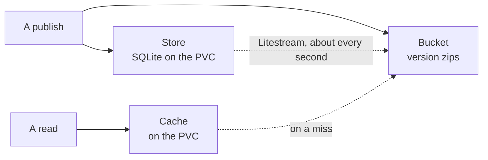

# Storage

How server mode keeps its data: the store in SQLite and how Litestream backs
it up, each version's zip in the bucket, and the bounded cache on the PVC that
makes reading fast. It is the mechanism page of [Server mode](../README.md),
for someone about to change it.

| What | Where | Lost with the PVC? |
| --- | --- | --- |
| Version zips | the bucket | no |
| The store | SQLite on the PVC, replicated to the bucket | at most its last second |
| Unpacked versions, compiled widgets, downloads | the cache | rebuilt on demand |

## The bucket

S3 or Azure Blob, named by one URL — `s3://bucket/prefix` or
`az://container/prefix`. A `file:///folder` URL is a local folder instead, for
trying server mode on one machine and for tests; on a deploy it would put the
durable copy on the PVC. Each version is the zip as uploaded, at
`documents/<id>/versions/<n>.zip`, written before the publish answers
([the PVC is only a cache](../constraints/the-pvc-is-only-a-cache.md)) and
never written again ([a version never changes](../constraints/a-version-never-changes.md)).
The store's replica sits beside them under `store/`.

## The store

One SQLite file, `$DEVPAGE_DATA_DIR/store.db`, with four tables:

| Table | One row per |
| --- | --- |
| `documents` | document: id, kind, title, latest version, created |
| `versions` | publish: document, number, author, published, size, sha-256 of the zip |
| `threads` | comment thread: document, page, anchor, the version it started on, detached |
| `messages` | message in a thread: author, at, text |

**Litestream backs it up, not devpage.** It streams SQLite's write-ahead log
to the bucket about once a second and takes periodic snapshots; on start it
restores the file from the bucket when the PVC is empty. It is the standard
open-source tool for one SQLite on one node beside an object store, so devpage
has no backup code. One process writes the store
([one replica](../constraints/one-replica.md)), which is what SQLite and
Litestream both assume.

## The cache

Everything else on the PVC is a copy: versions unpacked from their zips,
compiled widgets, rendered downloads. A read that misses fetches the version
from the bucket and unpacks it; losing the whole PVC only means fetching
again.

- **A limit, and a policy that chooses.** The cache knows its size, its limit
  and each entry — the version it belongs to, its bytes, when it was last
  read. When a write takes it past the limit, it asks its **eviction policy**
  which entries to delete to free enough room, and deletes them itself,
  skipping any entry being served — so a policy decides and never acts, and
  cannot break a read.
- **The limit is 80% of the PVC** — the size of the volume under
  `$DEVPAGE_DATA_DIR`, read at start — unless `DEVPAGE_CACHE_MAX_BYTES` sets
  it. A bigger volume is a bigger cache with nothing to configure, and the
  cache never fills the disk the store is on.
- **Nothing is ever stale.** Every entry belongs to a version, and a version
  never changes, so there is nothing to invalidate — only room to make.
- **An entry bigger than the limit** is served from the bucket without being
  cached.

Hits, misses, size and evictions are logged, so the PVC can be sized from what
the cache does.

### What a version holds in memory

A version read since the server started has its router in memory, and
everything worked out from its files is worked out once
([a version's work is done once](../constraints/a-versions-work-is-done-once.md)):

- **Each page's problems**, found on the page's first view and kept with the
  router — the version's files never change, so neither do they. Every later
  view of the page shows them without checking anything.
- **Its search index**, built on the version's first search rather than with
  its router, committed once, with no writer left open and no indexing
  threads. The indexes of the most recently searched versions are kept, up to
  256 MB in all; past that the least recently searched is dropped, and its
  next search builds it again.

A router goes when its version leaves the cache. So what memory holds grows
with the versions being read, not with every version ever read.

### The eviction policy

A port: given the entries and how many bytes to free, it returns which to
delete. One policy exists — the seam is there because policies are expected
to change, by what a cache under real use shows, without touching the cache.
A policy is a pure function of its entries, tested on lists of them, with no
disk or bucket.

| `DEVPAGE_CACHE_POLICY` | Chooses |
| --- | --- |
| `lru` (the default, and the only one) | The least recently read first, until the cache is at 90% of its limit, so a full cache doesn't evict on every read. Recency is kept in memory — a file's `atime` lies on volumes mounted `noatime` — and seeded from each entry's `mtime` on start. |
