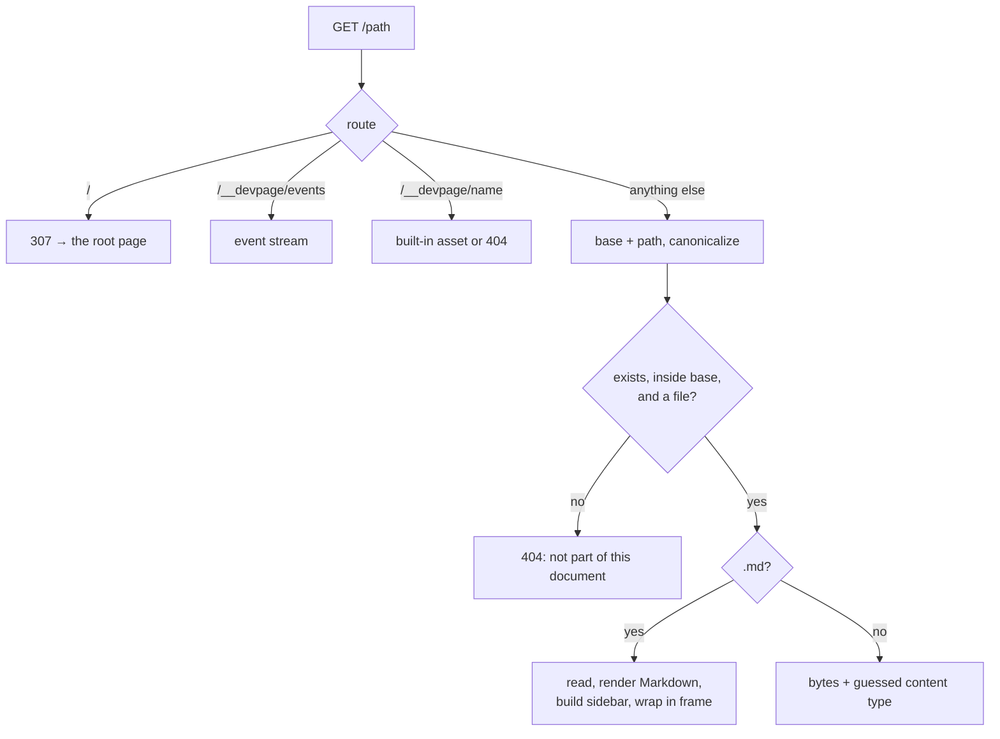

# Serving pages

How the viewer turns a request into a response: the URL names a file, the file
is checked to lie inside the document, a Markdown file is rendered into the
page frame and anything else is sent as it is. It also covers the built-in
assets, how the port is chosen and what is logged. It is a mechanism page
under the [viewer](../README.md), for someone about to change `src/server.rs`,
`src/render.rs` or `src/main.rs`.

## Routes

`src/server.rs` declares four routes:

| Route | Response |
| --- | --- |
| `/` | `307 Temporary Redirect` to `/<root>` |
| `/__devpage/events` | the live-update event stream — see [Live updates](../live-updates/README.md) |
| `/__devpage/{asset}` | one of the built-in assets |
| `/{*path}` | the file at `path` in the document's folder |

## The URL is the file path

A URL path is joined to the document's folder — `/boxes/README.md` is
`<folder>/boxes/README.md` — so relative links between Markdown files work as
written. Nothing is precomputed: every request reads the file from disk.

**Path safety.** `Document::file` in `src/document.rs` joins the path to the
folder, canonicalizes the result — resolving `..` and symbolic links, and
failing if the file doesn't exist — and accepts it only if it still starts with
the document's canonical folder. The handler then requires it to be a regular
file. Anything else — a path escaping with `..`, a symbolic link pointing
outside, a missing file, a folder — gets `404` with the body
`<path> is not part of this document`. Every file inside the folder is served,
whether or not a `watch` pattern names it, `devpage.yml` included.

A file that exists but can't be read gets `500` with the error's text.

## Rendering a Markdown file

A file ending in `.md` is read as text and passed to `render::page`:

1. **Markdown to HTML.** `render::markdown` runs comrak with these options
   (`options()` in `src/render.rs`):

   | Option | Effect |
   | --- | --- |
   | `extension.table` | GFM tables |
   | `extension.strikethrough` | `~~text~~` |
   | `extension.autolink` | bare URLs become links |
   | `extension.tasklist` | `- [ ]` / `- [x]` items |
   | `extension.footnotes` | `[^1]` footnotes |
   | `extension.header_id_prefix = ""` | every heading gets an id from its text, with no prefix |
   | `render.unsafe` | raw HTML passes through |
   | `render.github_pre_lang` | a fence's language is passed as a `lang` attribute — which the highlighter below then drops for every block except `mermaid` |

   `render::markdown` also plugs in a code-fence highlighter,
   `highlight::Highlighter` in `src/highlight.rs`, through comrak's `Plugins`
   (`SyntaxHighlighterAdapter`). For each fenced block it:

   - takes the first word of the info string as the language and looks it up
     with syntect's `find_syntax_by_token` (name or file extension) in
     `two_face::syntax::extra_newlines()` — the syntax set `bat` ships, loaded
     once on first use through a `LazyLock`;
   - if found, and the language isn't `mermaid`, emits syntect's class-based
     HTML (`ClassStyle::SpacedPrefixed { prefix: "hl-" }`): nested spans such
     as ``, colored by the
     `--syntax-*` tokens in `assets/style.css` (see
     [Diagrams and themes](../diagrams-and-themes/README.md#the-themes));
   - otherwise — no language, an unknown one, `mermaid`, or a highlighting
     error partway through — writes the code HTML-escaped and unhighlighted;
   - writes a bare `<pre>` and `<code>` with no language attributes, except
     `<pre lang="mermaid">` for Mermaid blocks, which is how the page script
     finds the diagrams to draw.

2. **Title.** `render::title` takes the first line starting with `# `, or the
   file name without its extension.
3. **Sidebar.** The [navigation tree](../navigation-tree/README.md) is built
   from the root page and rendered to nested lists, with the current page
   marked.
4. **Frame.** The pieces go into one HTML page:

   - `<title>` is `<page title> · <document title>`;
   - `<nav id="nav">` holds a link to `/` with the document title, then the tree;
   - `<main id="page"><article>` holds the rendered Markdown;
   - the stylesheet and two scripts — pele, then `devpage.js` — are loaded from
     `/__devpage/`.

   The ids `nav` and `page` are what [live updates](../live-updates/README.md)
   replace in place. Titles and sidebar labels are HTML-escaped; the page body
   is not, since raw HTML is allowed.

Nothing is cached between requests: each page request re-reads the page and,
to build the sidebar, every page the tree reaches.

## Other files

Any other file is read as bytes and returned with a `Content-Type` guessed from
its extension (`mime_guess`), or `application/octet-stream` when the extension
is unknown.

## Built-in assets

The page's own files are compiled into the binary with `include_str!`:

| URL | Source | Content type |
| --- | --- | --- |
| `/__devpage/style.css` | `assets/style.css` | `text/css` |
| `/__devpage/devpage.js` | `assets/devpage.js` | `text/javascript` |
| `/__devpage/pele.js` | `assets/vendor/pele.js` | `text/javascript` |

They are sent with `Cache-Control: no-cache`; any other name under
`/__devpage/` is `404`. Changing an asset means rebuilding devpage.

## Choosing a port

`src/main.rs` binds `127.0.0.1` — the local machine only — starting at port
3030 and trying each next port up until one is free. It prints `<title> → http://localhost:<port>` on
standard output, and fails with `no free port` only if every port from 3030 to
65535 is taken.

## Request logging

A middleware logs every request to standard error, as
`<method> <path> → <status> in <ms> ms`, for example
`GET /README.md → 200 in 0.7 ms`. The time is until the response starts, so
an event stream logs once, when it opens.

The exact `devpage.yml` fields and command line are in the
[configuration reference](../configuration-reference/README.md).
