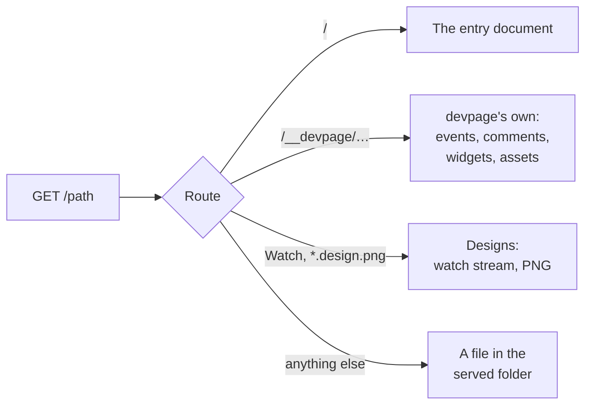
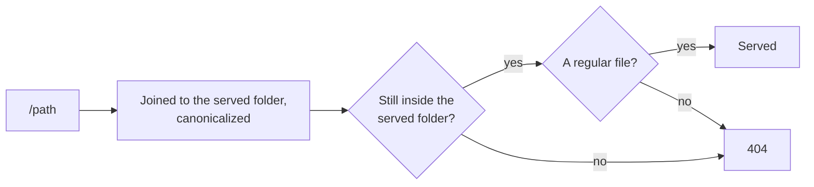

# Serving pages

How the viewer answers a request: the URL names a file in the served folder,
the path is checked to stay inside it, and the file is served as what it is — a
document, a page in its document's frame, or bytes. It also covers the built-in
assets, how the browser is told what to keep, the address devpage listens on
and what it logs. It is a mechanism page
under the [viewer](../README.md), for someone about to change how requests are
served; [which document a file belongs to](../document-index/README.md) and
[rendering a page](../rendering-a-page/README.md) go one level deeper.

## Routes

| Route | Response |
| --- | --- |
| `/` | `307 Temporary Redirect` to the entry document as its file says now — a site's root page, or a doc's or deck's document file (or the Markdown file devpage was given); while the entry's file is invalid, the page saying why |
| `/__devpage/events` | the live-update event stream — see [Live updates](../live-updates/README.md) |
| `/__devpage/comments…` | the comment store's requests — see [Comments](../comments/the-comment-store/README.md#the-requests); `404` with comments off |
| `/__devpage/system-widgets/{name}` | a system widget, compiled — see [Widgets](../widgets/how-widgets-run/README.md) |
| `/__devpage/widgets/{*path}` | a project widget or helper in the served folder, compiled — see [Widgets](../widgets/how-widgets-run/README.md) |
| `/__devpage/{asset}` | one of the [built-in assets](#built-in-assets) |
| `/devpage.design.v1.Designs/Watch` | a page's watch stream over every design it shows, as gRPC-Web; it is the service's only method, and the only path under `/devpage.design.v1.Designs/` that answers — see [Design engine](../design-engine/README.md#the-watch-stream) |
| `/{*path}.design.png` | the design at `path` painted as a PNG — see [Looking at a design as a PNG](../designs/README.md#looking-at-a-design-as-a-png) |
| `/{*path}.yml/{n}.png` | slide `n` of the deck at `path.yml` (or `.yaml`) as a 1920 × 1080 PNG, drawn by chrome-headless-shell, with an `ETag` (`304` when the request holds it); `404` with the reason when the file isn't a deck or has no slide `n`; `508 Loop Detected` when a page devpage's own Chrome is shooting asks for a slide not drawn yet — see [A slide as an image](../making-slides/README.md#a-slide-as-an-image) |
| `/{*path}` | the file at `path` in the served folder |

A query of `?print` renders a doc's or deck's document file in **print mode**,
the page `devpage pdf` has Chrome print ([Printing to PDF](../pdf/README.md)).
A site is never printed, so on a Markdown file `?print` always renders it as a
doc of one chapter in print mode, even when the file is a page of a site — which
is how `devpage pdf` prints one Markdown file.

## The URL is the file path

A URL path is joined to the [served folder](../writing-a-document/README.md#the-served-folder)
— `/docs/boxes/README.md` is `<served folder>/docs/boxes/README.md` — so relative
links between files work as written. Nothing is precomputed: every request
reads its files from disk.

**Path safety.** Every path takes the same three checks
([the rule](../constraints/the-served-folder-is-the-boundary.md)):

Canonicalizing resolves `..` and symbolic links, and fails if the file doesn't
exist. Anything that fails — a path escaping with `..`, a symbolic link
pointing outside, a missing file, a folder — gets `404` with the body
`<path> is not part of the served folder`. A file that exists but can't be read
gets `500` with the error's text.

## What a file is served as

A file that passes the checks is one of four things:

| The file | Is served as |
| --- | --- |
| A document file — YAML with `kind: site`, `doc` or `slides` | the document, as its kind |
| A Markdown file | a page, in the frame of the document it belongs to |
| A `.design` file | the [canvas page](#the-canvas-page) |
| Anything else | its bytes, as they are — see [Other files](#other-files) |

### The canvas page

A `.design` file is shown on the canvas page: a frame holding a `<canvas>`,
the light/dark switch in the corner with the head script that sets the theme
before the page paints, and the design script, which draws it as the
[design engine](../design-engine/README.md#in-the-browser) describes and runs
the switch. It belongs to no site and has no sidebar, navbar or comments.

## Which document a file belongs to

What makes a file a document file, which site a page belongs to and the index
that answers it are on [Which document a file belongs to](../document-index/README.md).

## Rendering a Markdown file

How a page is turned into HTML and put in its frame is on
[Rendering a page](../rendering-a-page/README.md).

## Other files

Any other file is read as bytes and returned with a `Content-Type` guessed from
its extension (`mime_guess`), or `application/octet-stream` when the extension
is unknown.

## Built-in assets

The page's own files are built into the binary by `build.rs`, each under its
**content address**: its name with the first 16 hex digits of the SHA-256 of
its bytes put before the extension — `/__devpage/devpage.<hash>.js`. An asset
that names another — `devpage.js` imports `design.js`, which imports
`design-engine.js` and the module — names it by its content address, written
in before the asset is hashed, so a change to the module gives all three new
addresses.

| Asset | Source | Content type |
| --- | --- | --- |
| `style.css` | `assets/style.css` | `text/css` |
| `devpage.js` | `assets/devpage.js` | `text/javascript` |
| `pele.js` | `assets/vendor/pele.js` | `text/javascript` |
| `react.js` | `assets/vendor/react.js` | `text/javascript` |
| `design.js` | `assets/design.js`, the design script: the canvas page's, and loaded by the page script on a page that embeds a design | `text/javascript` |
| `design-engine.js` | `assets/vendor/design-engine.js`, the [design engine](../design-engine/README.md#one-crate-two-targets)'s vendored bindings | `text/javascript` |
| `design-engine.wasm` | `assets/vendor/design-engine.wasm`, the design engine's vendored WebAssembly module | `application/wasm` |

Every address a page loads from devpage — these, and the
[widgets'](../widgets/how-widgets-run/README.md#compiling) — is made by one
function, `address` in `src/addresses.rs`, so the page's tags, its import map,
its widget list and the imports inside a compiled widget never name the same
file two ways. An asset is also asked for by its bare name (`devpage.js`) or
by an older hash, as a page from an older build does; it answers with the
current bytes. Any other name under `/__devpage/` is `404`. Changing an asset
means rebuilding devpage.

Each asset is compressed when devpage is built, as brotli and as gzip, and
sent in the first of those the request's `Accept-Encoding` takes, with
`Content-Encoding` and `Vary: Accept-Encoding`; a request that takes neither
gets the bytes as they are.

## Caching

What the browser may keep, and for how long:

| Response | `Cache-Control` | ETag |
| --- | --- | --- |
| A built-in asset at its content address, a widget at its current version | `public, max-age=31536000, immutable` — kept, never asked for again | as below |
| A built-in asset at its bare name or an older hash, a widget at any other version | `no-cache` | as below |
| Everything else — pages, files, design PNGs, the comment list | `no-cache` — kept, but asked for again each time | as below |
| The event stream, the watch stream | none | none |

Every response but the two streams carries a strong ETag, and a request whose
`If-None-Match` names it (compared the weak way, so `W/"…"` from a proxy
matches) is answered `304 Not Modified` with no body. One middleware gives a
response its ETag — the hash of its body — unless the handler set one: a
built-in asset's is its content hash, with `-br` or `-gz` for a compressed
copy; a [design's PNG](../designs/README.md#looking-at-a-design-as-a-png)'s is
a hash of its resolved scene and devpage's build, known before painting, so
a browser that has the PNG is answered without painting it again; a
[slide's PNG](../making-slides/README.md#a-slide-as-an-image) carries the
hash of the picture it keeps. Images
keep their addresses and get only an ETag.

A **build id** — a hash of everything the binary is built from — is on every
page's `<body>` as `data-build`; the page script loads a page from another
build whole rather than swapping it in
([The page script](../page-script/README.md#swapping-a-page-in-place)).

## The address

devpage listens on `127.0.0.1` — the local machine only — unless `--host`
names another address, which makes it
[deployed](../deploying/README.md). It takes the first free port from 3030 up,
or exactly the port `--port` names. It prints `<title> → http://localhost:<port>`
(with the host in place of `localhost` when one is given) on standard output.

## Request logging

The server `devpage` runs has a middleware that logs every request to
standard error, as
`<method> <path> → <status> in <ms> ms`, for example
`GET /README.md → 200 in 0.7 ms` — and `304` when the browser had it
already. The time is until the response starts, so an event stream logs
once, when it opens.

The exact document file fields and command line are in the
[configuration reference](../configuration-reference/README.md).

## Topics

- [Which document a file belongs to](../document-index/README.md) — document
  files, the nearest site, and the index that finds it without scanning.
- [Rendering a page](../rendering-a-page/README.md) — Markdown to HTML,
  highlighted code, the title, the sidebar and the page frame.
