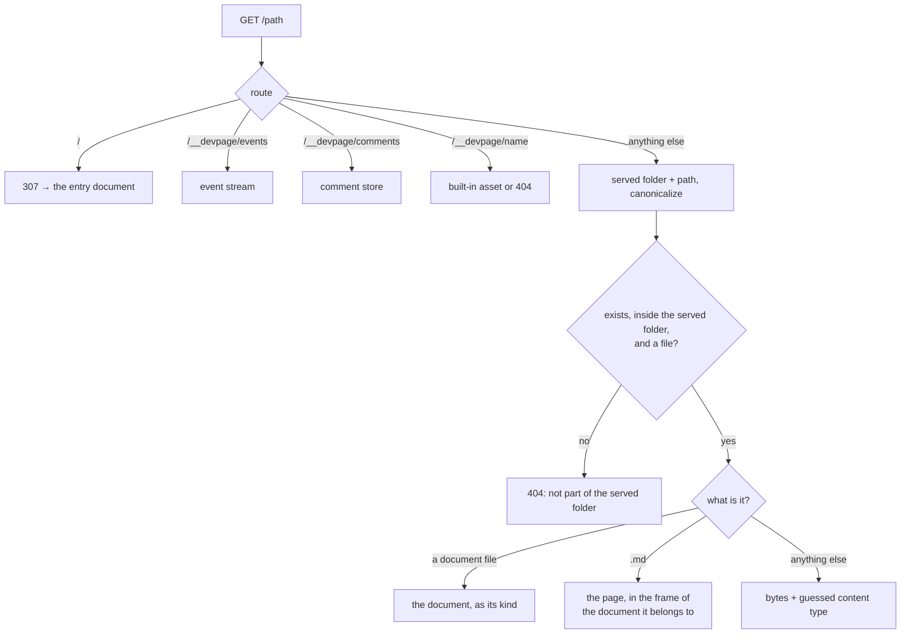

# Serving pages

How the viewer turns a request into a response: the URL names a file in the
served folder, the file is checked to lie inside it, a document file or a Markdown
file is rendered into the frame of the document it belongs to, and anything
else is sent as it is. It also covers the built-in assets, the address devpage
listens on and what is logged. It is a mechanism page under the
[viewer](../README.md), for someone about to change how requests are served.

## Routes

| Route | Response |
| --- | --- |
| `/` | `307 Temporary Redirect` to the entry document as its file says now — a site's root page, or a doc's or deck's document file (or the Markdown file devpage was given); while the entry's file is invalid, the page saying why |
| `/__devpage/events` | the live-update event stream — see [Live updates](../live-updates/README.md) |
| `/__devpage/comments…` | the comment store's requests — see [Comments](../comments/README.md#under-the-hood) |
| `/__devpage/system-widgets/{name}` | a system widget, compiled — see [Widgets](../widgets/README.md#under-the-hood) |
| `/__devpage/widgets/{*path}` | a project widget or helper in the served folder, compiled — see [Widgets](../widgets/README.md#under-the-hood) |
| `/__devpage/{asset}` | one of the built-in assets |
| `/{*path}` | the file at `path` in the served folder |

A query of `?print` renders a doc's or deck's document file in **print mode**,
the page `devpage pdf` has Chrome print ([Printing to PDF](../pdf/README.md)).
A site is never printed, so on a Markdown file `?print` always renders it as a
doc of one chapter in print mode, even when the file is a page of a site — which
is how `devpage pdf` prints one Markdown file.

## The URL is the file path

A URL path is joined to the [served folder](../writing-a-document/README.md#the-served-folder)
— `/docs/boxes/README.md` is `<served folder>/docs/boxes/README.md` — so relative
links between files work as written. Nothing is precomputed: every request
reads its files from disk.

**Path safety.** The path is joined to the served folder, canonicalized —
resolving `..` and symbolic links, and failing if the file doesn't exist — and
accepted only if it still starts with the served folder's canonical path
([the rule](../constraints/the-served-folder-is-the-boundary.md)). It must then be
a regular file. Anything else — a path escaping with `..`, a symbolic link
pointing outside, a missing file, a folder — gets `404` with the body
`<path> is not part of the served folder`. A file that exists but can't be read
gets `500` with the error's text.

## Which document a file belongs to

A **document file** is a `.yml` or `.yaml` file whose top-level `kind` is
`site`, `doc` or `slides` (`document::kind_of`); a YAML file with any other
`kind`, or none, is an ordinary file.

- **A document file** is loaded with `Document::load` and rendered as its
  kind: a site redirects to its root page; a doc renders all its chapters as
  one page with its outline; a deck renders its stage with every slide. One
  that can't be loaded — a missing chapter, an unknown field — gets
  `render::invalid`, a page saying it is not a valid document and why.
- **A Markdown file** is a page of the nearest site whose document file's
  folder holds it, shown in that site's frame with its sidebar. While that
  site's file can't be loaded, the page shows `render::invalid` for it instead.
  A Markdown file in no site's folder is shown as a doc of one chapter.

Finding the nearest site never scans folders. `src/index.rs` keeps an
**index** of the served folder: every document file and its kind, and every
`.gitignore`. `Index::build` walks the folder once at start with the `ignore`
crate, honoring each `.gitignore` in it, nested ones included, without needing
a `.git` folder, and skipping any `.git` and `.devpage` folders; a document
file in an excluded folder is not indexed. The watcher keeps it current
([Live updates](../live-updates/README.md#the-watcher)). `Index::site_for`
picks, among the indexed sites whose folder holds the page, the deepest — and
of two in the same folder, the one whose file name sorts first.

`devpage` shares one index between the server and the watcher
(`server::router_with_index`). `devpage pdf` serves through
`server::printing`, which builds its own index, has no watcher and logs
nothing; `server::router`, which also builds its own index, exists only for
the tests.

## Rendering a Markdown file

A file ending in `.md` is read as text and passed to `render::page`:

1. **Markdown to HTML.** `render::markdown` runs comrak with these options
   (`options()` in `src/render.rs`):

   | Option | Effect |
   | --- | --- |
   | `extension.table` | GFM tables |
   | `extension.strikethrough` | `~~text~~` |
   | `extension.autolink` | bare URLs become links |
   | `extension.tasklist` | `- [ ]` / `- [x]` items |
   | `extension.footnotes` | `[^1]` footnotes |
   | `extension.header_id_prefix = ""` | every heading gets an id from its text, with no prefix |
   | `render.unsafe` | raw HTML passes through |
   | `render.github_pre_lang` | a fence's language is passed as a `lang` attribute — which the highlighter below then drops for every block except `mermaid` |

   `render::markdown` also plugs in a code-fence highlighter,
   `highlight::Highlighter` in `src/highlight.rs`, through comrak's `Plugins`
   (`SyntaxHighlighterAdapter`). For each fenced block it:

   - takes the first word of the info string as the language and looks it up
     with syntect's `find_syntax_by_token` (name or file extension) in
     `two_face::syntax::extra_newlines()` — the syntax set `bat` ships, loaded
     once on first use through a `LazyLock`;
   - if found, and the language isn't `mermaid`, emits syntect's class-based
     HTML (`ClassStyle::SpacedPrefixed { prefix: "hl-" }`): nested spans such
     as ``, colored by the
     `--syntax-*` tokens in `assets/style.css` (see
     [Diagrams and themes](../diagrams-and-themes/README.md#the-themes));
   - otherwise — no language, an unknown one, `mermaid`, or a highlighting
     error partway through — writes the code HTML-escaped and unhighlighted;
   - writes a bare `<pre>` and `<code>` with no language attributes, except
     `<pre lang="mermaid">` for Mermaid blocks, which is how the page script
     finds the diagrams to draw.

   Last, every Markdown table is wrapped in `
`, so a
   table wider than the page scrolls inside its own box instead of widening
   the page.

2. **Title.** `render::title` takes the first line starting with `# `, or the
   file name without its extension.
3. **Sidebar.** The [navigation tree](../navigation-tree/README.md) is built
   from the root page and rendered to nested lists, with the current page
   marked.
4. **Frame.** The pieces go into one HTML page:

   - `<title>` is `<page title> · <document title>`;
   - first in `<head>`, the document's logo as `<link rel="icon">` when it has
     one, then a small script that sets `data-theme` on `<html>` — the
     reader's stored choice, or the system's — before anything paints
     ([choosing a theme](../diagrams-and-themes/README.md#choosing-a-theme));
   - `<body>`'s class names the frame: `site`, plus `with-navbar` and
     `no-sidebar` as the document file says;
   - `<header id="navbar">`, when the site has a navbar: its logo and title, its links
     and dropdowns with their icons drawn as inline SVG, and the theme
     selector ([the navbar](../organizing-navigation/README.md#the-navbar));
   - `<nav id="nav">`, unless `sidebar: false`, holds the tree — after a link
     to the site's root page with its logo and title when there is no navbar
     to hold it;
   - with no navbar, the theme selector in `
`, top
     right, unless `theme-selector: false`;
   - `<main id="page"><article>` holds the rendered Markdown;
   - in `<head>`, an import map naming React (`react`, `react/jsx-runtime`,
     `react-dom/client` → `/__devpage/react.js`) and `window.devpageWidgets`,
     the document's widgets with the address of each
     ([Widgets](../widgets/README.md#under-the-hood));
   - the stylesheet and two scripts — pele, then `devpage.js` — are loaded from
     `/__devpage/`.

   The ids `navbar`, `nav` and `page` are what
   [live updates](../live-updates/README.md) replace in place. A doc's and a
   deck's frames carry the same head — the logo's icon link and the theme script —
   and the theme corner. Titles and sidebar labels are HTML-escaped; the page body
   is not, since raw HTML is allowed.

Beyond the index, nothing is cached between requests: each page request
re-reads the page, its site's document file and, to build the sidebar, every
page the tree reaches.

## Other files

Any other file is read as bytes and returned with a `Content-Type` guessed from
its extension (`mime_guess`), or `application/octet-stream` when the extension
is unknown.

## Built-in assets

The page's own files are compiled into the binary with `include_str!`:

| URL | Source | Content type |
| --- | --- | --- |
| `/__devpage/style.css` | `assets/style.css` | `text/css` |
| `/__devpage/devpage.js` | `assets/devpage.js` | `text/javascript` |
| `/__devpage/pele.js` | `assets/vendor/pele.js` | `text/javascript` |
| `/__devpage/react.js` | `assets/vendor/react.js` | `text/javascript` |

They are sent with `Cache-Control: no-cache`; any other name under
`/__devpage/` is `404`. Changing an asset means rebuilding devpage.

## The address

devpage listens on `127.0.0.1` — the local machine only — unless `--host`
names another address, which makes it
[deployed](../deploying/README.md). It takes the first free port from 3030 up,
or exactly the port `--port` names. It prints `<title> → http://localhost:<port>`
(with the host in place of `localhost` when one is given) on standard output.

## Request logging

The server `devpage` runs has a middleware that logs every request to
standard error, as
`<method> <path> → <status> in <ms> ms`, for example
`GET /README.md → 200 in 0.7 ms`. The time is until the response starts, so
an event stream logs once, when it opens.

The exact document file fields and command line are in the
[configuration reference](../configuration-reference/README.md).
