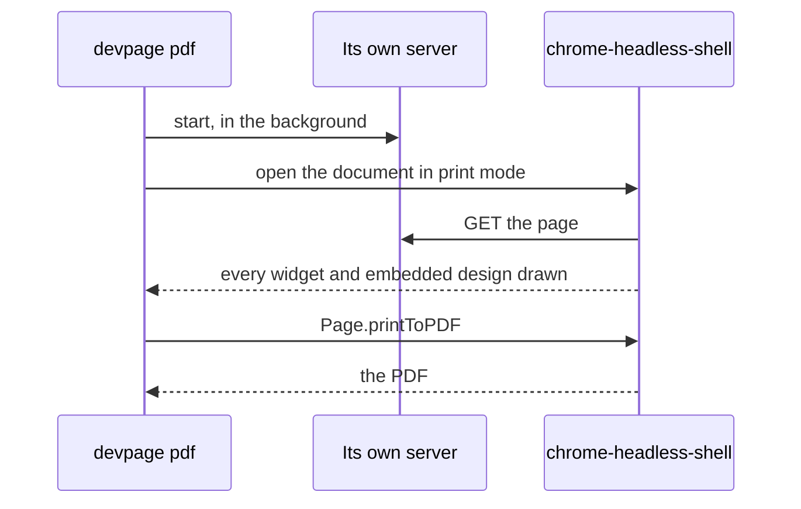

# How a PDF is printed

How `devpage pdf` gets a PDF out of a headless Chrome: the server it starts,
what it waits for before printing, and the one pinned Chrome it downloads and
drives. It sits under [Printing to PDF](../README.md), for
someone about to change `src/adapters/chrome.rs` or how a document is printed.

## The Chrome it drives

devpage does not render PDF itself. It starts its own server in the
background, which logs nothing, opens the document in print mode in a headless Chrome — laid out
as paper from the start, with the print media type, so every slide of a deck
is shown and a design embedded on any of them is fitted where it will print —
waits until
every widget has mounted and every embedded design is painted (diagrams come
drawn in the page's HTML) — a design with
problems and nothing valid to draw counts as soon as its problems show, so it
doesn't hold the PDF up; `devpage check` is what reports it. It waits for at
most 20 seconds, after which it logs what the page still waited for and
prints whatever the page shows — and has Chrome print it — the same `Page.printToPDF`
call Playwright makes, spoken directly over the DevTools protocol by the
`chromiumoxide` crate, with no Node and no extra process.

Every request the page makes carries `X-Devpage-Shot: 1`, so a slide's PNG
it shows is never drawn by another Chrome inside the print — see
[A slide as an image](../../../write/making-slides/README.md#a-slide-as-an-image).

Each run starts its own Chrome in the **shot profile** — the one a
[slide's PNG](../../../write/making-slides/README.md#a-slide-as-an-image) is drawn in, with
the shell's GPU on — with a profile folder of its own in the system's
temporary folder, so several prints can run at once, and deletes it when the
run ends. The PDF comes back from Chrome as bytes; nothing is written but the
output file.

The Chrome is always **chrome-headless-shell**, never a Chrome installed on
the machine, and always one version, pinned in devpage — 156.0.8078.47,
`CHROME_VERSION` in `src/adapters/chrome.rs`. devpage downloads it the first time it
needs one — into `~/Library/Caches/devpage/chrome-headless-shell` on macOS,
`%LOCALAPPDATA%\devpage\chrome-headless-shell` on Windows,
`~/.cache/devpage/chrome-headless-shell` elsewhere, in a folder named for the
platform and version, such as `mac_arm-156.0.8078.47` — and uses that copy
from then on. Because the version is pinned, finding the copy makes no
network call; only a missing copy is downloaded, as that version's zip from
`https://storage.googleapis.com/chrome-for-testing-public/<version>/<platform>/`.
There are builds for macOS (Apple silicon and Intel), Linux on x86-64 and
Windows; on any other platform, such as Linux on Arm, `devpage pdf` stops
with `chrome-headless-shell <version> has no build for <os> on <arch>`.
It is a bare program with no app bundle, so nothing devpage launches
appears in the macOS Dock, and every machine prints with the same browser.
A [slide's PNG](../../../write/making-slides/README.md#a-slide-as-an-image) and the
Chrome tests drive the same copy. Only [`devpage video`](../../making-a-video/how-a-video-is-recorded/README.md#the-chrome-it-drives)
drives another, Chrome for Testing, because the shell can't capture a tab.
