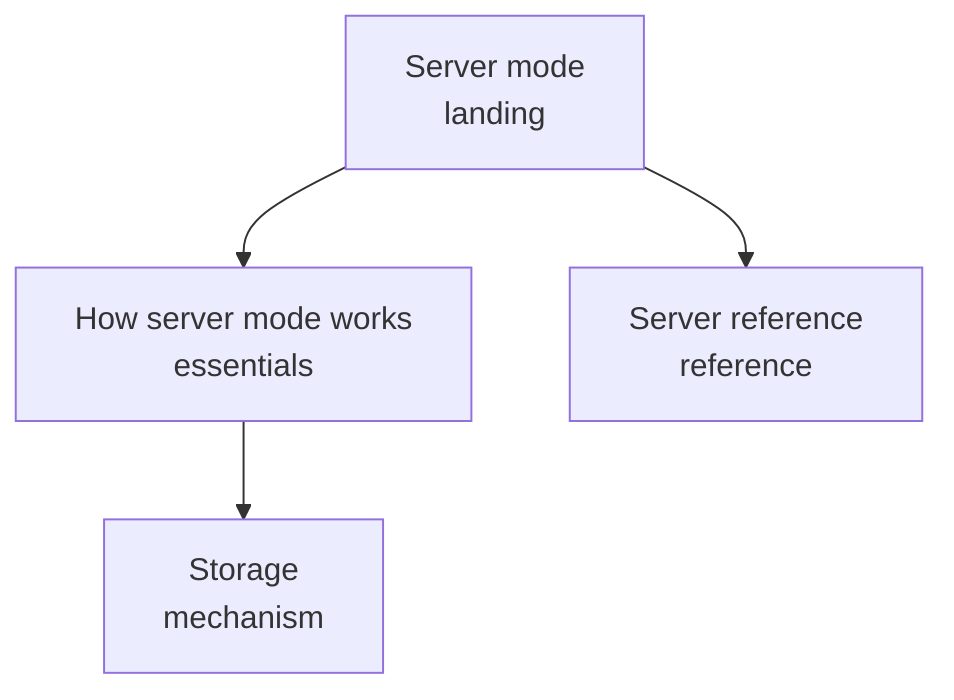

# Structuring a site

A reader should meet a system from the top: what it is, then how to think
about it, then how each part works inside. A site's structure is how it holds
its pages to that order:

- Every page says its type.
- Each type says which types it may sit under.
- `devpage check` reports a page with no type, or in the wrong place.

So a page about how one part works inside can only be reached through a page
that explains what that part is for. The types are the site's own — devpage
ships none — and a site that configures none is not checked for any. This
page is how to set one up. It sits under the [viewer](../README.md).

## Turning it on

A site names a **structure folder** in its document file, the way it names its
widgets folder:

```yaml
kind: site
title: Handbook
root: README.md
structure: structure
```

The folder holds one Markdown file per [page type](../glossary/README.md#page-type),
named after it:

<FileTree>

- docs/
  - devpage.yml
  - README.md
  - structure/
    - landing.md
    - essentials.md
    - mechanism.md
    - reference.md

</FileTree>

## A page says its type

Each page names its type in its [front matter](../configuration-reference/README.md#front-matter),
by the type file's name without `.md`:

```markdown
---
page-type: mechanism
---
# Storage
```

A page has one type.

## A type file

A [type file](../glossary/README.md#type-file) has two parts. Its front matter
holds what devpage checks; its text says what a page of that type is for,
which is what a person or an agent reviewing a page reads.

```markdown
---
parent: [essentials, task, mechanism]
---
# Mechanism

How one part works inside, and why: its design, the reasons for it and its
failure modes. Written for someone about to change it.
```

| Field | Meaning |
| --- | --- |
| `parent` | The types a page of this type may sit under: one name or a list. Left out, it may sit under any. |
| `sections` | `##` headings a page of this type must have, in this order. Other headings may stand anywhere among them. Left out, none is required. |

Both are optional, so a type file can be text alone: a type that may sit
anywhere and needs no section.

## Where a page sits

A page's parent is the page whose [Topics](../organizing-navigation/README.md#a-topics-section)
section lists it — its place in the sidebar. A page listed in several Topics
sections has the one place the sidebar gives it, and its parent is the page
that lists it there. A type may name itself as a parent — a mechanism under a
mechanism — so the tree is as deep as the system needs. The root page has no parent, so its type's `parent` does
not apply to it.

Links anywhere else in a page are free: a landing page may link to a mechanism
in a sentence. Only Topics sections place pages.

With the type files above, this tree passes, and a mechanism listed straight
under the landing page would not:



So a `parent` line is how a site says that its reader goes down one level at a
time: a mechanism is only ever reached through a page that explains what it is
a mechanism of.

## What is checked

Once a site has a structure folder, these are [problems](../checking-links/README.md),
shown in the preview and reported by `devpage check` like a broken link. A type file's own problems
show on every page of the site, as a navbar's do:

| What | Must | Reported as |
| --- | --- | --- |
| A page of the site | name a type | `<page>: no page-type` |
| A page's `page-type` | be a file in the structure folder | `<page>:<line>: page-type <type> — no <folder>/<type>.md` |
| A page whose type has a `parent` | sit under a page of one of those types | on the parent, at the Topics entry: `<link> — a page of type <type> sits under <types>, and this page's type is <type>` |
| A page of the site | be listed in a Topics section | `<page>: no Topics section lists this page` |
| A page whose type has `sections` | have each one, in order | `<page>: no ## <heading> section — a page of type <type> has <headings>`, or `<page>:<line>: ## <heading> comes before ## <heading> — …` |
| A type file's `parent` | name types the folder has | `<type file>:<line>: parent <type> — no <folder>/<type>.md` |
| A type file's front matter | hold only `parent` and `sections` | `<type file>:<line>: front matter — <the YAML error>` |

The pages checked are the site's own: the Markdown files `devpage check`
reaches that belong to this site. Type files, the site's `404.md` and the root
page's missing parent are not problems. A document of another kind listed in a
Topics section — a doc, a deck, a design, a code reference — has no type and
is not checked, and neither is a chapter of a doc or a slide of a deck that
lies in the site's folder; a nested site has its own structure, or none.

These docs are structured this way: [`docs/structure/`](../../../structure/landing.md)
holds their seven types, and a mechanism page is listed only under the
article that explains what it is a mechanism of.

Whether a page is true to its type — an essentials page that really teaches
the mental model — is not something devpage can tell. Review judges that,
against the type file's text.
