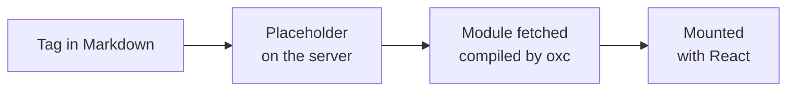

# How widgets run

How a widget tag in Markdown becomes a mounted React component: the
placeholder the server writes, how widgets are compiled and served, and how the
page script mounts them. It is a mechanism page under [Widgets](../README.md),
for someone about to change `src/widgets.rs` or the widget code in
`assets/devpage.js`.

## On the server

In `src/widgets.rs`, rendering a page finds the tags of known
widgets in its Markdown — skipping fenced, indented and inline code and HTML
comments — and turns each into
a placeholder: a `div` for a block widget, a `span` for an inline one, so an
inline widget never breaks its paragraph. The placeholder carries the widget's
name, its props as a JavaScript object literal (quoted values as strings, `{…}`
as written, bare attributes as `true`) and its Markdown source — and, for
`Example`, that source highlighted as Markdown by the same highlighter fenced
code uses, which reaches it as the `sourceHtml` prop. Its content stays between
the tags for comrak to render as Markdown. The page's `<head>` gets an import map
naming React, and the list of the document's widgets with the address of each.

## Compiling

A widget or helper is compiled from TSX by `oxc` when the
browser asks for it, with React's automatic JSX runtime. Capitalized names a
widget uses without declaring them are other widgets: the compiled module looks
each up by name when it renders, and lists them in `__devpageUses`. A system
widget composes only system widgets; a project widget composes the system
widgets and those of the document whose widgets folder holds it. Every project
widget's address carries its folder's **version** — the latest change time of
the folder and its `.ts` and `.tsx` files — and so does every relative import
inside it, so an edited widget or helper is fetched afresh rather than taken
from the browser's module cache. Compiled modules are remembered, keyed by the
file, its source, the names it can use and the version, so a widget compiles
once per change, not once per request. A file that doesn't compile is served as
a module that throws the compiler's message, and so is a widget whose relative
imports reach a helper that doesn't compile — with the helper's message — so
the page shows why in the widget's place rather than only that its import
failed.

| Address | What it serves |
| --- | --- |
| `/__devpage/react.js` | React and react-dom, [vendored](../../vendored-react/README.md), for the import map's `react`, `react/jsx-runtime` and `react-dom/client` |
| `/__devpage/system-widgets/<Name>.tsx` | A system widget, compiled from `assets/widgets/`, built into the binary |
| `/__devpage/widgets/<path>?v=<version>` | A project widget or helper at that path in the served folder, compiled; an import without an extension finds the `.tsx` or `.ts` |

## In the browser

In `assets/devpage.js`, each `pre[lang="mermaid"]` first
becomes a `Diagram` placeholder. Then the page script loads only the widgets the
content names, nested ones included, and those each lists in `__devpageUses`;
adds a widget's exported `css` to the page once; and mounts each outermost
placeholder with React. Nested widgets become React elements their parent can
read — a `Tabs` reads its `Tab`s' titles — and the outermost widget is wrapped
in an error boundary that shows a failure in its place; a widget whose module
didn't load shows the reason it didn't. Each widget gets its
props, `children`, `source` and `html`. Mounting happens on page load and again
after every live update, which takes the fresh page's widget list, so new
versions are fetched. The page marks itself ready only once every widget has
mounted, which is what `devpage pdf` waits for.

Widget and helper files refresh open pages whatever a site's `watch` list says
([Live updates](../../live-updates/README.md#the-watcher)).
