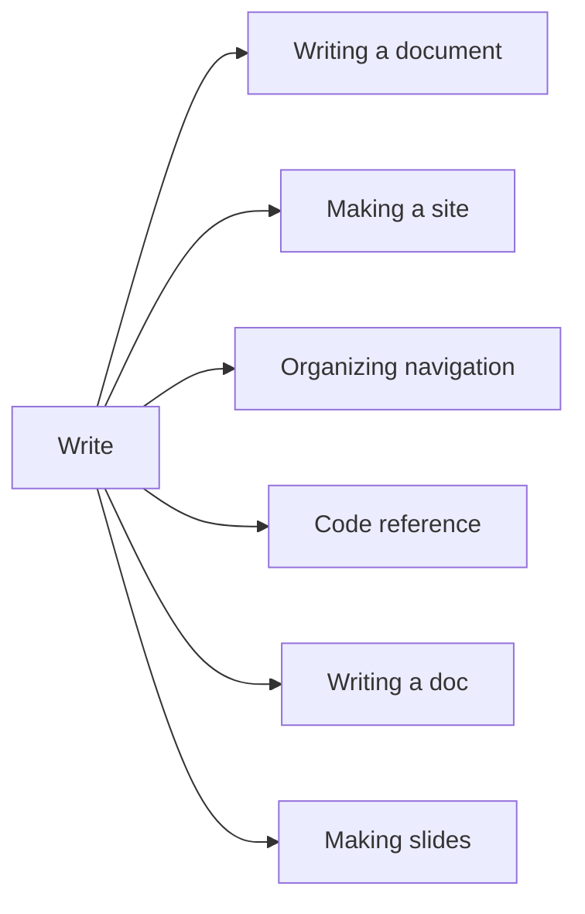

# Write

How each kind of document is written and how a site is laid out: the four
kinds and their document file, a site with its sidebar and its code reference,
a doc and a deck. It is a part of the [viewer](../README.md); what a page
itself can hold is on [On the page](../on-the-page/README.md).

## Topics

- [Writing a document](writing-a-document/README.md) — the four kinds, the
  document file, the served folder, links between pages and documents, and the
  Markdown that works.
- [Making a site](making-a-site/README.md) — a site's document file, root page,
  sidebar, navbar, logo, theme switch and `404.md`.
- [Organizing navigation](organizing-navigation/README.md) — how a site's Topics
  sections build the sidebar, and how to lay out its reading order.
- [Code reference](code-reference/README.md) — a page for every module, type and
  function of a site's code, read with tree-sitter, live, and checked when
  prose links to it.
- [Writing a doc](writing-a-doc/README.md) — chapters, the outline, and the
  PDF's paper, header and footer.
- [Making slides](making-slides/README.md) — one file per slide, the stage, the
  keys, and printing a deck.
