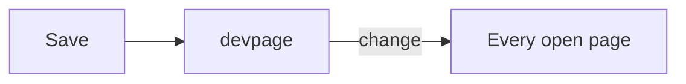

# Live updates

Save a file — by hand or by an agent — and every open page swaps in the new
version, in place, without a reload.

Teaches it: [Live updates](../boxes/viewer/live-updates/README.md).
