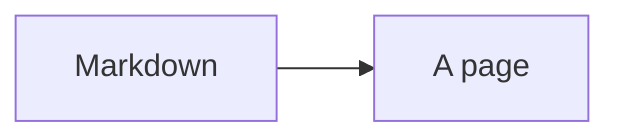

# Markdown and diagrams

GitHub-flavoured Markdown with raw HTML and highlighted code, and `mermaid`
fences drawn as diagrams whose boxes are links.

<Example>

| Kind | Like |
| --- | --- |
| site | a docs website |
| doc | a Word document |

- [x] tables, task lists, footnotes

</Example>

Teaches it: [Markdown that works](../boxes/viewer/writing-a-document/README.md#markdown-that-works),
[Diagrams and themes](../boxes/viewer/diagrams-and-themes/README.md).
