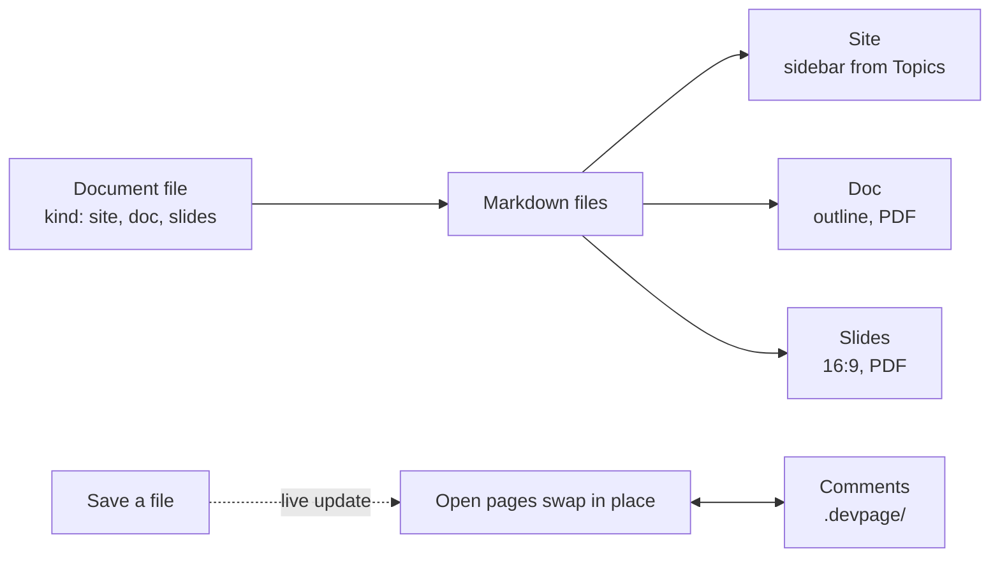
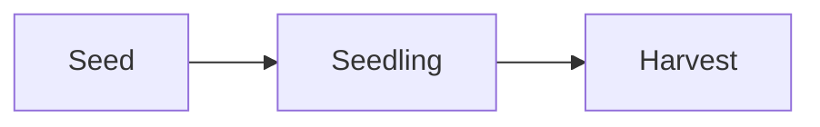

# Getting started

This page teaches the few ideas you need to reason about devpage — documents
and their three kinds, the folder they are served from, live pages,
diagrams and comments — and then walks a small site, a doc and a deck from an
empty folder to pages that update while you edit them. It sits under the
[devpage landing page](README.md); the [viewer](boxes/viewer/README.md)
explains each part in depth. To run the examples you need devpage installed —
see [Installing devpage](installing.md).

## The mental model

**A document is Markdown files plus a small YAML file.** The YAML file's `kind`
says which of three a document is: a **site** of pages with a sidebar, a
**doc** read top to bottom like a Word file, or a deck of **slides**. A single
Markdown file is a doc on its own, with no YAML at all.

**A folder is what is served.** devpage serves the folder you start it from —
usually the top of your repository. A file's address is its path in that
folder, so links between Markdown files work exactly as they do on disk —
including links from one document to another.

**A site's sidebar is its Topics.** A page lists its children in a
`## Topics` section at its end. The sidebar starts at the site's root page,
shows the pages its Topics lists, then the pages *their* Topics list, and so on.
A doc is navigated by its outline instead, and a deck by its keys.

**The page you see is the file on disk.** There is no build step and no cache:
each request reads the files and renders them. When a file changes, every open
page fetches itself again and swaps in the new content without reloading.

**A `mermaid` fence becomes a diagram.** A fenced code block whose language is
`mermaid` is drawn as an SVG in the browser, in the page's light or dark theme.
A `click` line in a flowchart makes a node a link, so a diagram can lead
to the page that explains each of its parts — like the one below.

**Comments are notes on the docs, not part of them.** Turn on comment mode with
the speech-bubble button by the theme toggle, then select text or hover a
paragraph to comment. Each thread is a file in a `.devpage/` folder git
ignores; resolving it deletes the file.



## A site, end to end

**1. Write the site.** Make a folder `garden/` with three files:

<FileTree>

- garden/
  - devpage.yml — the site: its title and root page
  - README.md — the root page, whose Topics list the sidebar
  - planting.md — a page with a diagram

</FileTree>

<Tabs>
<Tab title="devpage.yml">

```yaml
kind: site
title: Garden
root: README.md
```

</Tab>
<Tab title="README.md">

```markdown
# Garden

Notes on the vegetable garden.

## Topics

- [Planting](planting.md) — what goes in the ground, and when.
```

</Tab>
<Tab title="planting.md">

````markdown
# Planting


````

</Tab>
</Tabs>

**2. Run it.** From the folder holding `garden/`:

<Terminal>

```text
$ devpage garden
Garden → http://localhost:3030
```

</Terminal>

Given a folder, devpage reads the `devpage.yml` inside it. It prints the
address it serves on — `Garden → http://localhost:3030`, or the next port up
when 3030 is taken — and then logs each request it answers.

**3. Open the address.** `/` leads to the root page. The sidebar shows the
site's title, *Garden*, and under it one entry, *Planting* — the label is the
link's text in the Topics list, not the page's heading.

**4. Follow the link.** Clicking *Planting* swaps the page in place, and the
address becomes the file's path. The sidebar highlights *Planting*, and the
Mermaid fence is drawn as a three-box diagram.

**5. Edit a file.** With the page open, add a line to `planting.md` and save.
The page updates within moments, without a reload. Add a Topics item in
`README.md` pointing at `watering.md` before the file exists: the link is
marked broken and listed at the top of the page until you create the file —
then the sidebar grows a *Watering* entry on every open page.

**6. Comment.** Turn on comment mode with the speech-bubble button in the top-right
corner, select a few words on *Planting* and comment on them. The
comment is in the margin, and in `.devpage/comments/` as a small YAML file;
press **Resolve** and the file is gone.

## A doc and a deck

**A doc.** Add `garden/plan/devpage.yml`:

```yaml
kind: doc
title: Spring plan
chapters: [beds.md, schedule.md]
```

with the two chapters beside it, each starting with a `# heading`, and link
to it from `README.md` as `[Spring plan](plan/devpage.yml)`. It opens as one
long page with an outline beside it; `devpage pdf garden/plan` writes
`Spring plan.pdf`.

**A deck.** Add `garden/talk/devpage.yml` with `kind: slides`, a `title`, and
`slides:` listing one Markdown file per slide, and link to it from `README.md`
as `[Spring talk](talk/devpage.yml)`. Open it, use the arrow keys <Keys>← →</Keys>,
press <Keys>F</Keys> for fullscreen; `devpage pdf garden/talk` prints one slide
per page.

**Check it.** `devpage check garden` checks the site and everything it links
to — here, all three — and exits `1` if a link is broken: ready for a test.

For a finished example of each kind: these docs are a site,
[the feature catalog](features/devpage.yml) is a doc, and
[the devpage talk](talks/devpage/devpage.yml) is a deck — all three in the
navbar's **Examples** menu.

## Where next

- [Documenting another repository](boxes/viewer/writing-a-document/README.md#documenting-another-repository)
  — giving a real project's docs a `devpage.yml`.
- [Writing a document](boxes/viewer/writing-a-document/README.md) — the three
  kinds, the document file, the served folder, links, and the Markdown that works.
- [Writing a doc](boxes/viewer/writing-a-doc/README.md) and
  [Making slides](boxes/viewer/making-slides/README.md) — chapters, slides and
  paper.
- [Comments](boxes/viewer/comments/README.md) — commenting, and the files
  threads are kept in.
- [Organizing navigation](boxes/viewer/organizing-navigation/README.md) — how
  Topics sections shape the sidebar and the reading order.
- [Diagrams and themes](boxes/viewer/diagrams-and-themes/README.md) — Mermaid
  diagrams and the light and dark themes.
- [Configuration reference](boxes/viewer/configuration-reference/README.md) —
  every field of each kind, and the command line, exactly.
