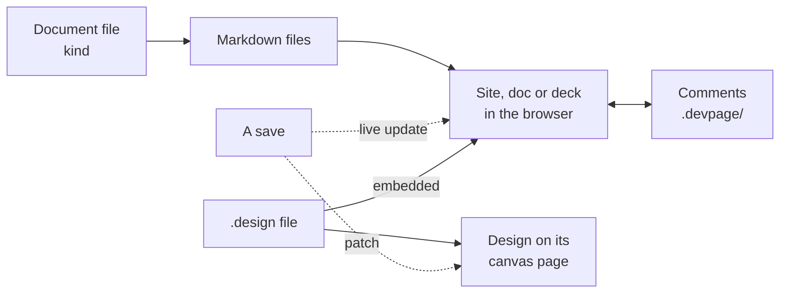

# Getting started

The few ideas you need to reason about devpage — documents and their
kinds, the folder they are served from, live pages, diagrams, widgets and
comments. It sits under the [devpage landing page](README.md); the
[viewer](boxes/viewer/README.md) explains each part in depth, and
[Your first site, doc and deck](your-first-site-doc-and-deck.md) walks all of
it end to end.

## Six ideas

<Cards columns={3}>

- (file-text) [A document is one of four kinds](boxes/viewer/writing-a-document/README.md#four-kinds)
  — A site, doc or deck is Markdown plus a small YAML file whose `kind` names it; a lone Markdown file is a doc on its own. A [design](boxes/viewer/designs/README.md) is one `.design` file, with no document file, drawn on a canvas.
- (folder-open) [A folder is what is served](boxes/viewer/writing-a-document/README.md#the-served-folder)
  — Usually the top of your repository; addresses are file paths, so links work as on disk.
- (list-tree) [A site's sidebar is its Topics](boxes/viewer/organizing-navigation/README.md)
  — Each page lists its children in `## Topics`; a doc has an outline, a deck its keys.
- (refresh-cw) [The page you see is the file on disk](boxes/viewer/live-updates/README.md)
  — No build step; a save swaps every open page in place.
- (workflow) [Fences become diagrams, tags become widgets](boxes/viewer/diagrams/README.md)
  — Mermaid drawn in the page's theme; capitalized tags are React widgets.
- (message-square) [Comments are notes, not docs](boxes/viewer/comments/README.md)
  — One file per thread in `.devpage/`, which git ignores; resolving deletes it.

</Cards>

## How they fit

## Where next

- [Documenting another repository](boxes/viewer/writing-a-document/README.md#documenting-another-repository)
  — Giving a real project's docs a `devpage.yml`.
- [Writing a document](boxes/viewer/writing-a-document/README.md) — the four
  kinds, the document file, the served folder, links, and the Markdown that works.
- [Writing a doc](boxes/viewer/writing-a-doc/README.md) and
  [Making slides](boxes/viewer/making-slides/README.md) — chapters, slides and
  paper.
- [Designs](boxes/viewer/designs/README.md) — a UI an agent writes as code,
  clicked through as a prototype, embedded in a page, and fetched as a PNG.
- [Comments](boxes/viewer/comments/README.md) — commenting, and the files
  threads are kept in.
- [Organizing navigation](boxes/viewer/organizing-navigation/README.md) — how
  Topics sections shape the sidebar and the reading order.
- [Diagrams](boxes/viewer/diagrams/README.md) and
  [Themes](boxes/viewer/themes/README.md) — Mermaid diagrams, and the light
  and dark themes.
- [Configuration reference](boxes/viewer/configuration-reference/README.md) —
  every field of each kind, and the command line, exactly.

## Topics

- [Your first site, doc and deck](your-first-site-doc-and-deck.md) — from an
  empty folder to pages that update while you edit them.
