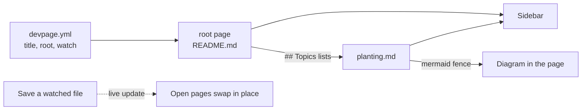
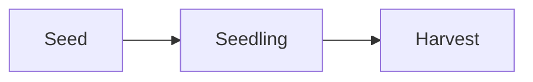

# Getting started

This page teaches the few ideas you need to reason about devpage — a document,
its pages, the sidebar their Topics sections form, live pages and diagrams —
and then walks one tiny document from an empty folder to a page that updates
while you edit it. It sits under the [devpage landing page](README.md); the
[viewer](boxes/viewer/README.md) explains each part in depth. To run the
example you need devpage built — see [Installing devpage](installing.md).

## The mental model

**A document is a `devpage.yml` plus Markdown pages.** The YAML file names the
document (`title`), the page it opens on (`root`) and, optionally, which files to
watch for changes (`watch`). Every page is a Markdown file in the YAML file's
folder or below it; devpage serves nothing outside that folder.

**The root page and its Topics form the sidebar.** A page lists its children in
a `## Topics` section at its end. The sidebar starts at the root page, shows
the pages its Topics lists, then the pages *their* Topics list, and so on. Links
anywhere else in a page work as ordinary links but never change the sidebar.

**The page you see is the file on disk.** There is no build step and no cache:
each request reads the Markdown file and renders it. When a watched file
changes, every open page fetches itself again and swaps in the new content
without reloading, so you stay where you were on the page.

**A `mermaid` fence becomes a diagram.** A fenced code block whose language is
`mermaid` is drawn as an SVG in the browser, in the page's light or dark theme.
A `click` line in a flowchart makes a node a link, so a diagram can lead
to the page that explains each of its parts — like the one below. Any other
fenced block that names a known language is syntax-highlighted.



## A first document, end to end

**1. Write the document.** Make a folder `garden/` with three files.

`garden/devpage.yml`:

```yaml
title: Garden
root: README.md
```

`garden/README.md`:

```markdown
# Garden

Notes on the vegetable garden.

## Topics

- [Planting](planting.md) — what goes in the ground, and when.
```

`garden/planting.md`:

````markdown
# Planting


````

`watch` is left out, so it defaults to every Markdown file (`**/*.md`).

**2. Run it.** With devpage [installed](installing.md), from the folder
holding `garden/`:

```sh
devpage garden
```

Without installing, run it from the devpage repository with
`cargo run -- <path to garden>`.

Given a folder, devpage reads the `devpage.yml` inside it. It prints the
address it serves on — `Garden → http://localhost:3030`, or the next port up
when 3030 is taken — and then logs each request it answers.

**3. Open the address.** `/` redirects to `/README.md`, the root page. The
sidebar shows the document title, *Garden*, and under it one entry, *Planting* —
the label is the link's text in the Topics list, not the page's heading. The
text after the link ("what goes in the ground…") is for the reader of the page
and does not appear in the sidebar.

**4. Follow the link.** Clicking *Planting* swaps the page in place and the
address becomes `/planting.md`: URLs are the files' paths inside the folder.
The sidebar highlights *Planting*, and the Mermaid fence is drawn as a
three-box diagram.

**5. Edit a file.** With the page open, add a line to `planting.md` and save.
The page updates within moments, without a reload. Add a second item to the
Topics list in `README.md` pointing at a new file `watering.md`, create that
file, and the sidebar grows a *Watering* entry on every open page. A link to a
file that doesn't exist yet is simply left out of the sidebar until the file
appears.

## Where next

- [Documenting another repository](boxes/viewer/writing-a-document/README.md#documenting-another-repository)
  — giving a real project's docs a `devpage.yml`.
- [Writing a document](boxes/viewer/writing-a-document/README.md) — the YAML
  file, where pages live, links, and the Markdown that works.
- [Organizing navigation](boxes/viewer/organizing-navigation/README.md) — how
  Topics sections shape the sidebar and the reading order.
- [Diagrams and themes](boxes/viewer/diagrams-and-themes/README.md) — Mermaid
  diagrams and the light and dark themes.
- [Configuration reference](boxes/viewer/configuration-reference/README.md) —
  every `devpage.yml` field and the command line, exactly.
