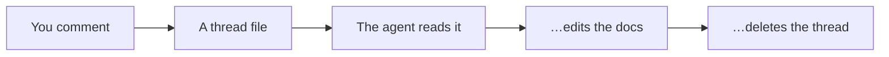

<Columns rows kicker="Comments, with agents" title="Review in the browser. Your agent does the rest.">



```yaml
# .devpage/comments/docs/design.md/20261025T181502Z-7f3a.yml
anchor: { quote: the client retries every write }
thread:
  - { author: Andrei Puni, text: "Every write, or only the outbox?" }
```

</Columns>
